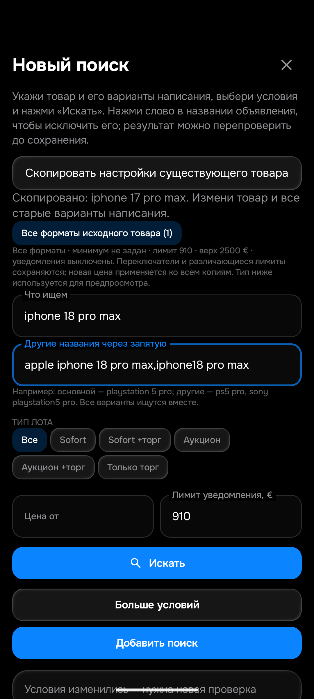
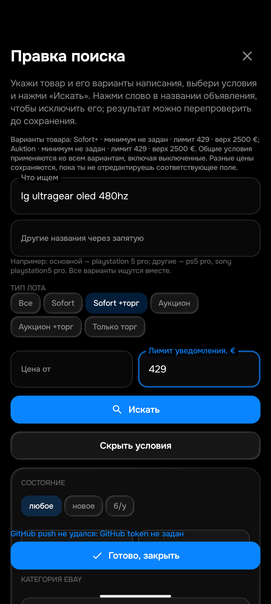

# Проверка редактора APK 0.094 на эмуляторе

По просьбе владельца работа перенесена на скрытый Android16 `emulator-5580`. Физический телефон после этого распоряжения не использовался и остаётся на0.093. Эмулятор содержит отдельную QA-базу из49 исходных поисков, без токенов, с выключенными worker/auto_sync и всеми notify=false. Рабочие50 поисков и Telegram эти сценарии не затрагивают.

## Исправления

**Пробелы в названии.** Поле «Что ищем» показывало результат нормализации SearchAliases.pack/names после каждого символа. Эти функции обрезают крайние пробелы, поэтому набранное «iphone18promax» склеивалось. Ошибка воспроизведена настоящим вводом на эмуляторе. Теперь поля держат исходный ввод отдельно от сохранённого запроса. Только явная загрузка редактора или шаблона обновляет поля; нормализация и смена loading их не сбрасывают. Новый Android Compose-тест вводит слова и пробелы отдельно, проверяет три названия и загрузку другого источника.

**Старые цены в подписи вариантов.** После успешного сохранения поле и база обновлялись, а подпись форматов оставалась прежней. Теперь редактор перечитывает сохранённую группу. Проверка сессии после ожидания и проверка несохранённых правок защищают новый экран от результата старого сохранения. На эмуляторе подписи обоихLG обновились430→429→430, а у двух выключенных QA-копий401→402.

## Настоящие действия в интерфейсе

| Сценарий | Проверенный результат |
|---|---|
| Копировать iPhone17→18 | Создана новая строка с лимитом910€ и тремя названиями с пробелами; источник не изменён |
| Удалить, перезапустить, восстановить | Строка не появилась сама; восстановлены тот же ID и условия |
| Копировать два формата Redmagic11Pro | Новые ID, Sofort+(buy_now_offer) и Auktion; разные минимумы50/null сохранены; общий лимит401€ |
| Выключить тестовую группу | Оба enabled=false, notify=false |
| Изменить лимит выключенной группы | Обе цены402€; ID, типы, bestOffer, минимумы и остальные поля сохранены |
| Удалить два варианта и перезапустить | Обе строки отсутствуют; в корзине видны два варианта |
| Восстановить два варианта | Те же ID, оба остаются выключенными;402€ и разные минимумы сохранены |
| Убрать тесты | Три временные строки снова в корзине; все49 исходных строк совпадают по смысловым полям |

Приватные SQLite-снимки сверены автоматически; открытый итог — [EMULATOR_094.json](EMULATOR_094.json). Серверный ACK для этой базы не заявляется: без токена push ожидаемо не проходит, ошибка видна, dirty сохраняется. Полная проверка конфликтов и восстановления GitHub-связи остаётся PARTIAL.

## Проверки и ограничения

Успешны344 Android unit-теста,6 instrumentation-тестов наAPI36,374 изолированных Python-теста,9 тестов cloud_sync и сборка APK. Версия0.094/code94; SHA256 `8e461f02cd49301f7f484cf8564917fda792709cf330a3b59b21ce1afc3d8abb`. Правила1792100348 и History13 не повышались: семантика отбора не менялась. На эмуляторе установлен094, на физическом телефоне остаётся093.

Повторный запуск прежнего GitHub-теста:[38815432183,attempt2](https://github.com/GitGayHub/e-monitor/actions/runs/38815432183/attempts/2) — SUCCESS, duplicateSuppressed=true. Ранний guard нашёл квитанцию120032 до config/eBay. Нового сообщения и правки caption не было. Первоначальная ошибка тестовой доставки и исправление сохранены в [PRICE_CHAIN_094.md](PRICE_CHAIN_094.md).

В Chrome проверены восемь страниц Nubia Leading, точных лотов нет. Отдельный обычный HTTP-запрос вернул SORRY и был остановлен. Сохранённый ответ распознаётся как network, а не пустая успешная выдача. HTTP-статус первой попытки не сохранился после ошибки очистки временной папки Windows; он не выдуман, повторного запроса не было. См.[браузерные факты](NUBIA_LEADING_BROWSER_094.json) и [HTTP-сравнение](NUBIA_LEADING_HTTP_094.json).

Общая приёмка26 товаров/104 корзин остаётся PARTIAL. Эти сценарии не заменяют40–50 независимых лотов на каждый товар, проверку всех алиасов/минимумов, гонки/сеть и успешный полный рабочий прогон.
