# Проверка 0.062 — 12 октября 2026

Обнаружены и исправлены две ошибки: отрицание косметических повреждений принималось за дефект следующего экрана; полный текст после доставленной фотографии терялся при неудаче отправки ответа.

Установка APK 0.062 и применение серверных правил 1791817854 подтверждены. 285 Python-тестов, 270 Android-тестов, сборка APK и семь проверок переноса прошли. 49/47 поисков, лимиты, ревизия и fingerprint сохранены. [Runtime](runtime062.json). [CI](https://github.com/GitGayHub/e-monitor-android/actions/runs/38268720002) на момент записи: in_progress/None.

| Корзина RTX 4050 OLED | APK и Python | Независимая оценка |
|---|---|---|
| Sofort | 1478.20 € · [267808972389](https://www.ebay.de/itm/267808972389) | RTX 4050 / OLED; в итог включён импорт, цена карточки ниже |
| Sofort+ | 849 € · [257781542239](https://www.ebay.de/itm/257781542239) | RTX 4050 / OLED; продавец признаёт косметические повреждения крышки |
| Auktion | Нет подходящего | Полученный [366727478986](https://www.ebay.de/itm/366727478986) имеет FHD+ non-touch вместо OLED |
| Auktion+ | Пустая полученная выдача | Не утверждение об отсутствии во всём рынке |

[40 прочитанных объявлений](OLED4050_MANUAL061.md), [телефон](4050-phone062.json), [Python](4050-python062.json), [снимок](4050-four062.png). [Lenovo 206617260836](https://www.ebay.de/itm/206617260836) больше не отклоняется за отрицание повреждений; [повторная проверка](yoga-description062.json). Минимум не изменился: итог этого Lenovo с импортом выше выбранного.

Доставка: [реальное фото 119991 и полный текст 119992](telegram-outbox062.json) подтверждены Telegram API. Первый отказ RetryAfter имитирован локально; повторён только текст, фото одно, очередь пуста. Новый тест ещё не прочитан в фоновом AyuGram. Тайм-аут и аварийное завершение оставляют видимое состояние неопределённой доставки; автоматический повтор такого текста не производится. История production отправок не менялась. Новая очередь включена в workflow checkpoint, но её перенос между реальными GitHub jobs пока не проверен.

Общая приёмка всех 25 товаров не завершена. Остаются независимые каталоги, свежий самовывоз, настоящий 429 и восстановление сети, неопределённая доставка самой фотографии и новый клиентский просмотр Telegram. Косметические вмятины без отдельного пользовательского запрета не исключались автоматически.

---

# Текущая сборка — 0.061

275Python/269Android/APK прошли,0.061 установлена с сохранениемданных. [Обновление ставок](AUCTION_REFRESH061.md) исправляет старое число после получения подробностей; исчезнувший Preisvorschlag у конкретной PS5 объясняется первой новойставкой, подтверждённой сайтом. [Runtime061](runtime061.json) подтвердил применение. [ТелефонPS5](ps5-phone061.json) / [полныйPython061](ps5-python061.json):1024/1010.49/316.49/909.49€,теже4ID,всеописанияPythonverified. [Тест119988](telegram-report061.json) доставлени[прочитанвPCклиенте](telegram-client061.json),непересылалсяповторно. [CI061](https://github.com/GitGayHub/e-monitor-android/actions/runs/38175380347):completed/success. Доказанный общий25×4 ниже относитсяк0.060.

Позднее PCчтение подтвердило [штатное060уведомление и старыйтест058119964](telegram-late-client060.json); ни одно сообщение не пересылалиповторно. Полнаяприёмкавсехтоваровпродолжается.

# Актуальный этап — APK 0.060, 11 октября 2026

**Лот Pixel5 со вздутой батареей больше не проходит. Четыре выбранных лота и итоговые суммы совпали в APK, полном Python-прогоне и тестовом отчёте Telegram. Полная приёмка всех25 товаров продолжается.**

Ручная причина и границы исправления: [Pixel](PIXEL_BATTERY_FIX.md), [40 уникальных страниц](PIXEL_MANUAL060.md). Телефонный одиночный прогон24.321с; [APK](pixel-phone060.json) / [Python](pixel-python060.json):126.19 /213.42 /56.19 /56.19€. Все выбранные Pythonописанияverified. Неисправный178561278680/91.19€ просмотрен в UI отказов; замена аккумулятора сама по себе не запрещена.

[Общий телефонный отчёт25×4](PHONE_MATRIX060.md) завершён за719.008с:100корзин, явно сохранена дата22:56. Он не доказывает независимую правильность всех товаров. Исчезнувший Sonyаукцион820202936472 действительно продан11Oct18:24:20MESZ за51€,13ставок. NubiaZ80Leading:четыре честных«Не найдено».

APK0.060/code60 установлена с прежней подписью, все49поисков/47активных/48прежнихстрок сохранены. SHA256287125D85BDED2D9CC95CFB07BBE550E84CFE9DD2B1093B374454554470A6587. [Pythonb7b0aec](https://github.com/GitGayHub/e-monitor/commit/b7b0aec3af3e5a536cb588be521670621b53effc), [Androidc4abc3c](https://github.com/GitGayHub/e-monitor-android/commit/c4abc3c15bfed2cd400819d5f22bdd01d7e954b0),правила1791749533.274Python/268Android/сборка прошли, [LinuxCI060](https://github.com/GitGayHub/e-monitor-android/actions/runs/38171368971) success.

[Сервер060](runtime060.json) реально применяет текущуюревизию/лимиты;normal/получатель/seen сохранены. [Telegram119987](telegram-report060.json) доставлен; [PCклиент](telegram-client060.json) прочитанвфоне:версия0.060,теже4лота. Это явно отмеченный тест отчёта;eBaylink-preview не является проверкойsendPhoto. Штатные059сообщения иэтапы подтверждены отдельно вtelegram-client059.json. Старый058тест119964непроверенвклиенте,повторнонеотправлен.

Осталось: независимые страницыостальныхтоваров/пустыхкорзин/дополнительныхзапросов,новыйреальныйсамовывозBerlinили≤80кмот09648вTelegram,настоящий429/восстановлениесетей,ошибкадлинноготекстапослефото/дедупликация. Непроверенные сценарии не объявленыуспешными.

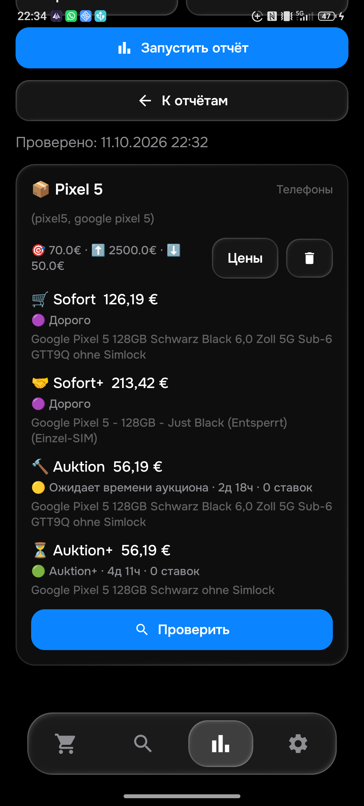

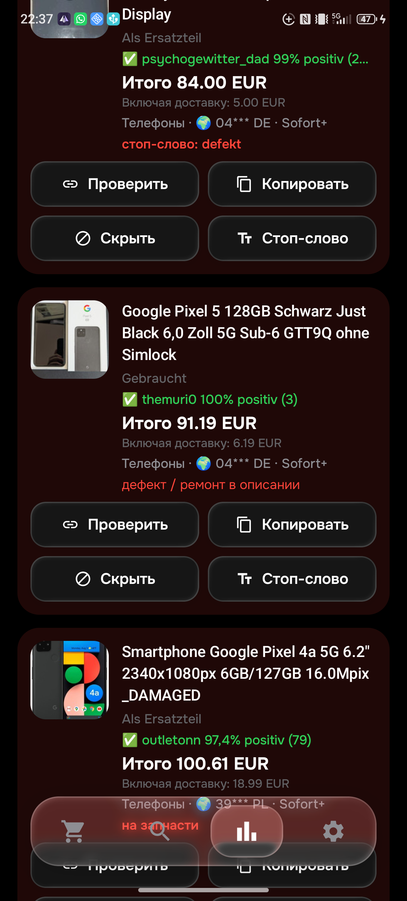

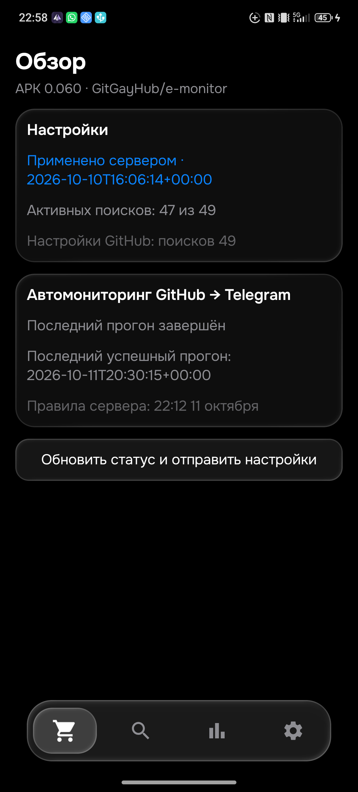

---

# Дополнение 0.059: встроенный SSD PS5 Pro

Исправлены Python/Kotlin после независимого чтения16 собственных описаний. [Таблица и причины поправок](PS5_SSD_CORRECTION.md).272Python/266Android OK, сборка059 OK. Установка и живые проверки пока выполняются; полный058 отчёт25×4 сохранён ниже и не объявляется059.

# Актуальный этап — APK 0.058, 11 октября 2026

**Воспроизведённые расхождения PS5 Pro исправлены. Четыре проверенные корзины полного Python-отчёта и физической APK совпали. Полная приёмка всех25 товаров ещё не завершена.**

Ручной просмотр настоящего eBay: [47 уникальных PS5](PS5_MANUAL.md), два написания запроса, Worldwide, EUR, доставка09648. Ошибка комплекта без «mit» отклоняла консоль CFI-7021 с кабелем; первый вариант сохранённого поиска исключал аукционы из серверной статистики; смешанная страница скрывала более дешёвые покупки. Исправлены правила содержимого, условия каждой корзины и запрос покупок при заполненной общей странице. Дополнительные запросы увеличивают расход квоты; работа сохраняет последовательность и существующее переключение на HTML.

| Корзина | APK / полный Python058, € | Лот | Статус |
|---|---:|---|---|
| Sofort | 1024.00 | [298742796679](https://www.ebay.de/itm/298742796679) | дорого |
| Sofort+ | 1010.49 | [128119110616](https://www.ebay.de/itm/128119110616) | дорого |
| Auktion | 212.49 | [820221826283](https://www.ebay.de/itm/820221826283) | ждать5д7ч |
| Auktion+ | 909.49 | [940001176756](https://www.ebay.de/itm/940001176756) | дорого |

Все выбранные Python-описания `verified`; право уведомления при750€ у всехfalse. Полный Python процесс использовал временные config/history/seen и не отправлял сообщений ([результат](ps5-python058.json)). Физическая проверка только карточки через приложение завершилась за55.099с ([результат](ps5-phone058.json)). Разницу ставки211.49→212.49 между ранней057 и058 отметили как изменение сайта.

APK058/code58 установлена с сохранением49 поисков/47активных и прежней подписью. SHA25692FB7CCE0CFE02F84B67DFD91A9B317B0F7C25A56EC5DDB8795EF53756B30457. Источники [Python be53d46](https://github.com/GitGayHub/e-monitor/commit/be53d46b849e0e995902d6added0b513ccf5c177) и [Android c895562](https://github.com/GitGayHub/e-monitor-android/commit/c89556251a8a579d2f75224e89f9c90258f0139f). 272 изолированных Python /266 Android /APK прошли. Старые3970 примеров не изменяли. [CI058](https://github.com/GitGayHub/e-monitor-android/actions/runs/38145533123): completed, success.

[Рабочий runtime](runtime058.json) подтвердил1791727334, текущуюrevisionb03139a4-6df4-4869-9e23-a8ca749bd709 и прежнийfingerprint; normal/получатель/seen сохранены. «Обзор»058 на физическом телефоне показал16:02 11 октября и успешныйпрогон14:08:20Z. В AyuGram фоновое чтение подтвердило настоящие штатные сообщения057 с актуальными лимитами16PM610/17PM910/Ray225. [Явно обозначенный тест отчёта058119964](telegram-report058.json) доставлен API; свежий AX клиента его пока не показывает. Не объявлять это визуальным подтверждением058 в клиенте и не отправлять повторно. Предыдущий056119953 с фотографией и полным текстом подтверждён отдельно.

**Осталось:** независимые проверки остальных товаров и ещё не проверенных пустых корзин, дополнительные SKU Samsung Worldwide, новое pickupBerlin/≤80км с расстоянием вTelegram, реальный429/сетевое восстановление, client receipt119964. Исторические056/057 результаты ниже не подменяют эти проверки.

Общий физический058 отчёт завершён: [25 товаров ×4 корзины](PHONE_MATRIX058.md), [точные данные](phone-all058.json),807.677с. Выбранные результаты этого прогона не содержат ошибок загрузки или неподтверждённых описаний.56 дорогих/6 ждут времени/4 проходят фильтры/28 пустых выдач/6 полностью отсеянных. Это проверка программы, а не независимая приёмка всех25 товаров. [Samsung Worldwide:21 страница](SAMSUNG_WORLDWIDE_OCT11.md) и полный Python058 подтвердили448.99/523.99/пусто/пусто. Аукцион Sony820202936472 вырос29.69→43.69, теперь дороже30€; ошибку фильтра из изменения ставок не выводим.

После передачи058 в обе дорожные ветки:0 изменений/0 конфликтов при safecheck/apply;272 Python/266 Android/сборка снова прошли. Чистый [road CI](https://github.com/GitGayHub/e-monitor-android/actions/runs/38146372352) и [emulator smoke](https://github.com/GitGayHub/e-monitor-android/actions/runs/38146372369) success. Ни один CI не подтверждает чтение119964 на физическом Telegram-клиенте.

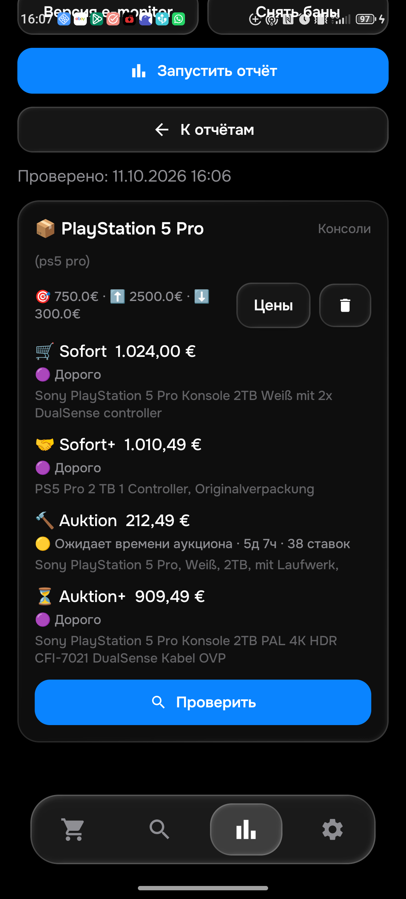

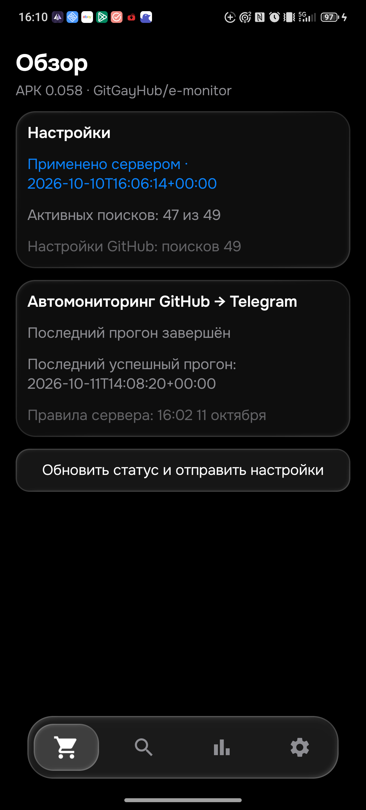

---

# Актуальный этап — APK 0.056, 10 октября 2026

**Вердикт: до исправлений Sony расходился с eBay и между APK/Python; после056 четыре проверенных минимума совпали. Полная приёмка25 товаров ещё не завершена.**

Первый дефект: поиск требовал SKU WH-ULT900N и пропускал исправный Sony за79.90€ без артикула в названии. Второй: после описания Python сбрасывал пользовательский лимит, возвращал общий нижний порог80€ и отклонял исправные78/79.90€. В055 сохранено каноническое название, в056 исправлена повторная проверка лимита. Новые тесты основаны на независимо прочитанных страницах. Общая проверка модели, назначения и описания сохранена; ремонты/запчасти не принимаются только из-за более широкого запроса.

| Корзина Sony | eBay / APK / Python056, € | Лот | Описание Python | Право уведомления при30€ |
|---|---:|---|---|---|
| Sofort | 78.00 | [168626274515](https://www.ebay.de/itm/168626274515) | verified | нет, дорого |
| Sofort+ | 79.90 | [307029264069](https://www.ebay.de/itm/307029264069) | verified | нет, дорого |
| Auktion | 29.69 | [820202936472](https://www.ebay.de/itm/820202936472) | verified | да, внутри24ч |
| Auktion+ | 106.19 | [168775660282](https://www.ebay.de/itm/168775660282) | verified | нет, дорого |

[40 страниц Sony](SONY_MANUAL.md), [живой Python](sony-four056.json), [старые запросы](sony-alias-before054.json), [новые запросы](sony-alias-after055.json). Все40 собственных описаний прочитаны; физическая работоспособность товара не проверяется удалённо. У дешёвого аукциона отмечена условная формулировка продавца. Импортные суммы зарубежных карточек в таблице не объявляются окончательными без отдельной проверки.

**APK056/code56 установлена с сохранением49 поисков**,47активных/25товаров; предыдущие48 бизнес-строк точно сохранены. SHA2566E4D50B50E95C0DB64E399467818192CD15B869E24D73137A3403A7FADAADE83. Сервер подтвердил1791657504, текущуюrevisionb03139a4-6df4-4869-9e23-a8ca749bd709, прежнийfingerprint,normal. «Обзор»056: успешныйпрогон18:40:02Z, правила20:38Berlin. Python[036400f](https://github.com/GitGayHub/e-monitor/commit/036400f3a51c9843b2f00955fd1ba802b9d0a3d3), Android[4d7d049](https://github.com/GitGayHub/e-monitor-android/commit/4d7d0499b4db0017862da5e3352adb62c9a38363).

268 изолированныхPython /263Android /7sync /APK успешно. [LinuxCI05638076596893](https://github.com/GitGayHub/e-monitor-android/actions/runs/38076596893): completed, success. СтаруюCIнеподменятьэтой.

[Telegram119953](telegram-proof056.json) реально доставлен; [AyuGramPC](pc-telegram056-proof.json): прочитаны фото и полныйтекстLG423.99/доставка18.99/limit430/initial/APK056/server20:38. RepeatSentfalse. Передтестом заново открыта страницаeBay и собственноеописание. Это явно отмеченный локальныйтест, рабочаяверсияGitHub подтвержденаruntimeотдельно. ПолныйПКскриншот со стороннимичатами остаётсяприватным. Телефонтеперь используетсятолькодляeMonitor; закреплённыйботнаПКагентнаходитсам.

NubiaZ80UltraLeading: сайт иPython дали0объявленийбезошибки; на физической054все4корзиныпоказали«Не найдено», неblocked ([снимок](leading-zero054.png)). Ray-BanHTMLнафизической054пройденчерезконтролируемуюпаузуAPI:107.656с, четыреминимуматежеAPI ([снимок](html-four054.png)). Квотавосстановлена точно,pendingfalse. Настоящийupstream429этимнеподтверждён; незавершённыйинспектор35/47невыданзаготовый.

**Осталось:** другие товары и все дополнительные запросы/пустые корзины, настоящий новый pickupBerlin/≤80км с расстоянием вTelegram, реальный429 и восстановление сетей. Ручнойобъёмсегодня: Ray40(39текстов),Sony40(40текстов),Samsung12(11полныхiframe/1часть). Старыеразделыниже—история, текущиеподтверждениявышеихуточняют.

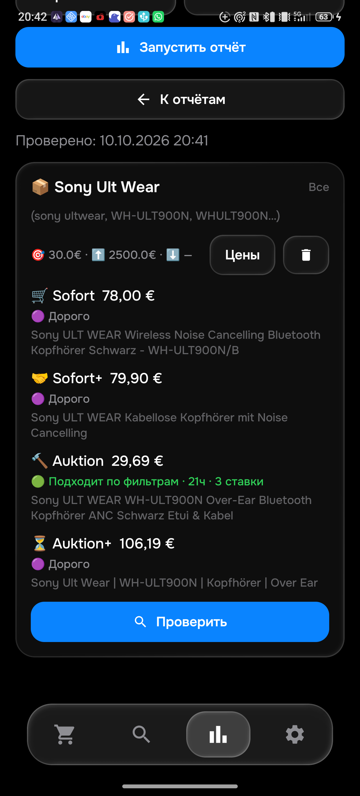

---

# Актуальная проверка — APK 0.053, 10 октября 2026

**0.053/code53 установлен на физический Android 16 с сохранением данных.** SHA256 `EAE1EB04036882AD8A1F983C9971C49D89EC7307256BE67F3565FB693F6557B3`, размер 69 515 041 байт. Правила **1791652884**. [Python ca9f367](https://github.com/GitGayHub/e-monitor/commit/ca9f367b48aab78342a645e725f2818122a6abdd), [Android b34ac47](https://github.com/GitGayHub/e-monitor-android/commit/b34ac471dbccd46ded0ae0c05e70171551f7fdbb).

- Исправлен выбор цены гибрида для all/offer: немедленная покупка в лимите либо ставка аукциона с её собственным временем. После деталей обе доступные цены пересматриваются. Статистика сохраняет оба исходных формата. Formatter теперь использует выбранную фильтром копию, вместо прежних флагов и цены.
- Реальная страница PS5 800775385524 содержит немецкое «Dieses Angebot wurde verkauft». Теперь собственный статус продажи исключает этот лот; случай похожих слов в рекомендациях не исключает исправный товар.
- **264 Python / 261 Android unit-тест / APK / 7 cloud-sync тестов успешно.** Новый общий JSON: шесть ценовых границ гибрида и два случая собственного статуса продажи. Отдельно проверены изменение BIN после выбора аукциона, настоящий formatter и повторная отправка.
- [Linux CI 38071359323](https://github.com/GitGayHub/e-monitor-android/actions/runs/38071359323): completed, success. Статус не подменяется результатом прошлой сборки.
- Runtime сервера подтвердил правила 1791652884 и успешный прогон **2026-10-10T17:22:41Z**. Конфигурация имеет прежнюю ревизию b03139a4-6df4-4869-9e23-a8ca749bd709 и прежний fingerprint ad5e357aa184f67d2433d5dd533b24fcb6ed2415a0032006207cc538d17af989. На телефоне 49 сохранённых / 47 активных; предыдущие 48 строк бизнес-настроек не изменились. Mode normal и получатель сохранены.
- Физическое превью Ray-Ban после обновления: 94 кандидата, 2 приняты / 92 отказа. Оба принятых лота — аукционы с ожиданием. Проверка четырёх корзин повторена: 286.12 / 306.19 / 105.90 / 246.19 €. Названия, суммы и статусы совпадают с проверкой 0.052. В галерее дешёвого 920025916687 отдельно просмотрены очки, а не только главная фотография case; на коробке видна надпись GEN 2.
- **Настоящий тест Telegram 119950 визуально прочитан в официальном Telegram на физическом телефоне**, включая фотографию, цену 423.99 €, доставку 18.99 €, лимит 430 €, Sofortkauf+, APK 0.053 и серверные правила 19:21 10 октября. [Receipt](telegram-proof053.json) подтверждает delivered=true, repeatSent=false. Это явно помеченный локальный тест; штатный GitHub-прогон также применил новую версию, что подтверждено runtime и штатным сообщением в том же чате. Окна ПК не переключались. AyuGram на телефоне оказался без входа; вход не выполнялся.
- [Ручная таблица 40 Ray-Ban](RAYBAN_MANUAL.md): 36 непустых полных seller-описаний, 4 недоступных. Несогласованная дата invoice у 318921017949 отмечена как неопределённость, не как доказанный Gen 1. Модифицированный LED и refurbishment выделены отдельно без выдуманного общего запрета.
- Сайт по Samsung Odyssey G6 500Hz + Germany показал 11 основных результатов, все Sofort, 1 с торгом, и серые рекомендации соседних моделей. Вариант Samsung G60SF на следующем запросе вернул «SORRY / Something went wrong on our end»: это ошибка доступа, а не доказанное отсутствие всех аукционов по всем вариантам. Полная независимая Samsung-проверка ещё не закончена.

**Общая приёмка всех 25 товаров × 4 корзины, 40–50 страниц на каждый товар, реальный новый самовывоз ≤80 км с визуальной доставкой и физический HTML-прогон при нулевой API-квоте остаются незавершёнными.** Совпадение тестов не объявляется доказательством правильности всего рынка. Подробности первоначального этапа 0.052 сохранены ниже.

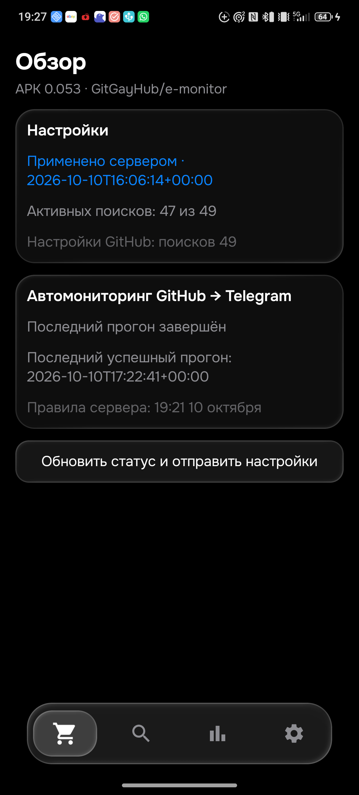
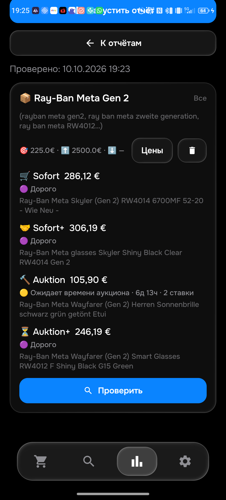
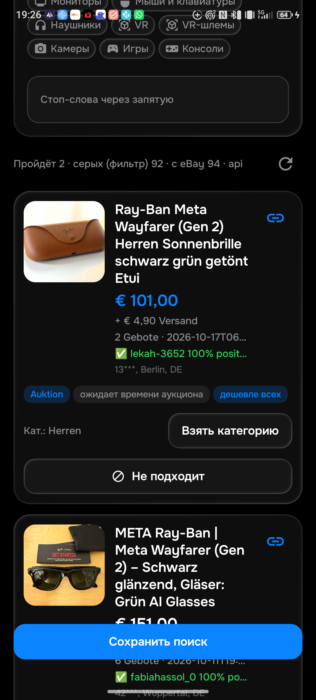
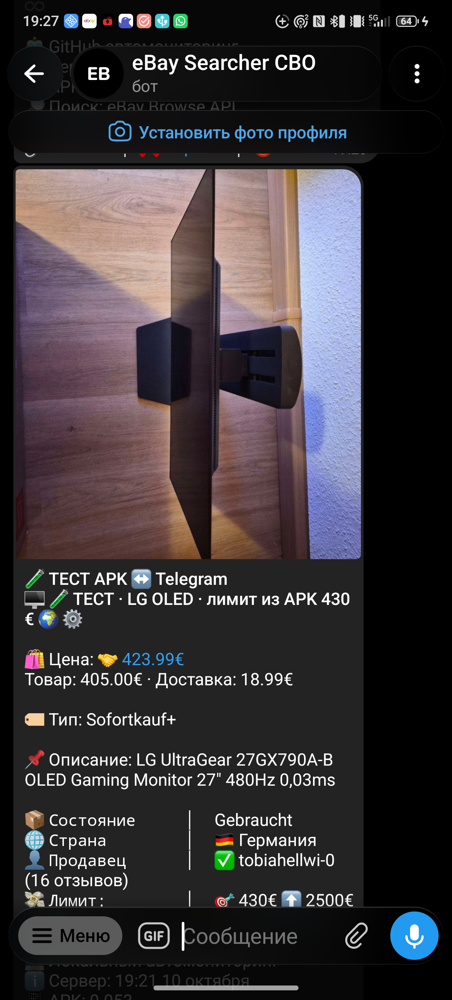
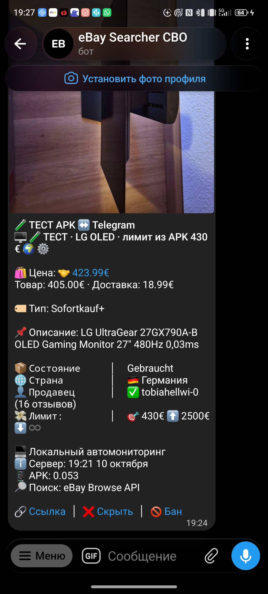

---

# Проверка на ПК и физическом телефоне —10 октября2026

Установлена APK **0.052/code52**, правила **1791648295**. SHA256: `9FCDED7AAE5C5EB056A1F0708674929FA7552613CB9F6CA5C4F00E20792906BC`.
Исходники: [Python6082093](https://github.com/GitGayHub/e-monitor/commit/6082093e606496974518b93cebd7d5066d371b7a), [Androiddb5d23e](https://github.com/GitGayHub/e-monitor-android/commit/db5d23ebb0e89d998d31b4472bf95dff1c66081f).
[LinuxCI38066192241](https://github.com/GitGayHub/e-monitor-android/actions/runs/38066192241) успешно завершён.

## Что исправлено и реально воспроизведено

- Telegram119934 отправил [Samsung147486582559](https://www.ebay.de/itm/147486582559) как OLED500Hz. Настоящий браузер подтвердил собственные название, характеристики и полный selleriframe: G60F, LS27FG602EUXEN, IPS350Hz. Префикс FG602 неоднозначен. Теперь E-вариант/IPS/другая частота отклоняются, S-вариант/G60SF принимается. Питание50/60Hz не считается частотой экрана. APK после исправления показывает подходящий G60SF за448.99€ как дорогой.
- Фото Samsung присутствовало в исходных данных. Старый formatter убирал изображение при длинной подписи с определением состояния eBay. Состояние сокращается до названия; длинный текст сохраняет фото и отдельно отправляет полный текст. Фотография того же Samsung реально доставлена тестом **119943**,photoDelivered=true,@eBaySearcherBOT. Он явно обозначен как неподходящий IPS350Hz, не как новое предложение.
- Самовывоз: только **Berlin** либо подтверждённое расстояние **≤80км от09648**. Убраны Potsdam, весь диапазон10–14xxx и догадки по названиям городов. Bernau bei Berlin не получает исключение Berlin. Расстояние рассчитывается по центрам индексов, по прямой. Неизвестное место не разрешает отправку; собственная карта самовывоза используется для раскрытия замаскированного индекса. Доставка вместе с необязательным самовывозом остаётся доставкой и сохраняет её стоимость.
- [PS5изскриншота800775385524](https://www.ebay.de/itm/800775385524): в браузере original listing показывает карту Berlin DE13585. Уже продано9 октября; текущая страница показывает600€, прежняя доставка680€ — историческое сообщение. Повторно как актуальный лот не отправлялся. Новое сообщение самовывоза должно прямо показывать Berlin либо место+км от09648.
- Через UI физического телефона добавлен **Ray-Ban Meta Gen2,225€,all,DE,categoryall**,id ray_ban_meta_gen_2. В051 живое превью приняло Originalverpackung за5+4.19€: исправлено в052, также отсеивается Dummie/без функции. Названия и коды поколения сверены с официальным Ray-Ban; RW4006/RW4008/RW4010 не становятся Gen2 из-за неверной подписи. Полный комплект с etui/OVP сохраняется.

## Настройки и доставка

49 сохранённых/47активных/25товаров; прежние48 строк бизнес-настроек точно сохранены. Ревизия **b03139a4-6df4-4869-9e23-a8ca749bd709**,manifest commit9e446ba. Манифест, расшифрованная конфигурация и настоящий runtimeACK совпадают; appliedAt2026-10-10T16:06:14Z,logic1791648295,stateok. Физический «Обзор» после обновления показывает «Применено сервером» и последующий успешный прогон16:16:04Z. Mode normal и текущий получатель сохранены.

Тест **119942**: [LG800366377085](https://www.ebay.de/itm/800366377085),405+18.99=423.99€,лимит430€,APK0.052,initial,та же новая ревизия. Полный собственный iframe повторно прочитан в браузере10 октября. TelegramAPI подтвердил доставку; повторный вызов false. На ПК фоновая фотография окна подтверждает новый тест/уведомление18:10 и футер0.052; окно Codex перекрывает основную часть сообщения, поэтому полный визуальный текст не объявлен проверенным. Окна ПК не активировались.

## Повторная проверка

Python260 изолированных тестов, Android258 unit-тестов и сборка OK. Общее новое множество25 модельных случаев и2 HTML-карты самовывоза. Два исторических API-fixture сохраняют accepted=false; reasonover_limit→filtered соответствует новому требованию80км/подтверждённого места. Старые expected сохранены отдельным полем. Датированный replay моделей проверяется во время фактического capture, чтобы наступивший конец аукциона не менял модельный expected; production продолжает использовать реальное время.

| Товар | Корзина | Цена с доставкой | Результат APK | Ссылка |
|---|---|---:|---|---|
| Ray-Ban Meta Gen 2 | Sofort | 286.12 € | 🟣 Дорого | [лот](https://www.ebay.de/itm/168567790055) |
| Ray-Ban Meta Gen 2 | Sofort+ | 306.19 € | 🟣 Дорого | [лот](https://www.ebay.de/itm/287608281919) |
| Ray-Ban Meta Gen 2 | Auktion | 105.90 € | 🟡 Ожидает времени аукциона · 6д 14ч · 2 ставки | [лот](https://www.ebay.de/itm/920025916687) |
| Ray-Ban Meta Gen 2 | Auktion+ | 246.19 € | 🟣 Дорого | [лот](https://www.ebay.de/itm/820220040744) |
| Samsung Odyssey OLED G6 500hz | Sofort | 448.99 € | 🟣 Дорого | [лот](https://www.ebay.de/itm/137797112911) |
| Samsung Odyssey OLED G6 500hz | Sofort+ | 523.99 € | 🟣 Дорого | [лот](https://www.ebay.de/itm/398162444700) |
| Samsung Odyssey OLED G6 500hz | Auktion | — | ❌ Не найдено · в полученной выдаче нет объявлений этой корзины | — |
| Samsung Odyssey OLED G6 500hz | Auktion+ | — | ❌ Не найдено · в полученной выдаче нет объявлений этой корзины | — |

Ray-Ban:94 API-кандидата,052 превью2 проходят/92отказа; дешёвый920025916687 независимо прочитан в браузере: полный собственный iframe и модель Gen2,101+4.90€,аукцион ещё6д14ч. Проверка одной карточки четырёх корзин5.986с. Samsung: одна карточка/4 корзины4.013с. Это результаты полученной выдачи, не доказательство абсолютного минимума всего рынка.

## Оставшиеся ограничения

Полная независимая приёмка всех25товаров×4корзины и40–50уникальных лотов на каждый товар НЕ закончена. Прочитанные сегодня Samsung/PS5/Ray-Ban/LG не заменяют весь этот аудит. У Samsung пустые аукционные корзины ещё требуют независимой проверки сайта. Реальный новый самовывоз в пределах80км и его полный визуальный текст Telegram ещё не подтверждены. Капчи/403/недоступное описание остаются ошибками, а не пустой успешной выдачей. Эмулятор052 ещё не проверялся: эмулятор051 дал HTML403 и не имел GitHubtoken; его локальная тестовая запись Ray-Ban не отправлялась и не заменила настройку физического телефона.

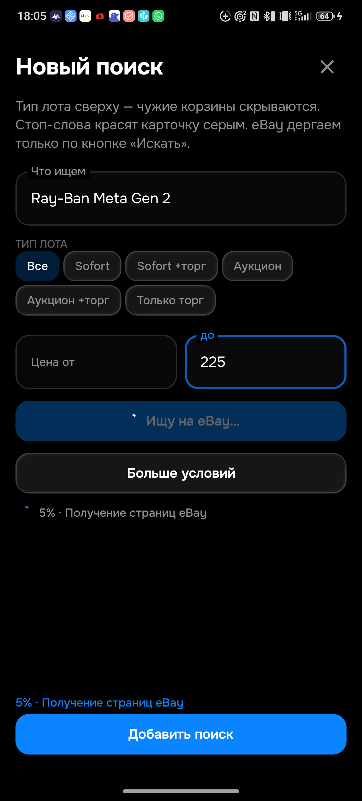
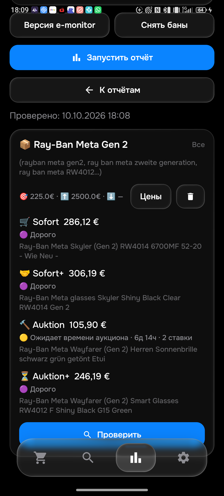
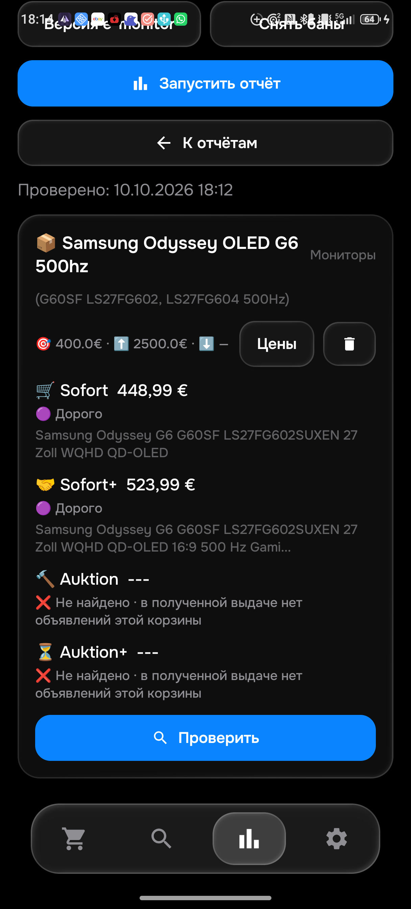
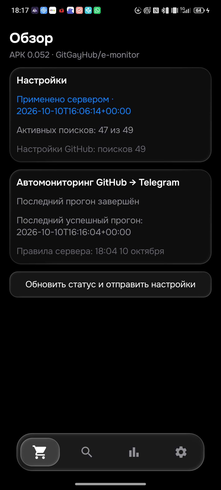
