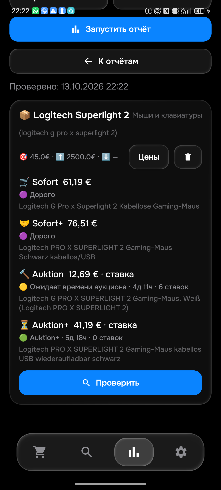

# Проверка eMonitor 0.073 — 13 октября 2026

Это промежуточный отчёт. Полная приёмка всех 25 товаров и 100 корзин ещё не завершена.

## Что исправлено и подтверждено

- Убрана фраза о неизвестной цене предложения из Telegram и APK. Осталась короткая отметка «ставка». Аукционная ставка не участвует в сравнении с покупной медианой и не получает такую «скидку».
- Ножки `237099772350` из исходного ошибочного сообщения больше не считаются мышью. На физическом телефоне: «аксессуар: ножки / глайды, не мышь».
- Целая мышь `307150632164` с характеристикой «5 Tasten» проходит проверку устройства и полного описания. На телефоне: 102,94 €, «Дорого» при лимите 45 €. Отдельные кнопки, ремонт и аксессуары продолжают исключаться.
- Собственный артикул `820221654834` противоречит запрошенной модели Superlight 2: это артикул 2c. Лот исключён, минимум Sofort+ сменился с 72,99 € на 76,51 €.
- Ожидающий аукцион отделён от дорогого товара: в проверенной корзине один ожидает времени, второй превышает лимит.

## Свежая сверка APK и Python

Физический отчёт за 22:22 и Python за 22:22 совпали по всем четырём ценам и ID. Полные описания четырёх минимумов прочитаны независимо в браузере. Это подтверждение конкретной выборки; совпадение двух программ само по себе не доказывает правильность всего каталога.

| Корзина | Цена с доставкой | Лот | Статус при лимите 45 € |
|---|---:|---|---|
| Sofort | 61,19 € | [920017485002](https://www.ebay.de/itm/920017485002) | Дорого |
| Sofort+ | 76,51 € | [366640211196](https://www.ebay.de/itm/366640211196) | Дорого |
| Auktion | 12,69 € — ставка | [206618622307](https://www.ebay.de/itm/206618622307) | Ожидает времени |
| Auktion+ | 41,19 € — ставка | [168787849340](https://www.ebay.de/itm/168787849340) | Подходит по действующим правилам Auktion+ |

## Независимая проверка и тесты

В браузере открыты 48 уникальных страниц мышей; у 47 прочитан полный текст продавца. Четыре первоначально пустых описания восстановились при повторном открытии. Один завершённый лот не отдал описание. 44 страницы относятся к основной выдаче и контрольным минимумам, ещё четыре — к проверке старых примеров. Проданный каталог требует входа; проданных лотов прочитано 0. [Список лотов, цен, времени и оценки](mouse-manual073.json).

Проверка назначения товара отдельно от пользовательских условий: например, сохранённое стоп-слово OVP может исключать целую мышь с упаковкой. Такие настройки не были изменены автоматически.

302 изолированных Python-теста, 286 Android-тестов и сборка прошли. Исходные 3 970 примеров сохранены. Шесть предварительных причин отказа исправлены отдельным проверенным дополнением: «отфильтровано» → «дорого», право уведомления остаётся выключенным. [Причины и доказательства](MOUSE_TASTEN073.md).

[Чистая GitHub-проверка](https://github.com/GitGayHub/e-monitor-android/actions/runs/38461883211) успешна. Дополнительная загрузка APK не состоялась из-за квоты хранилища GitHub; выведено предупреждение. Существующие артефакты не удалялись. Рабочая APK установлена локально с прежней подписью.

## Версии и настоящая доставка

APK **0.073**, код **73**, правила **1791922765** — 22:19 по Берлину. SHA256 установленной APK: `B934E67C5B2362D3DEF1DDD13E796DEEDBDD2094AE4D2FFFF9A477C1F0285E10`.

Сервер подтвердил эти правила, успешный прогон и 47 активных поисков. Сохранены 49 поисков, прежняя ревизия настроек, лимиты, режим normal и получатель Telegram. [Подтверждение сервера](runtime073.json).

Тест **120017** отправлен один раз и прочитан непосредственно в AyuGram на ПК в фоне: версия 0.073, ставка 41,19 €, товар 35 € и доставка 6,19 €, без удалённой фразы и без скидки от покупной медианы. Проверка была текстовой; фотография этим тестом не подтверждается. [Подтверждение доставки](telegram-bid073.json).

## Что остаётся

Сервер записывает ценовую историю после предварительной фильтрации, до полной проверки описания и артикула. Эта ошибка обнаружена и ещё не исправлена; старые агрегаты нельзя считать полностью проверенной выборкой. Также остаются выбранные варианты Z70, остальные товары и варианты названий, проданный каталог и незавершённые проверки реальных сетевых сбоев. Полный перечень — [таблица приёмки](ACCEPTANCE_CURRENT.md) и `acceptance-current.json`.
