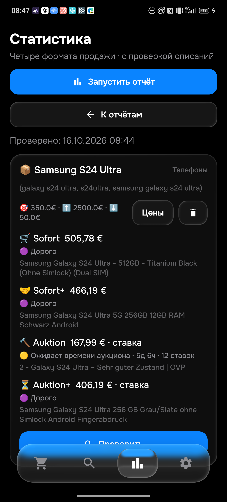
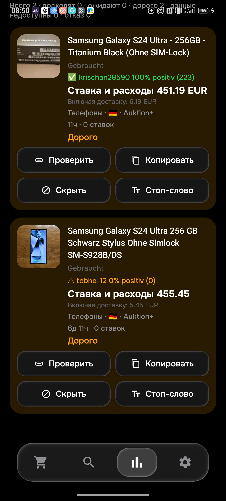

# Проверка S24 Ultra и исправления 0.096 — 16 октября 2026

На физическом телефоне установлена **APK0.096/code96**, правила **1792132880 / History16**. Локальные проверки, реальный отчёт и просмотрщик завершены. Код опубликован: botmain`a5121e7d36080d03d48fd79ca778230b71db8623`,Androidsource`869b9441279c53adf18a2b5fa5ca772f84674f75`. Применение сервером0.096 и CI проверяются отдельно. **Общая приёмка26товаров/104корзин не завершена.**

## Что исправлено

- Обозначение целого телефона со стилусом или чехлом в конце названия стало предварительным кандидатом. Для неоднозначного названия нужен собственный текст, явно продающий телефон. «Только чехол/перо», «без телефона», совместимость, дисплей/запчасти и неопределённый текст не проходят. Явные комплекты «Smartphone mit S Pen» сохраняют прежние правила. Характеристики модели и дефекты проверяются дополнительно.
- Слова продавца о сколе дисплея (`Mini Platzer`, `Abplatzer`) распознаются как повреждение, с учётом отрицаний. Работоспособность не отменяет скол. Обычные мелкие царапины не превращаются в трещину.
- Явные единицы RAM проверяются и вMB/MiB/GiB. Объявленные8MB не игнорируются;12GiB/12288MB допустимы для12GB-модели. Противоречие не объявляется доказанной подделкой.
- Собственное «Nur an Selbstabholer» перекрывает автоматическую доставку. После обновления данных повторяется правило самовывоза: до80км от09648 либо Берлин. Пример366724884284 изФранкфурта воспроизведён; положительные контроли с разрешённой доставкой/отрицанием сохранены.

Изменения совпадают вPython/Kotlin.26 новых общих контролей проверяют предварительный и полный отбор во всех четырёх форматах; прежние3970снимков не переписаны. История повышена до16, чтобы предварительная проверочная сборка сHistory15 не подтверждала финальные правила.

## Независимый браузерный аудит

В настоящем Chrome открыты **50уникальных страниц S24**:36аукционных и14дополнительныхSofort. Прочитаны50непустых собственных текстов; четыре первоначально пустых загрузились при обычном повторном открытии. Для одного вариативного объявления отдельно раскрыты собственные условия и разделS24Ultra, но нужная конфигурация/цена ещё не выбраны. Его начальные285,92€ не считаются ценойS24Ultra. Рекомендации и отзывы не используются как описание.

Полный переченьID,времени,цен,форматов,гибридныхBIN/ставок и ручных причин: [S24_BROWSER_096.json](S24_BROWSER_096.json). Это выборка50страниц, а не доказательство полноты всех739Sofort или всехалиасов. Импортные оценки и противоречия каталога помечены отдельно.

## Настоящий телефон

Финальный отчёт из одной карточки завершился за183617мс,1товар/4корзины, лимит350€:

| Корзина | ID | Сумма | Результат |
|---|---|---|---|
|Sofort|[880020109702](https://www.ebay.de/itm/880020109702)|499,99+5,79=505,78€|Дорого; ownописание и сумма независимо совпали|
|Sofort+|[298435287203](https://www.ebay.de/itm/298435287203)|460+6,19=466,19€|Дорого; повреждено лишь защитное стекло, собственный дисплей цел|
|Auktion|[327399499743](https://www.ebay.de/itm/327399499743)|ставка161+6,99=167,99€|Ожидает времени аукциона,5д6ч/12ставок; не цена покупки|
|Auktion+|[137839581581](https://www.ebay.de/itm/137839581581)|ставка400+6,19=406,19€|Дорого; **смешанныеS928B/S938Bвхарактеристиках ещё не разрешены, правильность модели не сертифицирована**|

Причины двух конкретных лотов подтвердились в настоящем отчёте:237119211915 теперь отклонён из-заRAM/характеристик, а не какчехол;237125682016 со сколом дисплея — «дефект/ремонт в описании». Лот860047665781 соStylus подтверждён в настоящем просмотрщике:455,45€=450+5,45,фото и продавец видны,статус «Дорого»,аксессуаром не считается. Диапазон450–460€ оставил2строки/2дорогих/0отказов/0недоступных;после сброса6строк/4дорогих/2отказа. Все50поисков и лимит350€ сохранились. [Машиночитаемые факты](PHONE_096.json).

Обновление выполнено проверенной передачей APK иSHA256 перед установкой, без очистки приложения. **Все столбцы всех50поисков совпадают до/после установки и после отчёта**. Ревизияce6d8944-34df-441a-8cd5-483e0b5a9542/dirtyfalse,обаLG430сохранены.0.096wrapper реально установлен дважды; [инструкцияUSB](../../PHONE_USB.md). Промежуточная сборкаHistory15 не является финальным артефактом.

## Проверки, сервер и Telegram

377изолированныхPython,347Androidunit,9sync,4installer и сборка успешны. CI0.095 source/readiness/emulator38860775630/38860907649/38860907596 успешны. Сервер реально применил0.095/1792130642 с прежнимfingerprint/ревизией/normal; это подтверждение предыдущего этапа, **не0.096**. СнимкиRUNTIME_095.json/CI_095.json рядом.

НовогоTelegramтеста0.096 не отправляли. ВПКAyuGram фоновое чтение не дало сведений чата бота; окно не активировали. Старую подтверждённуюLGдоставку120032/093 не выдаём за новую. Не пересылать прежние120019/120022/120025–120032.

Далее: road0.096/CI/runtime; спорные кодыS24и точностьхарактеристик; всеоставшиесятовары/алиасы/минимумы,CRUD/гонки/сеть/восстановление/повторы и свежаядоставка. HTML/APIблокировки и очереди не превращаются в «Не найдено» и не объявляются устранёнными по Chromeдоступу.
