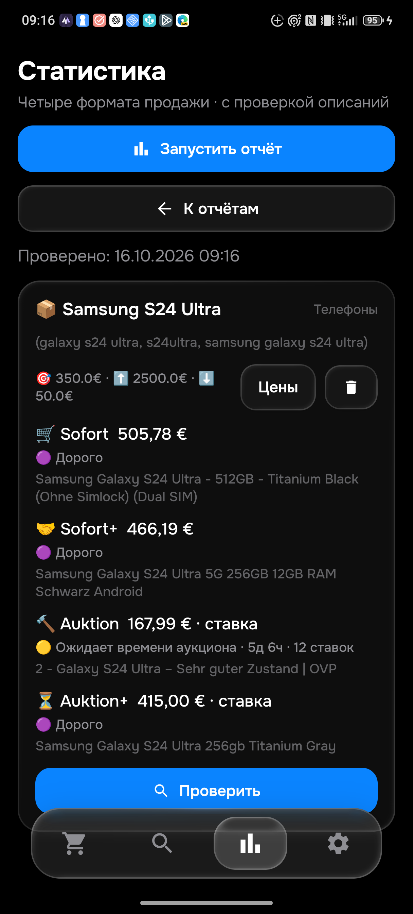
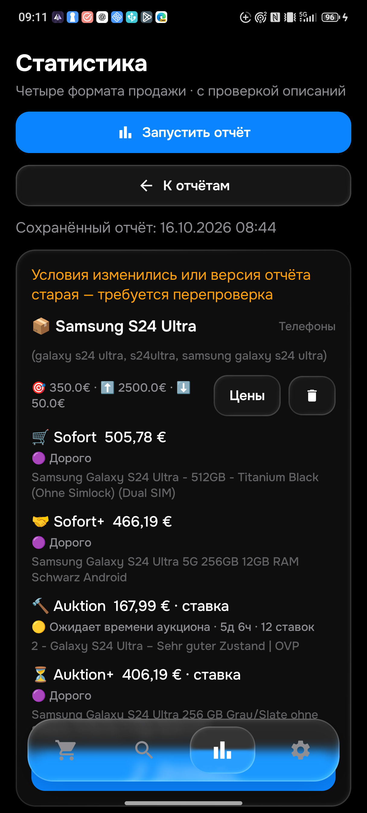

# Проверка противоречивых кодов Samsung — APK0.097

На физическом телефоне установлена финальная **0.097/code97**, правила **1792134014 / History17**. SHA256 `11dd957b35e3368021bb71e640b7f99470661369c897ff40557f27b1d756d190`. Код ещё ожидает публикации и серверного подтверждения. **Общая приёмка26товаров/104корзин PARTIAL.**

## Подтверждённая ошибка и исправление

[137839581581](https://www.ebay.de/itm/137839581581) был выбран вAuktion+ за406,19€, хотя полеHerstellernummer содержит одновременноSM-S928B/DS иSM-S938B/DS. Собственная страница и описание независимо прочитаны вChrome, запись вS24_BROWSER_096.json. Это противоречие каталога, не доказательство подделки.

Samsung подтверждает разные модели: [SM-S928 — S24Ultra](https://www.samsung.com/uk/support/model/SM-S928BZTHEUB/), [SM-S938 — S25Ultra](https://www.samsung.com/ae/support/model.SM-S938BZBOMEA/), [SM-S937 — S25Edge](https://www.samsung.com/ie/business/smartphones/galaxy-s/galaxy-s25-edge-titanium-icyblue-256gb-sm-s937blbdeub/). Теперь проверяются все распознанные коды в собственном title/Model/ModelNumber/MPN/Herstellernummer и явно подписанном поле описания. Одно совпадение не перекрывает конфликт другого кода. РегиональныеB/U/U1и остальные суффиксы сохраняются. ПроцессорSM8650, сравнение с другим телефоном и неизвестная опечаткаsm-5928B не выдумывают распознанную другую модель.

Обе реализации используют одинаковые18JSONконтролей ×4формата, включая настоящий спорный лот, правильные/неправильные коды, смеси, региональные версии, описание и контрольS25Edge. Исходные3970снимков/28отдельныхreviewedcorrections не менялись. Прошли378изолированныхPython,349Androidunit и сборка.

## Реальный повтор на телефоне

Запуск из одной карточкиS24 завершился за239399мс,1товар/4корзины, лимит350€:

| Корзина | ID | Сумма | Результат |
|---|---|---|---|
|Sofort|880020109702|505,78€|Дорого|
|Sofort+|298435287203|466,19€|Дорого|
|Auktion|327399499743|ставка167,99€|Ожидает5д6ч/12ставок|
|Auktion+|880018711090|ставка415,00€|Дорого|

Спорный137839581581 реально присутствует среди отказов с причиной «модель/характеристики не соответствуют поиску». НовыйAuktion+415€, а не406,19€. Это не цена немедленной покупки. Все столбцы50поисков совпали до/после установки и отчёта;ce6/dirtyfalse,LG430 и остальные лимиты сохранены. [PHONE_097.json](PHONE_097.json).

Новый минимум880018711090 независимо читался вChrome ранее,06:06:35UTC:415+0€,12GB,собственный текст целого телефона/комплекта. Свежий браузерный повтор сейчас **не подтверждён**: прежняя вкладка не подключилась к управлению, скрытое открытие новой недоступно. ОкнаПК не активировали и браузер не подменяли. Время старого ручного наблюдения не выдаётся за новое. Полнота всехалиасов/каталога по-прежнему не доказана.

## Устаревший отчёт

ДоUIисправления старая0.096 открывалась в0.097 без предупреждения о новых правилах. Теперь при восстановлении сравнивается версия правил, неизвестная/отличающаяся помечает результат для перепроверки. Сохранённые дата/ID/цены остаются историческими. На настоящем телефоне повторно открыт тот же отчёт096, предупреждение видно; новый097отчёт его не показывает. JSONschema1 сохранён.

## Внедрение и оставшееся

Предыдущая096 фактически примененасервером07:05:52UTC,1792132880/ce6/fingerprint/normal/48active. Все3CI096успешны (source38863563519,roadreadiness38863882472,emulator38863882429). Runtimeостаётсяerror/network/blocked/незавершённыеописания; ACK не означает успешный полный проход.

097пока локальная, на телефоне уже финальная; требуется безопаснаяпубликацияmain/source/обеroad иruntime/CI. Запущен дополнительный реальныйS25Edgeпрогон097 с лимитом325€, его итог ещё не заявляется. Нет новой подтверждённойTelegram097доставки. НаПКAyuGram открыт другойчат,фоновоечтениене подтверждаетбота;окнаПКнеактивируются.

Продолжить полный каталог26товаров/104корзин, ручные40–50лотовнакаждыйтовариливседоступные,алиасы/минимумы/описания/проданные,CRUD/гонки/сеть/восстановление/повторы и реальнуюдоставку. Не пересылать старые120019/120022/120025–120032. Не выдавать unitсовпадение/одинуспешныйтовар за полнуюприёмку.

Дополнительный физический S25 Edge097 завершён за204478мс: Sofort485,99 / Sofort+490,00 / Auktion506,19ставка / Auktion+556,19ставка. Все четыре выше лимита325, все50столбцовпоисков сохранены. S25_PHONE_097.json. Свежая независимая сверка страниц этих минимумов ещё не выполнена.
