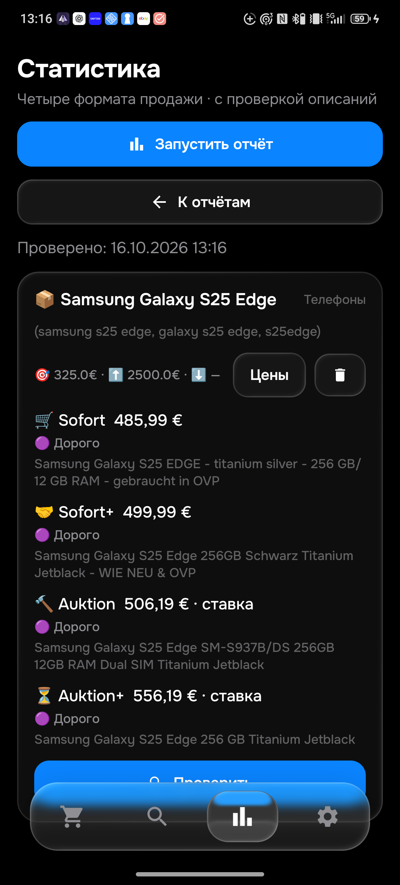
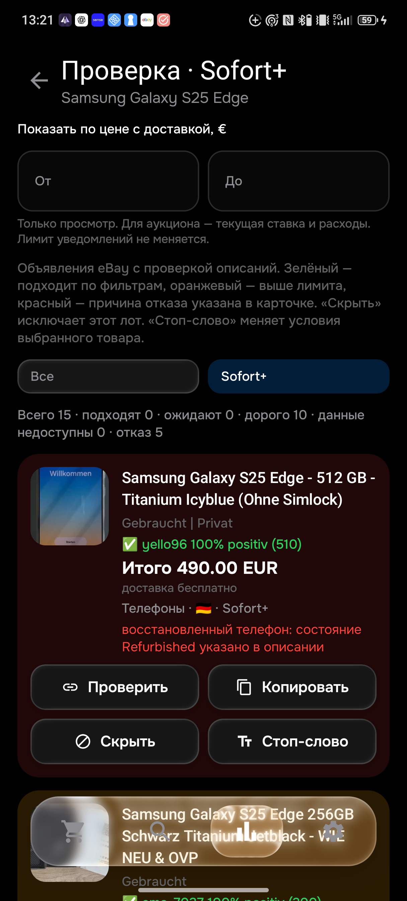

# Проверка 0.098: страна, задержки и refurbished

**Общая приёмка остаётся незавершённой: 26 товаров, 104 корзины.** Этот этап проверяет конкретные исправления и не подтверждает весь каталог.

На физическом телефоне установлена финальная **APK 0.098 / code98**, правила **1792148597 / History18**. SHA256: `cf24820a4538c3fae88c2e049a2aa52868ed75ba6cbe463f6ed26e63de78e84e`. Все столбцы всех 50 поисков сохранены; ревизия ce6d8944-34df-441a-8cd5-483e0b5a9542, dirty=false, оба LG430. Промежуточная 0.098 с SHAaee9227c… заменена после обнаружения собственного refurbished в описании S25.

## Страна в уведомлении

У [820244670988](https://www.ebay.de/itm/820244670988), сообщение120034, сервер сохранил местоположение `Brand-Erbisdorf DE 09618`, но форматировщик не распознал DE между городом и индексом. Исправлено в Python и Kotlin. Общие проверки включают код перед индексом, UK/GB, названия стран и города со словами, похожими на код. В настоящем Chrome оригинальное объявление показывает Brand-Erbisdorf, Deutschland. Старое сообщение прочитано в AyuGram на ПК в фоне:600+6,19=606,19€, страна действительно отсутствовала.

История ставок показывает начало16октября10:52:40MESZ; подтверждённая запись feed появилась09:15:39.083UTC — примерно через23минуты. Это конкретный замер старой версии, а не обещание скорости новой. Лот позднее завершён досрочно; текущие670€ в шапке и725€ в истории различаются, фактическая цена сделки не подтверждена.

Второй скрин14,19€ совпал с историческим сообщением120031 /APK0.090: пустая коробка [237125562884](https://www.ebay.de/itm/237125562884). Её отбор исправлен начиная с093. Скрин не доказывает повторный пропуск коробки в098.

## Что изменено для скорости

- Рабочий монитор начинает с новых объявлений. Ручная статистика сохраняет сортировку для поиска минимума. Правила модели, комплекта, описания, расходов, региона и этапа уведомления одинаковы.
- Подходящий лот проходит обычную окончательную проверку и отправляется сразу после своего описания, до проверки остальных кандидатов и дополнительных страниц.
- На одну страницу выделяется до2описаний. При необходимости отдельно проверяются до2добавленных оканчивающихся аукционов. Остальные кандидаты сохраняются в очереди; её курсор не теряется при перезапуске. Основная очередь и endingSoon имеют раздельные курсоры.
- HTML-проверка допускается через3минуты вместо15. Сохраняются выбор8старейших доступных поисков, общий срок прохода, ограниченияAPI и обработка блокировок. Дополнительный endingSoon раньше отсекался допуском очереди; теперь разрешён один ограниченный дополнительный запрос после первичной отправки.
- В feed schema1 добавлены необязательные `firstDiscoveredTime`, `detailsVerifiedTime`, `telegramConfirmedTime`, а в лог — измерение от обнаружения до доставки. Первое наблюдение не выдаётся за момент публикации eBay.

Тесты воспроизводят длинный первый товар и переход ко второму, отправку до следующего описания, возобновление оставшихся кандидатов, приоритет подходящих новых лотов, отдельный endingSoon и сохранение времени первого наблюдения. Непроверенные данные не становятся положительным результатом.

**Доставка за30минут пока не доказана на новой версии.** GitHub и eBay могут задерживать запуск и доступ к данным. Незавершённая выборка не подтверждает медиану; при небольшом лимите описаний полная медиана популярного товара может оставаться недоступной. Следующий этап должен отдельно проверить длительность полного круга26товаров и обновление истории без задержки уведомлений.

## Новый пропуск из независимого просмотра S25

097 выбрала [336839721068](https://www.ebay.de/itm/336839721068) за490€. В настоящем браузере прочитано1414символов собственного описания: продавец прямо сообщает покупку этого телефона refurbished, хотя в шапке стоит Gebraucht. Исправление учитывает собственную историю покупки, немецкие даты и отрицания; рекламные сравнения и другой старый телефон не становятся причиной отказа. Добавлены10общих примеров ×4формата. Прямой HTML получил1533символа собственного описания безAPI и подтвердил отказ.

**Финальная098 на телефоне также отклонила этот лот:** «восстановленный телефон: состояние Refurbished указано в описании продавца». Повторный S25 Edge завершён за162859мс:

| Корзина | Сумма с доставкой | Проверенный лот |
|---|---:|---|
| Sofort |485,99€|[920038228164](https://www.ebay.de/itm/920038228164)|
| Sofort+ |499,99€|[188989652905](https://www.ebay.de/itm/188989652905)|
| Auktion |506,19€ — ставка|[237121832128](https://www.ebay.de/itm/237121832128)|
| Auktion+ |556,19€ — ставка|[940016054198](https://www.ebay.de/itm/940016054198)|

Все четыре выше лимита325€. Три полных собственных описания этих минимумов повторно прочитаны в Chrome; у188989652905 подтверждены шапка/модель/499,99+0, но iframe описания пустой — независимое подтверждение его описания остаётся открытым. У гибридного237121832128 ставка500+6,19 и покупка700+6,19 разделены. Также повторно прочитан S24 минимум880018711090: рабочий телефон, два кабеля/чехол/коробка,415+0; свежая браузерная сверка097 теперь есть. Это не полная проверка всех алиасов и более дешёвых лотов.

Промежуточная098 прошла iPhone16:699,99 /696,99 /11,45ставка /626,19ставка; этот отчёт сохранён отдельно и не выдаётся за полный независимый аудит минимумов.

## Проверки и внедрение

388изолированныхPython-проверок,351Android unit-проверка,9проверок синхронизации,4проверки установки и сборка — PASS. Исходные3970примеров не менялись. Настоящая установка через официальныйADB сохранила данные. Скрин результата и JSON рядом с отчётом.

098 опубликована в main бота, источнике Android и обеих дорожных ветках. Серверное применение098 и её CI проверяются отдельно; предыдущая097 реально применена и все её3CI успешны. Новая Telegram-доставка098 пока не заявляется. Старые120019/120022/120025–120032 не повторялись. Полный каталог, обработка ошибок и восстановление остаются в общей приёмке.

В минипросмотрщике Sofort+ на финальной098 реально видны15строк:10дорогих,5отказов,0недоступных. У490€ показаны фотография, продавец, Германия и точная причина Refurbished. Диапазон450–495€ оставил1отказ; сброс восстановил15строк. После просмотра все столбцы всех50поисков совпали с исходными.

Дополнение11:25UTC: у188989652905 встроенный iframe оставался пустым. Его собственный, открыто указанный в DOM URL описания обычным переходом вChrome открыл140символов: целый телефон как новый, оригинальная упаковка; плёнки/адаптер/чехол идут подарком. Теперь собственные описания всех4текущих минимумов S25 независимо прочитаны. Первоначальную недоступность iframe в журнале не скрывали.

Найдена отдельная причина задержки старта: запуск38892562909 завершилсяskipped после отменыAppSync. Раньше событиезавершения отменённой синхронизации попадало в общую concurrency-группу и вытесняло ожидающий настоящий монитор ещё до проверкиjob.if. Теперь неуспешныеworkflow_run получают отдельную уникальную группу; успешнаясинхронизация,ручнойзапуск,расписаниеиpush остаются в общей последовательной очереди. Активныйпроходнеотменяется. Проверено наматрицесобытийpush/schedule/manual/success/cancelled/failure/skipped/timed_out.

Это поведение ожидающего слота описано в [официальной документации GitHub](https://docs.github.com/en/actions/concepts/workflows-and-actions/concurrency). Срок доставки новой версии всё ещё должен быть измерен фактически, а не выведен из изменения YAML.

11:31UTC: независимо прочитаны собственные описания всех4минимумов сохранённого iPhone16отчёта. Суммы совпали:699,99 /696,99 /11,45ставка /626,19ставка. У800795500239 реальный целый рабочий телефон:5,26ставка+6,19доставка, без ремонтов/блокировок,87%аккумулятор. Ожидание времени аукциона корректно. У336842481169 есть косметические царапины, но не заявлены трещины/поломка дисплея; у960041638850 коммерческая проверка функций без заменённых деталей сама по себе не считаетсяRefurbished. Все факты вBROWSER_098.json;полнота поиска40–50лотов/алиасов дляiPhone16ещёнеподтверждена.
