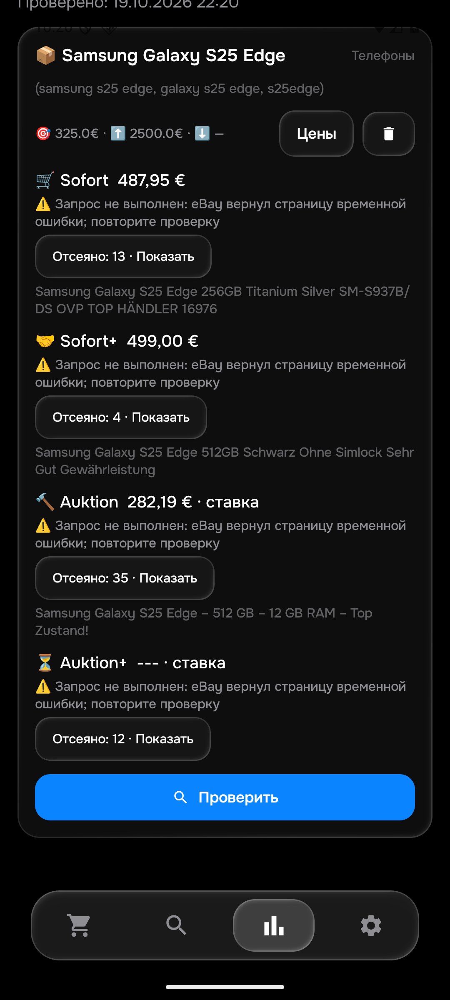
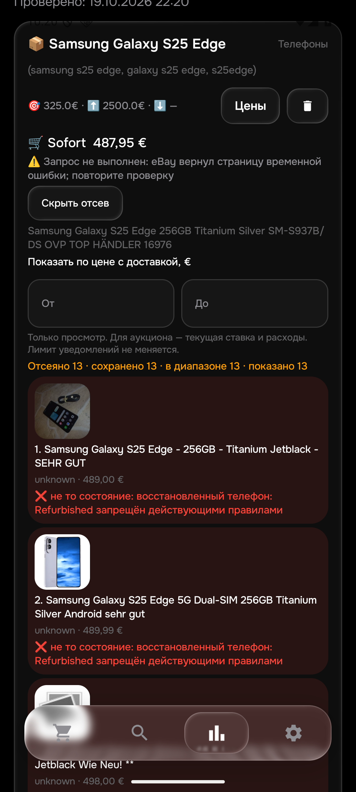
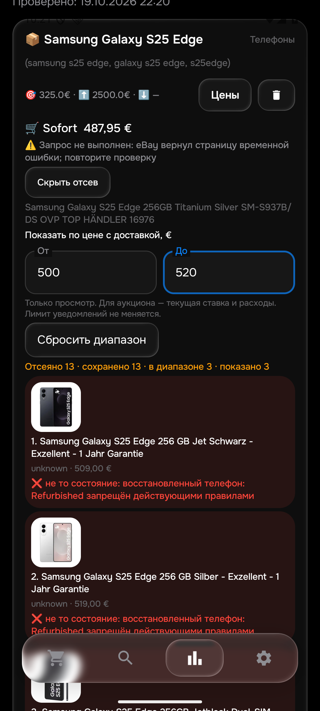

# Проверенный этап 0.122

Ложный отказ целого S25 Edge с чехлом исправлен в Python; отрицание перечисленных дефектов дисплея исправлено в обоих языках. До исправления ручной набор совпадал с Python в 38/40, с Kotlin в 39/40; после — 40/40 в обоих. Настоящий дефект после «aber», в следующем предложении, вздутие аккумулятора и обмен без продажи продолжают исключаться. Чехол для телефона и чехол с защитным стеклом не превращаются в телефон. Первая полная проверка выявила регрессию старого RedMagic case-теста; ограничение проверено и исправлено, ожидание старого теста сохранено.

Также включены локальные исправления 0.120/0.121: кэш HTML учитывает действительный URL, вычисленный нижний порог и модель; редактор цен старого отчёта открывает текущие условия и сохраняет только изменённые поля. В QA воспроизведено 310 → 320: старый редактор предлагал 310; новый показал 320, после чего через интерфейс восстановлены 310. Разные нижние/верхние пороги и выключенные варианты сохраняются, неверные числа не стирают значения.

Проверки: 471 изолированный Python-тест, 386 JVM-тестов, сборка APK и 16 настоящих Android-тестов на emulator-5580 прошли. Новый случай проверен и на ART. Тот же подготовленный ввод 40 S25 Edge, прежние 33 описания и 3 Pixel-аукциона прошли оба языка; исходные 3970 примеров сохранены. Эти проверки не заменяют независимую ручную приёмку всего каталога.

При смене внешнего набора Gradle первоначально переиспользовал предыдущий результат. Исправлен учёт пути и содержимого набора в зависимостях тестовой задачи; Pixel-набор повторно действительно выполнен, SHA проверен по XML. Это исправление проверочной инфраструктуры, не результат живого eBay-запроса.

Установлена 0.122/code122, правила 1792447959, история 29. SHA APK `1ff5a86860e80462a1998b85fe08b44663acfb99f0cd426f50466e70716f6c2b`. Все 50 QA-поисков / 48 активных и все столбцы совпадают до установки и после 16 Android-тестов. Уведомления, worker и синхронизация QA отключены; QA не переносится на сервер. Физический телефон не использован. Старая ошибка 404 в изолированном qa-local не характеризует рабочий сервер.

Код опубликован; живой прогон и серверное применение описаны ниже. Новых Telegram-сообщений в этом этапе нет; старые сообщения не повторять.

Ручной набор описан в [S25_EDGE_BROWSER_122.md](S25_EDGE_BROWSER_122.md). Общая приёмка 26 товаров / 104 корзин, все алиасы и минимумы, реальная доставка до 15 минут, успешные Android-аукционы и сценарии сети остаются незавершёнными. HTML основной, API — резерв; HTML также может возвращать ошибки и капчи, безлимитная доступность не обещается.

## Живой прогон на эмуляторе

Проверка одного S25 Edge через карточку «Поиски» завершена за 130,288 с. Получены Sofort 487,95 € (237132276755), Sofort+ 499 € (168789962802), Auktion 282,19 € с доставкой (840030862522); Auktion+ не подтверждён. Одна ошибка дополнительного запроса eBay сохранена во всех корзинах, поэтому цены являются проверенными кандидатами неполной выдачи, а не доказанными минимумами. Текущая ставка аукциона не смешана с ценой покупки.

Лот 168789962802 с отрицанием дефектов дисплея теперь реально включён живым Android, а не только подготовленным тестом. Его собственное описание получено отдельно через iframe. У более дешёвого аукциона 168801151829 загрузка собственной страницы не завершилась за 6000 мс; его пригодность Android не подтвердил. Поэтому минимум Auktion не принят. В этом запросе WebView действительно получил 5 аукционов; ошибки HTML и полнота описаний остаются предметом следующей работы.

В отсеянных объявлениях визуально видны фотографии и причины. Диапазон 500–520 € изменил показ с 13 до 3 записей (509/519/520 €); сброс вернул 13. Лимит уведомления сохранился 325 €. Все 50 строк поиска остались побайтно равны по значениям полей. После принудительного закрытия/обычного запуска сохранённый отчёт не изменился (SHA совпал).

## Публикация и ограничения проверки

Код сохранён в обоих исходных репозиториях и дорожных ветках: [bot](https://github.com/GitGayHub/e-monitor/commit/2204e9a48dc9a569d9089b19f4cf15a24d1f75ba); [bot-cloud](https://github.com/GitGayHub/e-monitor/commit/1fbd91cb043b3f93e511f65beed18f3c5362e732); [android](https://github.com/GitGayHub/e-monitor-android/commit/4ee3b334d8a8e4b94fee4614f9b92261bfc11bbf); [android-cloud](https://github.com/GitGayHub/e-monitor-android/commit/1fdcb8891ff3fc20a4f2c907c48aa5df4cae809a). Cloud check/apply: 0 изменений, 0 конфликтов; backup20261019T222210299293Z. После checkpoint прошли 21 изолированная Python-проверка, 7 целевых JVM-проверок и assembleDebug без изменения SHA установленного APK.

Применение новых правил сервером пока НЕ подтверждено: рабочий проход ещё использовал прежние правила. Metadata 0.122 не считается подтверждением исполнения. Runtime-срез хранится в RUNTIME_122.json. Охват за 15 минут — показатель частоты обхода, не задержка конкретного объявления до доставки.

Три GitHub CI-запуска не получили runner из-за ограничения оплаты/расходов аккаунта; тесты там не запускались. Локальные результаты указаны отдельно. Ссылки: [Cloud emulator - stats inspector](https://github.com/GitGayHub/e-monitor-android/actions/runs/39334137067), [Cloud readiness - both repositories](https://github.com/GitGayHub/e-monitor-android/actions/runs/39334137061), [Cloud readiness - both repositories](https://github.com/GitGayHub/e-monitor-android/actions/runs/39334030795). Повторно не запускали, оплату не меняли.
