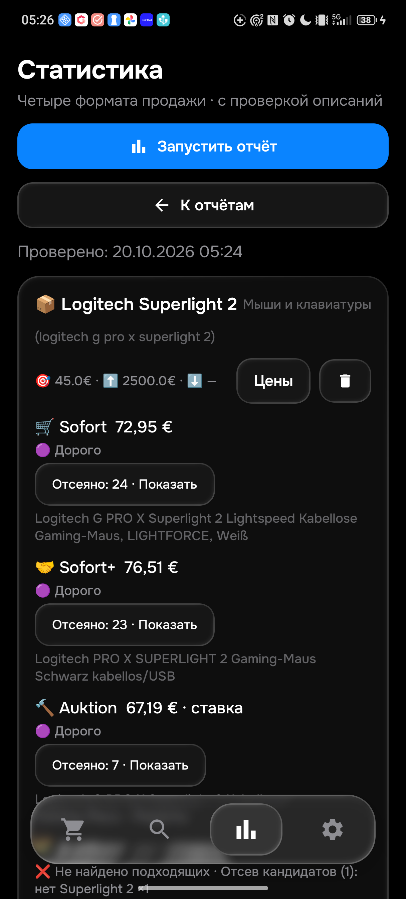

# Проверка 0.125: накладки вместо мыши и настоящий телефон

В Telegram на ПК в фоне прочитано настоящее сообщение120104/APK0.122 о [318888171957](https://www.ebay.de/itm/318888171957). Полное собственное описание независимо прочитано в Chrome: продаются декоративные накладки гарнитуры. Ошибочные характеристики «Gaming Mouse» не подтверждают наличие мыши. Это подтверждает транспорт конкретного сообщения, но не правильность отбора и не задержку объявления до Telegram. Новые сообщения не отправлялись.

Обе реализации теперь проверяют такие накладки в названии и полном описании. Целая мышь или гарнитура с поставляемыми аксессуарами остаётся допустимой. `Werktags`, отрицания и комплект проверены отдельно. Android показывает причину «аксессуар: декоративные накладки в описании» и цитату продавца. Дополнительный регрессионный случай выявил пропуск прямого «Mouse is broken»; утверждение неисправности теперь исключается, отрицание и условие гарантии сохраняются. Лимиты и баны не менялись. История повышена до31 в обоих языках.

До исправления: Python2метода/28отказов subtest и Kotlin2метода/2отказа на первоначальных12случаях. Итоговый набор расширен до18случаев и четырёх форматов; нельзя приписывать baseline итоговому18-caseнабору. Ранний полный запуск изменялся вместе с fixture и не используется как финальное доказательство. Финальный замороженный прогон: **474Python PASS81,709с;391JVM PASS;сборка PASS52с;21Android PASS62,214с**. Подготовленные34одинаковых полных входа прошли оба языка, включая33прежних без изменений. Исходные3970не менялись.

На установленной0.125 прямое реальное чтение318888171957 дало COMPLETE,443символа нормализованного собственного текста и правильный отказ как аксессуару. Собственный текст совпал с Chrome. Фактический JSON Android отдельно прошёл Python/Kotlin; SHA`ffcf9bdac8474d3b0342b0f33e88f6d6afaf727da0e1737e5fcfdf8c9f0b4389`. Это прямая диагностика, не обычное обнаружение, минимум или доставка. В ней найдено отдельное открытое расхождение: доставка14,35€ у парсера против приблизительных14,42€ на сайте. Согласование цены этим тестом не доказано.

APK0.125/code125/rules1792452137/History31/SHA`3eb6bd3a3d866367b7a1fae4ee1f5b3e3fc85139242cf742e3d7c2a318e1fb55` установлен сначала на эмулятор, затем на физический телефон поверх0.108 без сброса. Сохранены все столбцы всех50поисков,48активных, ce6, действующие лимиты. QAпрофиль эмулятора50/48/notify0/workerfalse/autosyncfalse/59a71baf не переносился на телефон или сервер. После зависания ввода и появления настоящего offline восстановлен канал прежним официальнымADB37.0.1/NATIVE с теми же ключами; после ограниченного таймаута enumeration восстановилась. Кабель переподключать не просили, драйверы/настройки защиты не меняли. `cmd input` после восстановления действительно открыл «Поиски».

Через настоящее приложение телефона запущен один Superlight2, четыре корзины,77,491с. Результаты: Sofort72,95€;Sofort+76,51€;Auktion67,19€;Auktion+отсев одного кандидата первого поколения. Три фактическихJSONкэша записаны внутри этого прогона: SHA55f70627e272246da9177cb6e4a54dbdf22b5d468a14557d5ad4c8eba730a94e. Отсутствие сетевой ошибки не доказывает полноту алиасов или глобальный минимум.

|Корзина|Независимая проверка сайта|Вывод|
|---|---|---|
|Sofort|[366717729242](https://www.ebay.de/itm/366717729242),72,95€+0, own MPN910-007555|Подтверждённая новая ошибка: это SE, а не стандартная2; название не содержит SE. [Logitech](https://www.logitechg.com/en-gb/shop/p/pro-x-superlight-2-se.910-007555) подтверждает модель. Исправить следующей версией.|
|Sofort+|[366640211196](https://www.ebay.de/itm/366640211196),70,32€+6,19€|Стандартная2, full own только название, без дополнительных заявлений о состоянии. Дороже45€.|
|Auktion|[168799119063](https://www.ebay.de/itm/168799119063),61€+6,19€|Целая2 с установленными и запасными skates; own заявляет исправность. Это ставка, не цена покупки. Дороже45€.|
|Auktion+|[960079740179](https://www.ebay.de/itm/960079740179),16€+2,90€|Целая мышь первого поколения с skates; правильный отказ по поколению, не аксессуар и не ошибка запроса.|

Это4независимых собственных описания плюс отдельный ранее прочитанный318888171957; не40–50лотов и не полный каталог. У сохранённого2C-поиска rawquery равен стандартной2, компактность задана includeWords[2c,2 c,compact]; текущие подписи выглядят одинаково. Следом проверить передачу этого намерения в запрос/фильтры/UI без изменения пользовательских настроек.

Код опубликован: [bot](https://github.com/GitGayHub/e-monitor/commit/e754385544effea4bd56b9f0377505179258f8f0), [bot-cloud](https://github.com/GitGayHub/e-monitor/commit/bb295b9198dbd408c8a97862f835463f4cf19955), [android](https://github.com/GitGayHub/e-monitor-android/commit/7e1a3560d639d23a3fb2343d235db7995b287e99), [android-cloud](https://github.com/GitGayHub/e-monitor-android/commit/213883232b0d5f8c53181b94bd77752e1fce76bf).

Сервер применил правила1792452137 в2026-10-20T13:40:07+00:00; fullfingerprint/ce6/normal50/48/LG430 проверены. Охват и ошибки — RUNTIME_125.json; охват попыток не равен задержке доставки.

Общая приёмка остаётся PARTIAL:26товаров/104корзины, все алиасы, минимумы,40–50уникальных полных описаний либо весь доступный каталог,CRUD/сеть/синхронизация/реальная доставка≤15мин не завершены. Последний отдельно прочитанный runtime12420Oct03:17UTC:24запроса/0полностьюзагруженных/65карточек/0описаний/0уведомлений;48попытокза15мин не являются здоровой выдачей. Доступность серверногоHTML требует отдельного исправления; APIостаётся резервом. CI125: три запуска не получилиrunner из-за billing/spending limit. Это не выполненные тесты и не зелёныйCI. Не повторять и не менять оплату. См.CI_125.json.
