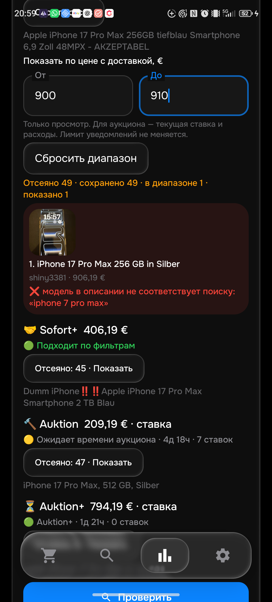

# Проверка 0.129 — 20 октября 2026

Общая приёмка остаётся **частичной**. Проверить все 26 активных товаров / 104 корзины и подтвердить настоящую доставку за 15 минут ещё предстоит. С отключённым профилем 2C сохранено 27 товарных профилей / 108 корзин.

Исправлено противоречие собственной модели телефона: лот [147637622122](https://www.ebay.de/itm/147637622122) озаглавлен как 17 Pro Max, но описание начинается «iPhone 7 Pro Max 256 GB». Полное описание повторно прочитано в Chrome в 15:24:41 UTC: 854 знака, противоречие осталось. Цена на странице 900 € + 6,19 €. Физическую модель аппарата это не доказывает; запрет по ID или продавцу не добавлен.

Python и Kotlin проверяют собственные утверждения о продаваемой модели, включая обозначения производителя. Сравнения с предыдущим телефоном, аксессуары для другой модели, примеры и отрицание другой модели с указанием правильной сохраняют контекст. Отказ приложения показывает модель и цитату из описания, а не «сломано». История цен обновлена до структуры 35 в обеих реализациях: прежние агрегаты не подтверждают скидку по новым правилам.

## Проверки

- 483 изолированных Python-теста PASS; 399 JVM-тестов и сборка PASS.
- 28 проверок внутри Android на эмуляторе PASS. Из них новые 29 общих примеров × четыре формата и путь HTTP → собственное описание → причина/точная цитата. Старые 3970 примеров не редактировались.
- Неизменный набор восьми входов: пять прежних фактических captures и три подготовленных по независимому чтению сайта. Оба языка теперь 8/8; на 0.128 оба принимали ошибочный iPhone (7/8). Это проверка этих входов, не полнота каталога и не восстановление raw-данных исторической отправки.
- Первое интеграционное синтетическое описание имело меньше 80 байт. Тест корректно получил недоступность описания; добавлена обычная HTML-оболочка fixture. Рабочий порог получения описаний не ослаблен. Прямой исходный baseline противоречия сохранён отдельно.
- APK 0.129 установлен на эмулятор и, после нового разрешения пользователя, на физический телефон. Все столбцы всех 50 телефонных поисков и ревизия ce6d8944 сохранены. На телефоне проверяется только eMonitor; Telegram на телефоне не открывался.

## Ограничения и следующие проверки

HTML остаётся основным источником, API — резервом при доступной квоте. Ошибки / SORRY / капчи не означают «нет результатов». Полная независимая выборка по 40–50 собственных описаний либо всему доступному ассортименту для каждого товара, алиасы, минимумы, CRUD/сеть/синхронизация и правильная фактическая доставка ещё не приняты. Упоминание продавцом минимума 950 € при карточке 900 € — отдельная проблема условий продажи, этой проверкой модели не решена. Не добавлен общий запрет обычного самовывоза или платежей.

Обычный прогон одного iPhone 17 Pro Max на телефоне запущен через «Поиски»; его результат следует фиксировать отдельно от unit-тестов. Новых тестовых Telegram-сообщений на этом этапе не отправлялось. Последующие подтверждения сервера, состояние CI и живой прогон записываются отдельными JSON.

## Реальный телефонный прогон

Один выбранный iPhone 17 Pro Max, четыре корзины, завершён через обычный интерфейс за **243,299 секунды** (report1792522692359). Sofort1049€ /920013137592; Sofort+406,19€ /237133957801; Auktion209,19€ /206634225427 (ожидает времени); Auktion+794,19€ /198717501299. Эти значения — наблюдения приложения, **не доказанные независимые минимумы**.

Ошибочный147637622122 действительно отсеян в обычном прогоне с причиной модели. Вручную проверен диапазон просмотра900–910€: из49сохранённых отказов показан1, с настоящей миниатюрой. Затем диапазон сброшен. Все столбцы всех50поисков одинаковы до установки, после установки, после отчёта и после перезапуска приложения. Telegram на телефоне не открывался.

**Нерешённый случай:** [237133957801](https://www.ebay.de/itm/237133957801),400+6,19€. В Chrome собственное описание полностью прочитано20октября19:02:14UTC:54знака, повторяет неоднозначноеDumm/Dumbbвназвании, без подтверждения работы аппарата. В0.129 он принят. Фактическая модель/макет/подделка не установлены; корректным проверенным минимумом его не считать. Следующий шаг — обработка такой неопределённости с объяснимой причиной, не выдуманный бан продавца/ID.

## Публикация и применение

- [bot](https://github.com/GitGayHub/e-monitor/commit/627d8056510b224f895050b764f7c42fa93fda81)
- [bot-cloud](https://github.com/GitGayHub/e-monitor/commit/ccf5c99f97e32f1c9a39f53832f109e56c988c67)
- [android](https://github.com/GitGayHub/e-monitor-android/commit/b542da1f01552474c829fa7fb06ad6489e6e8628)
- [android-cloud](https://github.com/GitGayHub/e-monitor-android/commit/1f8cb50f4f68d7575c284e13cb83935c897b5dd7)

На срезе 2026-10-20T19:00:22+00:00 сервер ещё сообщает правила0.128/rules1792506986. **Применение129 пока НЕ подтверждено**. Существующий рабочий прогон не отменяли и не перезапускали; ждать естественного запуска опубликованного кода, затем повторить strict fingerprint/revision/normal50/48/LG430проверку.

Три проверки GitHub Actions не стартовали из-за billing/spending:39479242212,39479241926,39479129525. Это не результат выполнения тестов. Оплата и повторный запуск не выполнялись. Локальные проверки выше прошли.

## Последующее подтверждение сервера

В 2026-10-20T20:24:36+00:00 сервер подтвердил rules1792509816/0.129 и полный fingerprint настройки ce6/normal50/48/LG430. Предыдущая пометка «ожидается» относится к более раннему срезу. Cloud check/apply0файлов/0конфликтов; после него5Python/4JVM+buildPASS,APKнеизменен. Общая приёмка остаётсяPARTIAL.
