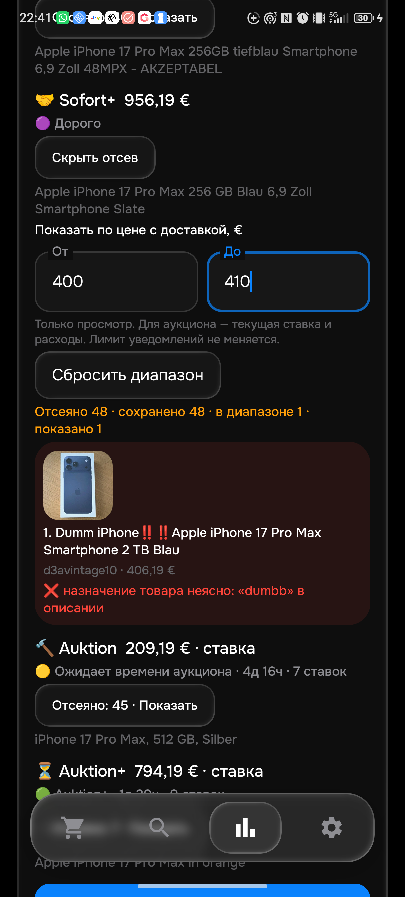

# Проверка 0.130 — 20 октября 2026

Общая приёмка **PARTIAL**:26активныхтоваров/104корзины;27сохранённыхпрофилей/108сотключённой2C. Проверки всех алиасов/минимумов,40–50полныхсобственныхописанийлибофактическидоступногокаталоганатовар,CRUD/сеть/синхронизацияиправильнаяреальнаядоставка≤15минещёнезавершены.

## Исправление

[237133957801](https://www.ebay.de/itm/237133957801) на129 попал в Sofort+ как подходящий за400+6,19€. Собственное описание прочитано Chrome полностью20октября19:02:14UTC:54знака, лишь повторяет неоднозначноеDumm/Dumbbназвание. Это **не доказательство подделки или фактической неработоспособности**.

130 сохраняет такую неоднозначность как отказ положительной верификации: «назначение товара неясно», с точным словом из собственного описания. Правило ограничено начальной собственной формулировкой продажи. Никакого общего поиска похожих опечаток, бана продавца/ID или вывода по низкой цене не добавлено. ОтрицаниеDummy, исправленная формулировка, прежняя фотобутафория и никнейм сохраняют контекст. Неподтверждённый предмет не поступает в verified notification callback и ценовую медиану.

History36вPythonиKotlin. Проверенные агрегаты35 не подтверждают скидку по новым правилам.

## Выполнено

- До исправления воспроизведены21отказPythonпроверок(20форматныхслучаев+callback) и2падающихJVMметода; исходные ожидания не подгонялись.
- 485Python PASS92,531с;401JVM+сборка PASS1м26с.
- **2новыхпроверкиAndroidнафизическомтелефоне PASS8,636с**:12общихслучаев×4формата иHTTP→собственноеописание→причина/точнаяцитата. Не заявлены30актуальныхARTтестов:эмуляторсейчаснеработает;28предыдущихпроверокотносятсяк129.
- Тот же набор из9входов Python/Kotlin9/9:5прежнихфактическихcaptures+4подготовленныхпонезависимомучтениюсайта. SHA975309abba6f8c7f15c4845905f43cac4b44930a667527ad72cf5804d1b930d3. Это не новый независимый каталог и не подтверждение реальной доставки.
- Телефон обновлён до0.130/code130,APK SHA0331cd42336ae61d558f6a4cffa58a7f83402e864bfe0109f53f9172a0b1ed9e,rules1792528491. Все столбцы всех50поисков сохранены. Telegram на телефоне не открывался.

Обычный телефонный прогон завершён: 245732мс. Dumm/Dumbb действительно отсеян с отдельной причиной;147637622122 также остаётся отсеянным. Сохранены все50поисков. Остальные результаты вLIVE_130.json; глобальные минимумы не доказаны.

## Публикация и сервер

- [bot](https://github.com/GitGayHub/e-monitor/commit/49a33b00c1fb50700aa4a445c91c98ded229b816)
- [bot-cloud](https://github.com/GitGayHub/e-monitor/commit/b12e92ccfa734893fcb565d74386d7c7758753ef)
- [android](https://github.com/GitGayHub/e-monitor-android/commit/9ab6c0d41825eff8649da31c1ade3daa86452122)
- [android-cloud](https://github.com/GitGayHub/e-monitor-android/commit/2ef369ccfd62222012d3655ea0d79c31f3eadc45)

Применение130 сервером подтверждено в 2026-10-20T20:50:46+00:00;rules1792528491,полный fingerprint/revisionce6/normal50/48/LG430. Режимnormal,50сохранённых/48включённых,ревизияce6d8944-34df-441a-8cd5-483e0b5a9542,LG430,получатель/seen/bansсохранены. Живой монитор не отменять ради применения версии.

HTMLосновной/APIрезервприживойквоте. ОшибкиHTMLнеявляютсяNoResults,полнотадоступностиинеобходимаяскоростьпоканедоказаны. Цена950вownдругого147637622122противкарточки900—отдельныйнепроверенныйценовойконтракт. Небанитьобычныйсамовывоз/оплату без решенияпользователя. CIbillingнеоплачивать/неrerun.

## Начата независимая проверка Samsung OLED G6 500Hz

В настоящем Chrome выбран Worldwide, доставка09648, проданные/завершённые объявления. Основной запрос дал3точныхрезультата и60карточек вместе с «меньше поисковых слов». Эти60карточек **не равны60провереннымтоварам**.

Полностью прочитано одно дополнительное собственное описание [407216707533](https://www.ebay.de/itm/407216707533),199знаков, через«Originalangebot ansehen»: продавец описывает OLED G6 QHD500Hz27дюймов с коробкой и хорошим состоянием; собственные характеристики OLED/2560×1440/27дюймов. Это проданный Sofort+ с принятым предложением: показано350€+10,49€, фактическая согласованная цена не раскрыта. Не использовать её как подтверждённую цену сделки.

Python/Kotlin одинаково отклоняют завершённый лот для текущего уведомления. В отдельном синтетическом контроле убран только признак завершения, чтобы проверить распознавание модели и назначения по тому же собственному тексту: оба принимают модель. Общий дополнительныйreplay11входов/10уникальныхID,включает2контроляодногоновогоID;это не11новыхлотов. MONITOR_130.json. Независимый каталог ещё не завершён. На телефоне через «Поиски» запущены четыре текущие корзины только этого монитора.

## Текущие четыре корзины Samsung на телефоне

Прогон130 завершён за77.213с: Sofort469,95€,Sofort+523,99€—оба«Дорого»прилимите400€. Auktion/Auktion+сохранилиошибкучтениявыдачи;необъявленыуспешнымпустымрезультатом. Все50строк/всестолбцынастроексохранены. LIVE_MONITOR_130.json.

ВChromeглавныймировойаукционныйзапрос20октября20:54:49UTCпоказал«0 Ergebnisse»и«Keine exakten Treffer gefunden». УAPKeщё2другихалиаса:ихисходныеответынеполучены. Нельзяутверждать,чтовсеониуспешны,илислепозаменятьошибкунаNoResults. Следующийшаг—сохранитьреальныеURL/ответ/типошибкикаждогоизтрёхAPKзапросовисравнитьсChrome. Causeнеустановлена;этооткрытаяприёмочнаяпроблема.

## Конечное подтверждение130

Применение130 сервером подтверждено в 2026-10-20T20:50:46+00:00;rules1792528491,полный fingerprint/revisionce6/normal50/48/LG430. Предыдущая пометка ожидания относится к раннему срезу. Прогон20:44:40–20:50:46UTC:21поискзапрошен/13полностьюзагружены/1452карточки/22описания/0подтверждённыхуведомлений.42из48попытокв15мин,самаядавняя1447с:это **не доказательство доставки≤15мин**,естьнедоступныепоиски.

Код сохранён в обоих исходных и дорожных репозиториях:

- [bot](https://github.com/GitGayHub/e-monitor/commit/49a33b00c1fb50700aa4a445c91c98ded229b816)
- [bot-cloud](https://github.com/GitGayHub/e-monitor/commit/b12e92ccfa734893fcb565d74386d7c7758753ef)
- [android](https://github.com/GitGayHub/e-monitor-android/commit/9ab6c0d41825eff8649da31c1ade3daa86452122)
- [android-cloud](https://github.com/GitGayHub/e-monitor-android/commit/2ef369ccfd62222012d3655ea0d79c31f3eadc45)

Три CI130не начали выполнение из-заbilling/spending:39494674495,39494674454,39494267540. Не оплачено,повторноне запущено. Сами локальные проверки выше прошли.

