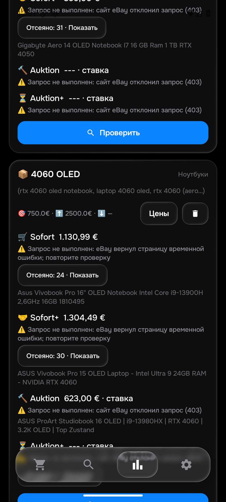

# eMonitor0.133: реальные ошибки ноутбуков — 21 октября2026

Общая приёмка **PARTIAL**:26активныхтоваров/104корзины. В этом этапе независимо прочитаны8 новых полных описаний, из них7 текущих и1 проданный лот. Это не40–50на каждый товар и не весь каталог.

## Подтверждённые ошибки и исправления

1. **ASUS с RTX4050 попадает в4060 OLED.** В [206416001145](https://www.ebay.de/itm/206416001145) собственный технический список указывает RTX4050, ниже общая реклама серии упоминает доRTX4060. На живом GUI132 этот ASUS показан вSofort4060 за1130.99€. Python тоже ошибочно принимает его для4060. Исправлены распознавание GPUmodelполя без двоеточия и слишком широкий захват80символов, куда попадало следующее рекламное значение. Техническая видеокарта не подменяется маркетингом. Подходящий4050 остаётся4050,4060отклоняется.
2. **Непроверенная батарея считается исправной.** Полное собственное описание [Dell377583163555](https://www.ebay.de/itm/377583163555) подтверждает OLED/4050, но прямо говорит о непроверенном удержании заряда. Обе реализации принимали его. Теперь явное утверждение продавца об отсутствии проверки аккумулятора у ноутбука отклоняется с отдельной причиной «аккумулятор не проверен продавцом». Отрицания, условные рекомендации и блоки других товаров не считаются таким утверждением. Ёмкость80% сама по себе не отказ.

Оба исправления меняют отбор: History38 вPython иKotlin исключает старые ошибочные агрегаты из подтверждённой текущей медианы.

## Доказательства

- Python:489тестов PASS. Android:405JVMтестов и обе сборки PASS. Старые3970примеров сохранены; совпадение языков не заменяет ручную оценку.
-16GPUпримеров и12проверок батареи в каждом из4форматов. GPUbaseline:Python40отказов/JVMFAIL; послефиксаPASS. Батарея:Python20отказов; реальный полныйDellошибочно принят обоими дофикса.
-12частных входов/7уникальных реальныхID:Python12/12,Kotlin12/12. SHA256 `4b82fedb925ed9903efdc3cdf09940a9dc0f92facb8aeef04342c11d1761acbc`.8йAcerпрочитан как завершённый контроль, в12входов не включён. ПолныеownHTML остаются частными.
-На обычном запросе4050OLED было3точныхSofortрезультата,0точныхактивныхаукционов и1точныйпроданныйаукцион. Рекомендации ниже выдачи не являются точными совпадениями; подходящие по фактическим характеристикам дополнительные лоты проверены отдельно.
-[ASUS940023024856](https://www.ebay.de/itm/940023024856) независимо подтверждён как4060OLEDбез заявленного дефекта:618€ставка+5€доставка. Это623€текущей ставки, не цена покупки и не основание для Sofortмедианы.
-LenovoизВеликобритании:GBP1120+4.50;EURввыдаче приблизительны,импортнеизвестен. ПроданныйAcer:ценаGBP454.22показана,фактическийрасчётсделкинеподтверждён. Ниоднаизэтихоценокнеобъявленаподтверждённойевропокупнойценой.

| Лот | Товар | Статус |
|---|---|---|
| [137739595703](https://www.ebay.de/itm/137739595703) | Gigabyte Aero 14 OLED Notebook I7 16 GB Ram 1 TB RTX 4050 | текущий лот |
| [206617260836](https://www.ebay.de/itm/206617260836) | Lenovo Yoga Pro 7 14IMH9 Ultra 7 155H RTX 4050 16GB RAM 1TB SSD OLED Laptop- | текущий лот |
| [336845270491](https://www.ebay.de/itm/336845270491) | HP OmniBook 7 AI 16-ay0790ng, Ultra 7 255H, 32GB/2TB, 16" 2K OLED Touch, RTX4050 | текущий лот |
| [206416001145](https://www.ebay.de/itm/206416001145) | Asus Vivobook Pro 16" OLED Notebook Intel Core i9-13900H 2,6GHz 16GB 1810495 | текущий лот |
| [800784388428](https://www.ebay.de/itm/800784388428) | MSI Cyborg 15 A13VE i5-13420H 16GB 512GB SSD RTX 4050 6GB Gaming Laptop Notebook | текущий лот |
| [377583163555](https://www.ebay.de/itm/377583163555) | Dell XPS 14 9440 Intel Core Ultra 7 155H 1,40GHz 32GB 512GB SSD RTX 4050 (V6523)- | ставка, не покупная цена |
| [940023024856](https://www.ebay.de/itm/940023024856) | ASUS ProArt Studiobook 16 OLED | i9-13980HX | RTX 4060 | 3.2K OLED | Top Zustand | ставка, не покупная цена |
| [407107907200](https://www.ebay.de/itm/407107907200) | Acer Swift X 14 OLED 14.5 i7-13700H RTX4050 16GB 1TB | продан / недоступен |

## Установки и незавершённая приёмка

APK133собран,SHA256`bbf0a1a21d93bef4868a5ce618c7dbfa685bef38dceff73dd49007eb6c014128`. Правила1792543635/History38. Наэмулятореустановлена0.132;native133:0подтверждённыхметодов. Физическийтелефонпоследнийразпроверенна131;сейчасотсутствуетвADB/PresentOnlyPnP,серверADBнеперезапускался.

ОригинальныйобщийGUIпрогон132:последнийснимок15/26,завершён=False. В4050/4060естьHTTP403/временныеошибки.1130.99/899/1304.49/623€приэтихошибках—частичныекандидаты,недоказанныеминимумы. Неперезапускатьработающийпрогондляустановки133. Послеокончаниясохранитьвесьновый26/104отчёт,сверитьвсе50строкQAдо/послеизатемустановить133/выполнитьnativeиобычнуюGUIперепроверку.

QA50/48notify0,workerfalse/autosyncfalse,qa-local/isolated; несинкатьвproduction. Productionnormal/50/48/ce6d8944-34df-441a-8cd5-483e0b5a9542/LG430/recipient/seen/bansсохранить. Подтверждениеприменения133сервером:False. НовыхTelegramтестов/визуальнойдоставкинет:окноAyuGramсейчаспоказываетдругойчат,ПКнеактивировался. Скорость≤15миннеподтверждена.

Следом:полныйотчёт26/104,каждаяпустая/ошибочнаякорзина,независимыйостальнойкаталог,всеалиасы,CRUD/сеть/синхронизация/цена→применение→реальноеуведомление. Необъявлятьобщуюцельзавершённой.

## Публикация

Публикация ещё не выполнена.
