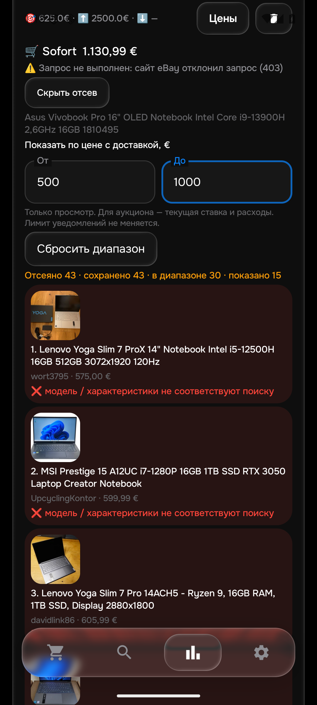
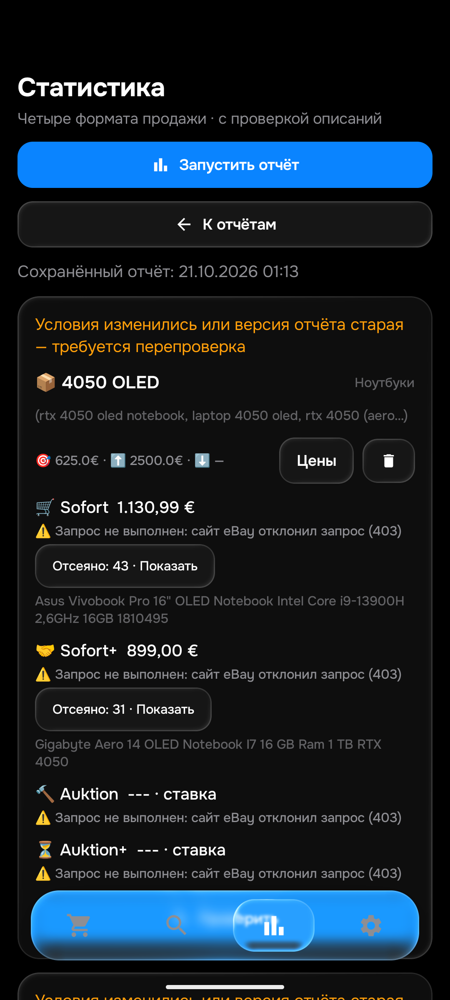

# eMonitor 0.133: проверка 21 октября 2026

Общая приёмка **не завершена**. Исправлены две ошибки, подтверждённые независимым чтением eBay. Рабочий сервер и эмулятор обновлены до 0.133. Физический телефон в этом этапе не доступен; последняя подтверждённая установленная на нём версия — 0.131.

## Что исправлено

**RTX 4050 ошибочно попадает в поиск RTX 4060.** В [ASUS 206416001145](https://www.ebay.de/itm/206416001145) технический список конкретного устройства указывает RTX 4050. Ниже реклама серии говорит «до RTX 4060». Python и Android принимали его для обоих поисков; в настоящем общем отчёте 0.132 он показан в Sofort 4060 за 1130,99 €. Теперь явно указанная видеокарта не подменяется соседним рекламным текстом. Распознаётся техническое поле без двоеточия; первое непосредственное GPU-значение не захватывает последующую рекламу. Этот ASUS остаётся 4050 и отклоняется для 4060.

**Непроверенный аккумулятор принимается за подтверждённо исправный.** У [Dell 377583163555](https://www.ebay.de/itm/377583163555) полное описание подтверждает OLED/4050, но продавец прямо указывает отсутствие проверки удержания заряда. Обе реализации принимали лот. Теперь у ноутбука появляется отдельная причина «аккумулятор не проверен продавцом». Неизвестная поломка не объявляется доказанной. Отрицания, условные рекомендации и описания других товаров не считаются таким утверждением; ёмкость 80% сама по себе не отказ.

Оба изменения влияют на отбор, поэтому версия истории повышена до **38** в Python и Kotlin. Старые ошибочные агрегаты не подтверждают текущую медиану.

## Проверки исправлений

- **489 Python-тестов, 405 JVM-тестов, сборки приложения и тестовой APK прошли.** Исходные 3970 примеров сохранены.
- 16 GPU-примеров и 12 примеров проверки батареи прогнаны в четырёх форматах продажи. До исправления: 40 ошибочных GPU-вердиктов и 20 вердиктов батареи в Python; JVM также воспроизвёл ошибки. После исправления проверки прошли.
- **11 методов непосредственно в Android на эмуляторе прошли:** два новых метода со 112 сочетаниями условий и формата плюс девять прежних проверок описаний, состояния и моделей. Это контролируемые данные; они не доказывают настоящую доставку Telegram.
- 12 частных входов по семи реальным ID прошли в обоих языках; SHA256 `4b82fedb925ed9903efdc3cdf09940a9dc0f92facb8aeef04342c11d1761acbc`. Расширенный Kotlin-контроль из 13 входов с исходным неверным монитором также прошёл; SHA256 `48aef0c8665a45fdb0d57a6fd3575e4c414d079ba965d4dd9ee2916b9f3f4b29`.

Полные описания сначала прочитаны в обычном Chrome, затем сохранены по известным публичным iframe и сверены с независимо прочитанными фрагментами. Raw HTML остаётся частным. Совпадение языков само по себе не считается доказательством правильности.

## Независимые объявления

В этом этапе прочитаны **8 новых описаний ноутбуков**: семь текущих и один проданный лот. Это не 40–50 на каждый товар и не весь каталог. Основной запрос 4050 OLED дал три точных Sofort-результата, ноль точных активных аукционов и один точный проданный аукцион. Рекомендации проверялись отдельно.

| Лот | Товар |
|---|---|
| [137739595703](https://www.ebay.de/itm/137739595703) | Gigabyte Aero 14 OLED Notebook I7 16 GB Ram 1 TB RTX 4050 |
| [206617260836](https://www.ebay.de/itm/206617260836) | Lenovo Yoga Pro 7 14IMH9 Ultra 7 155H RTX 4050 16GB RAM 1TB SSD OLED Laptop- |
| [336845270491](https://www.ebay.de/itm/336845270491) | HP OmniBook 7 AI 16-ay0790ng, Ultra 7 255H, 32GB/2TB, 16" 2K OLED Touch, RTX4050 |
| [206416001145](https://www.ebay.de/itm/206416001145) | Asus Vivobook Pro 16" OLED Notebook Intel Core i9-13900H 2,6GHz 16GB 1810495 |
| [800784388428](https://www.ebay.de/itm/800784388428) | MSI Cyborg 15 A13VE i5-13420H 16GB 512GB SSD RTX 4050 6GB Gaming Laptop Notebook |
| [377583163555](https://www.ebay.de/itm/377583163555) | Dell XPS 14 9440 Intel Core Ultra 7 155H 1,40GHz 32GB 512GB SSD RTX 4050 (V6523)- |
| [940023024856](https://www.ebay.de/itm/940023024856) | ASUS ProArt Studiobook 16 OLED / i9-13980HX / RTX 4060 / 3.2K OLED / Top Zustand |
| [407107907200](https://www.ebay.de/itm/407107907200) | Acer Swift X 14 OLED 14.5 i7-13700H RTX4050 16GB 1TB |

Дополнительно прочитан [Samsung 147486582559](https://www.ebay.de/itm/147486582559) из исходной жалобы: **350 Гц IPS / LS27FG602EUXEN**, а нужен 500 Гц OLED. Цена 160 + 10,99 €. Аппаратный дефект не заявлен: это отказ по модели. Python и Kotlin его отклоняют. В галерее восемь слотов, первая фотография реально загружена; это не отдельное подтверждение Telegram-медиа. С учётом прежних проверок прочитано 20 собственных описаний Samsung.

У правильного [ASUS 940023024856](https://www.ebay.de/itm/940023024856) подтверждены OLED/4060, отсутствие заявленного дефекта экрана и работоспособность органов управления. 618 € + 5 € — **текущая ставка и доставка**, не цена покупки. Британский Lenovo: GBP 1120 + 4,50; EUR приблизительны, импорт неизвестен. У проданного Acer показано GBP 454,22, фактический расчёт сделки независимо не подтверждён. Эти суммы не становятся подтверждённой покупной медианой.

## Общий живой прогон: важный незакрытый результат

Оригинальный GUI-прогон **0.132** завершён 21 октября в **01:13:35.703 UTC**, занял **56,81 минуты**, сохранил **26 товаров / 104 корзины**. Он полностью сохранён до установки 0.133.

**В 90 из 104 корзин есть ошибки получения: 34 HTTP 403 и 56 временных ошибок сайта.** Остальные: 10 «Дорого», три «все кандидаты отсеяны» и одна корзина без объявлений. Даже эти 14 корзин ещё не прошли полную независимую приёмку каталога. [Таблица всех товаров, корзин и ссылок](GLOBAL_132_FROM_133.md).

Цены рядом с ошибкой — частичные кандидаты, не доказанные минимумы. Количество обработанных строк не означает успешную проверку всех запросов. Nubia Z80 Ultra Leading в этом ответе получил ошибку сайта; его нельзя заменить реальным нулём из другого ответа браузера.

## Что проверено в интерфейсе 0.133

После сохранения отчёта установлена 0.133. Все столбцы всех 50 поисков совпали до установки, после Android-проверок и после проверки интерфейса.

- Номер APK отображается в «Обзоре»; новый сохранённый отчёт содержит 26 товаров и подпись 0.132.
- После обновления старый отчёт явно помечен как требующий перепроверки.
- В «Отсеяно» действительно загружаются фотографии.
- Диапазон **500–1000 €** показывает **30 из 43** сохранённых лотов — совпало с отдельным подсчётом JSON. Только нижняя граница 500 € даёт 39, сброс возвращает 43. Лимит уведомления остался 625 €, база поисков не изменилась.

Найден ещё не исправленный дефект интерфейса: клавиатура закрывает нижние поля цены, автоматической прокрутки к полю нет. При одной попытке координатный тап агента попал в клавиатуру и добавил цифру; ввод исправлен, затем тест повторён с проверкой фокуса и скрытием клавиатуры. Это не изменение пользовательских лимитов. Исправление видимости полей — следующий пункт.

## Версии, сервер и ограничения

APK **0.133 / code 133**, правила **1792543635**, History **38**. SHA256 APK: `bbf0a1a21d93bef4868a5ce618c7dbfa685bef38dceff73dd49007eb6c014128`.

Рабочий сервер строго подтвердил 0.133 в **01:04:29 UTC**: полная конфигурация, ревизия `ce6d8944-34df-441a-8cd5-483e0b5a9542`, normal, 50 сохранённых/48 активных поисков и LG 430 € совпали. Получатель, seen и баны не менялись. Последний подтверждённый здесь проход: 20 попыток, шесть полностью загруженных поисков, 1361 карточка, 22 описания, ноль подтверждённых отправок; состояние partial. В очереди того снимка 187 описаний iPhone 17 и 132 S25 Edge — это объём незавершённой проверки, не число подходящих объявлений.

**Доставка до 15 минут не доказана; новых тестовых сообщений или визуальных подтверждений Telegram в этом этапе нет.** ПК не активировался. Физический телефон не обновлён до 0.133: в отладке и текущих USB-устройствах его нет; сервер ADB не перезапускался. Эмулятор изолирован: 50/48, notify=0, worker и autosync выключены, ключей нет. Его HTTP 404/token missing для фиктивного QA-репозитория не характеризует рабочий сервер.

GitHub CI для этой публикации не получил runner из-за billing/spending: 39524398446, 39524398371, 39524355085. Оплата и повторный запуск не выполнялись; перечисленные успешные тесты запускались локально.

Следующие приоритеты: устранение воспроизведённых ошибок получения HTML и измерение очереди/повторов; свежая GUI-проверка 4060 на 0.133; исправление перекрытия полей клавиатурой; независимые объявления, алиасы и минимумы для остальных товаров; CRUD/сеть/синхронизация и настоящая доставка на обновлённой системе. HTML остаётся основным, API — резервом с доступной квотой. Проверка полного описания перед положительным результатом сохраняется.
