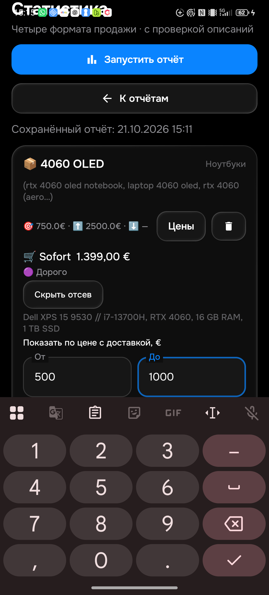
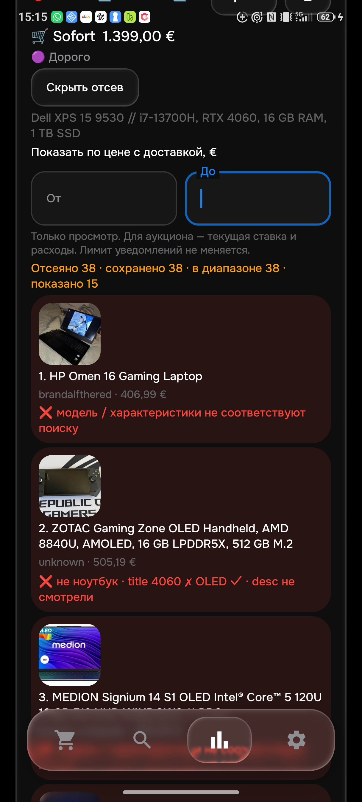
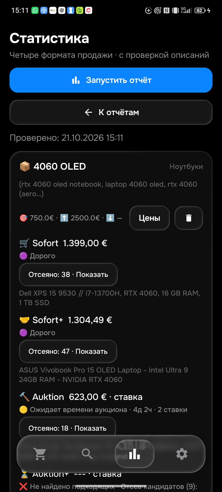

# Проверка на физическом телефоне — 21 октября 2026

Общая приёмка остаётся **PARTIAL**: 26 активных товаров / 104 корзины. Этот этап проверяет обновление телефона, одну живую группу и исправления 0.134; он не подтверждает весь каталог или доставку за 15 минут.

## Установка и сохранность данных

Телефон NX741J доступен через официальный WinGet ADB 37.0.1 с ADB_USB_LEGACY=1. Сервер ADB не перезапускался, кабель не переподключался. Последовательно установлены 0.133 и 0.134 с сохранением данных. Все 50 строк поисков совпали **по всем столбцам** до обновления, после установки, после native-проверок и после интерфейсной проверки. Ревизия ce6d8944-34df-441a-8cd5-483e0b5a9542, dirty=false, 48 активных поисков. Ray-Ban 225 €, LG 430 €, режим normal и получатель сохранены.

0.134 SHA256: `71432fcd0d543f6ac98281cb91b3a09105fd61f3fe362aa293e9d57a5227b571`. Правила 1792543635 / History38 сохранены: отбор, дефекты и цены не менялись. Изменены только размещение интерфейса и повторное получение уже запрошенной HTML-выдачи.

## Подтверждённые исправления 0.134

1. Содержимое учитывает высоту клавиатуры; нижняя навигация скрыта при вводе. На физическом телефоне в сохранённом отсеве проверены «От», переключение на «До», ввод 500–1000 €, закрытие клавиатуры и сброс диапазона. Оба поля полностью видны над клавиатурой. Показано 24 из 38 — совпало с независимым подсчётом JSON; сброс вернул 38. Лимит 750 € не изменился. Три фотографии фактически загрузились, URL фотографий есть у всех 38 сохранённых кандидатов. Превью добавления и отдельный мини-просмотрщик с клавиатурой ещё не проверены.
2. Первый HTML-план уже выполняет все варианты запроса отдельно для покупки и аукциона. Старый код затем повторял аукцион с тем же диапазоном. Теперь успешный HTML-результат хранит покрытые форматы и фактический нижний порог; одинаковый запрос не повторяется. Более широкий Sofort без автоматического порога, ошибка отдельного формата и смешанная/API-выдача сохраняют дополнительные запросы. Это не отключение описаний и не превращение ошибки в пустую выдачу. Ускорение в секундах на живой 0.134 пока не измерено.

## Живая группа RTX 4060 OLED — именно 0.133

Прогон завершился за 925244 мс (15:25), сохранён до обновления на 0.134. Это не новый прогон 0.134.

| Корзина | Полученный результат с доставкой | Проверка |
|---|---|---|
| Sofort | [Dell 1399 €](https://www.ebay.de/itm/407108230772), дорого | Собственное полное описание прочитано в Chrome: RTX4060, OLED в основной карточке, питание включено, косметический износ, аккумулятор >=51%; минимальный заряд владельцем не задан |
| Sofort+ | [ASUS 1304,49 €](https://www.ebay.de/itm/357207267549), дорого | Полное описание: RTX4060, OLED, питание с американской вилкой и адаптером, американская клавиатура, аппаратная неисправность не заявлена; Python/Kotlin принимают одинаковый ввод |
| Auktion | [ProArt 623 €](https://www.ebay.de/itm/940023024856), ставка, ожидает времени | Собственное описание независимо прочитано на предыдущем этапе; новая ставка 618 +5 €; это не цена покупки |
| Auktion+ | Не найдено подходящих; 9 отклонённых | Успешный запрос, причины отсева сохранены; это не ошибка соединения. Все алиасы и полный независимый каталог этой корзины ещё не приняты |

Ошибочный ASUS206416001145 с реальной RTX4050 теперь находится в отсеве Sofort с причиной несоответствия модели. Неправильный старый минимум 1130,99 € устранён в живом интерфейсе. Точный основной запрос в Chrome показал 4 покупки, далее рекомендации. Это не весь каталог всех алиасов. [Gigabyte 1634 €](https://www.ebay.de/itm/257624149520) имеет настоящую RTX4060/OLED, но продавец явно пишет о повреждении в центре дисплея; Python/Kotlin его отклоняют. Два новых ноутбука с одинаковыми полными описаниями проверены обоими языками; новый Dell вручную сопоставлен с фактическим результатом приложения.

## Настоящий Telegram

В фоне AyuGram прочитан текст реального сообщения **120120** для [iPhone820262335001](https://www.ebay.de/itm/820262335001), APK0.133 / правила1792543635. Подтверждённая серверная лента содержит тот же ID сообщения и 680 +6,19 =686,19 €, Auktion+, Hannover/DE. Полное собственное описание прочитано вручную в Chrome: iPhone17ProMax, аккумулятор98%, OVP, косметические следы на рамке, отсутствие трещин. Одинаковый ввод принят Python/Kotlin. Это подтверждает настоящую доставку и содержание **одного** уведомления 0.133.

От первого обнаружения сервером до подтверждения Telegram — 5,337 с. Время публикации объявления независимо не установлено: этот интервал **не доказывает доставку от публикации за 15 минут**. Новых тестовых сообщений этот этап не отправлял. Фоновый скриншот AyuGram вернул изображение перекрывающего Codex; он не используется как визуальное доказательство Telegram. Подтверждение клиента — прочитанный текст UIA, без активации окна ПК.

## Проверки и оставшиеся ограничения

409 JVM-методов, включая 4 новых проверки HTML-покрытия, и обе сборки прошли. Полный индекс результатов заморожен до последующих адресных replay. На физическом телефоне 11 ART-методов прошли отдельно на 0.133 и 0.134; только локальные контролируемые примеры, без production-синхронизации/отправок из тестов. Два метода диапазона цен прошли; дополнительный replay настоящего уведомления и двух новых ноутбуков прошёл. Python-код не менялся; прежние 489 проверок относятся к 0.133, новые собственные описания проверены отдельно.

HTML остаётся основным источником, API — резервом. Ошибки eBay ещё есть: последний полученный статус в интерфейсе не является успешной проверкой всех поисков. Старые 90/104 ошибок общего эмуляторного132-прогона не заменяются успехом одной телефонной группы. Впереди независимый каталог всех товаров/алиасов, разбор остальных пустых корзин и сбоев, CRUD/сеть/синхронизация, живое измерение 0.134 и доставка от публикации <=15 минут. Счёт/лимит GitHub CI ранее мешал запуску runner; зелёный CI нового HEAD не подтверждён.
