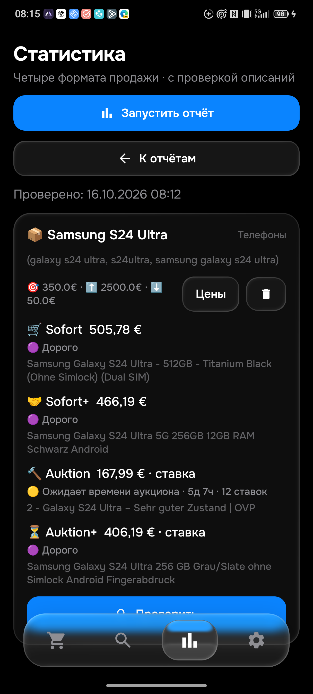

# S24 Ultra: независимая проверка и два пропуска — этап0.095

Состояние: **APK0.095/code95 установлена на физический телефон**, правила1792130642/History14 в обеих реализациях. Локальные проверки завершены; серверная публикация и runtime095 ещё ожидают подтверждения. Общая приёмка PARTIAL.

## Установка0.094

Владелец16октября повторно разрешил физический телефон. В05:49UTC APK094 установлен поверх093 без очистки. Все столбцы всех50 поисков до/после совпали; revisionce6d8944-34df-441a-8cd5-483e0b5a9542/dirtyfalse. Настоящий ввод названия и двух алиасов сохранил пробелы; черновик закрыт без сохранения,50 строк и ревизия неизменны. Сервер ACK старой рабочей конфигурации виден. Source CI094[38819072106](https://github.com/GitGayHub/e-monitor-android/actions/runs/38819072106) успешен. Road094 readiness38857589318 и emulator38857589325 завершились SUCCESS. Telegram наПК читался только в фоне: сейчас другой чат; новых помеченных тестов не отправляли и их визуальная доставка не заявляется.

## Независимая выдача

В05:52UTC Chrome открыл аукционы samsung s24 ultra: категория9355, мир, до2500€, доставкаDE/09648, сортировка по цене с доставкой. В заголовке36 точных результатов. В DOM121 настоящая карточка: первые36 точные, затем явный раздел результатов по меньшему числу слов. Остальные85 не считаются точными совпадениями. Рекомендации/отзывы не используются как собственное описание.

Физический094 запущен из карточки толькоS24; отчёт за114,874сек.,1товар/4корзины. Sofort505,78€(880020109702),Sofort+466,19€(298435287203),Auktion293,69€(168791585099),Auktion+406,19€(137839581581). Лимит350€,настройки не менялись.

## Подтверждённые расхождения

| ID | Сайт и собственный текст | APK094 | Исправление |
|---|---|---|---|
|[327399499743](https://www.ebay.de/itm/327399499743)|Ставка161+6,99=167,99€,5д7ч,12ставок;целый исправныйS24Ultra,OVP/кабель/S-Pen;характеристики12GB и модель со spaced«s24»;доставка есть,самовывоз необязателен|Отказ«нет Samsung»|Явное семейство GalaxyS24 подразумевает Samsung; поколение/Ultra,другие бренды,запчасти и полное описание всё ещё проверяются|
|[327399492289](https://www.ebay.de/itm/327399492289)|255+6,99=261,99€,аналогичный полный исправный телефон того же продавца|Отказ«нет Samsung»|То же правило|
|[257794983463](https://www.ebay.de/itm/257794983463)|278,77+6,19=284,96€;в собственном тексте полный исправный смартфон без царапин экрана/задней панели|Отказ«аксессуар/запчасть» из-за«Slate Design»|Названия формы Slate/Bar/CandyBar Design/Style Smartphone нейтрализуются только у модельного полного телефона с памятью;чехол/дисплей/сервис в остальном заголовке сохраняют отказ|

Новая логика бренда также покрывает Apple→iPhone,Google→Pixel и Samsung↔GalaxyS,только в телефонном запросе. Старые модели и модификации не становятся совпадениями. Собственные описания обязательны; отсутствие текста,дефект и коробка не превращаются в положительный результат. Это исправление предварительного отбора,не право отправить ранний аукцион.

17 общих JSONконтролей дляPython/Kotlin:три собственных браузерных случая,другие семейства,неверные поколения/модификации,чехол/запчасть/коробка,плохое/пустое собственное описание,завершённый лот;все четыре формата. Первые прогоны:376Python/346Android,по одному историческому несовпадению причины в обеих реализациях.398452900585 — старое sparseAPI«GalaxyS24Ultra» безSamsung,итого613,81€ при350€. В исходных3970 snapshots ничего не меняется:28-я отдельная reviewed correction меняет толькоfiltered→over_limit,accepted остаётсяfalse. Старое sparse описание не сертифицируется и не разрешает Telegram.

## Прочитанные дополнительные страницы

| ID | Наблюдение |
|---|---|
|267810561201|Гибрид:ставка165€,BuyNow480€,доставка6,19€;RAM8GB конфликтует сS24Ultra;при первом чтении iframe пуст,не считать полным описанием|
|960065298274|201+6,49€;собственный комплект с чехлом/плёнкой/частью коробки,но собственный текст иRAM8GB против модели|
|960017889636|202+6,99€;RAM8GB,при первом чтении iframe пуст,не считать полным описанием|
|287641381791|Действительно повреждён экран;функционирование дефект не отменяет. Великобритания,цена/доставка/импорт отдельно|
|128133250586|Реальный завершённый Samsungремонт с заменой дисплея/корпуса/платы,проверками и документом. Отказ по ремонту,не аксессуар|
|860032217490|Отклеивается защитное стекло,не экран телефона;но RAM8GB оставляет конфликт модели|
|168791585099|286+7,69=293,69€;обычные следы,плёнка и чехол в комплекте;телефон,не аксессуар|
|800795224155|302+5€;собственное описание без дефектов,ноRAM8GB конфликтует с моделью|
|287642663040|Исправный12GBтелефон изАвстралии;293,06+21,90€ до импортных сборов,не подтверждённая конечная цена. Ownнет зарядки,общая шапка говорит есть — комплектация противоречива|
|137836649037|322,21+6,19€;полный исправный комплект;RAMуказан8MB,сведения противоречивы,не сертифицировать модель независимо|
|287636129356|350+6,19€;ownтекст и характеристикиRAM8GB конфликтуют сS24Ultra|
|168789922022|357+6,19€;полный512GB/12GBтелефон с4чехлами;пузырьки только под плёнкой,экран исправен;дороже350€|

Samsung[официально указывает12GB RAM для S24Ultra](https://www.samsung.com/us/support/answer/ANS10000756/),проверено16октября. Конфликт8GB/8MB не доказывает подделку:может быть ошибка продавца/каталога,поэтому модель остаётся неподтверждённой. Само совпадение правил не доказывает физическую подлинность.

## Физический результат0.095

376 изолированных Python,346 Android unit,9cloud_sync,4теста безопасного APKinstaller и сборка прошли. Шесть instrumentationUIтестов прошли на094; повтор095 пока не заявляется. Обычная потоковая установка зависала при исправном device. Передача файла, проверкаSHA256 и установка уже переданного APK завершились Success без перезапускаUSBсервера. ФактическиversionCode95; все столбцы всех50поисков и revisionce6/dirtyfalse сохранены. Не называть это отключением кабеля.

Свежий отчёт физической095 завершился за119465мс,один товар/четыре корзины. Sofort505,78(880020109702),Sofort+466,19(298435287203),**Auktion167,99(327399499743),ожидает времениаукциона5д7ч/12ставок**,Auktion+406,19(137839581581). Прежний минимум094293,69 оказался неправильным из-за ложного отказа бренда. Цена/доставка нового167,99 совпадают с независимо прочитанной страницей. Аукцион не превращён в покупку или немедленное уведомление. См.[PHONE_095.json](PHONE_095.json).

## Объём независимой проверки и оставшиеся расхождения

Открыты все36 первичных аукционных страниц,прочитаны33 непустых собственных текста;три пустых не засчитаны. Полный переченьID/UTC/цен/причин:[S24_BROWSER_095.json](S24_BROWSER_095.json). Это не50лотов и не полнота всех алиасов/корзин. Из85 рекомендаций по меньшему числу слов совпадения не делались.

Независимый аудит выявил дополнительные задачи:237119211915(целый телефон сHülleвконцеtitle,ложная причина аксессуар,ноRAM8GBконфликт),860047665781(целый телефон соStylus,095предварительноотсеял),237125682016(скол/повреждениедисплея),137839581581(смешанныеS928B/S938Bвхарактеристиках),137836649037(RAM8MB),366724884284(ownсамовывозFrankfurtприавтодоставке). Их правильность не объявляется исправленной этим этапом; продолжить конкретный replay/причины и повторные UIпроверки. Конфликт каталога не доказывает подделку.

Новых тестовTelegram095 не отправляли. Предыдущая цепочкаLG120032/093 и восстановление430 подтверждены отдельно;не выдавать их за доставку095. Продолжать26товаров/104корзины,полныйживой/проданныйкаталог,алиасы/минимумы,сеть/гонки/повторы.
