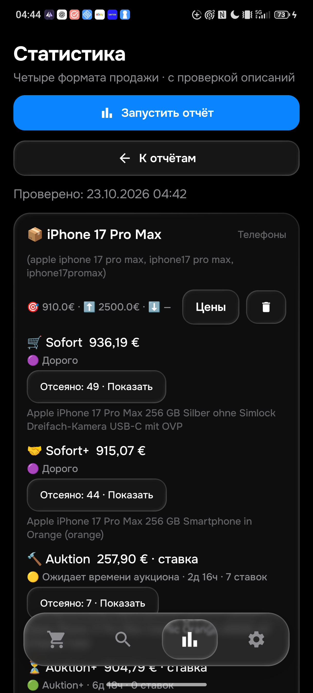
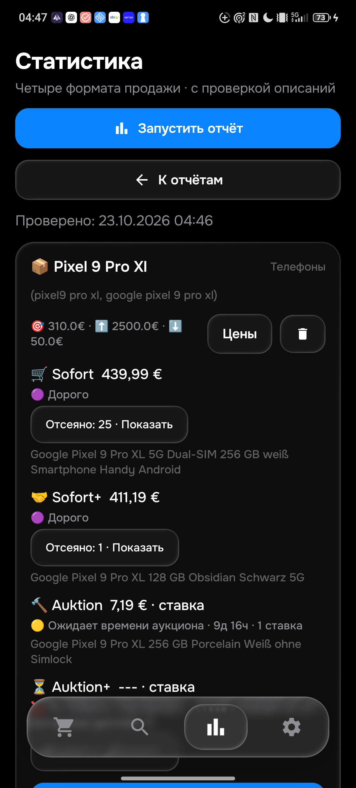

# Проверка 0.148 — реальные пропуски iPhone и задержка запуска браузера

Два пропуска найдены независимым чтением eBay в Chrome и воспроизведены в сохранённом отсеве APK0.147. Исправления одинаковы в Python/Kotlin. 0.148/code148, rules1792722194, History45. Полная приёмка 26 товаров/104 корзины остаётся PARTIAL.

| Лот | Независимый вывод | Ошибка147 | Результат148 |
|---|---|---|---|
| [840048433110](https://www.ebay.de/itm/840048433110), 930+6,19 € | Целый iPhone17ProMax256GB; USB-C — разъём; царапины на защитном стекле | Аксессуар/запчасть | Проходит релевантность; реальный Sofort936,19 €, выше лимита910 |
| [198736751866](https://www.ebay.de/itm/198736751866), 969+0 € | Целый iPhone17ProMax; собственная таблица продавца явно указывает нужную модель и A19Pro; каталог ошибочно A17Pro | Противоречие процессора | Проходит релевантность; дороже936,19 € и лимита910 |
| [800735218801](https://www.ebay.de/itm/800735218801), 419,99 € | Pixel9ProXL с треснувшей задней крышкой | Отказ по дефекту | Отказ верный, подтверждён повторным чтением собственного описания |
| [800735250775](https://www.ebay.de/itm/800735250775), 429,99 € | Pixel9ProXL с треснувшим стеклом камеры | Отказ по дефекту | Отказ верный, подтверждён повторным чтением собственного описания |

Никакое название не разрешает уведомление без полного собственного описания. USB-C снимается только как характеристика начинающегося с модели телефона с ёмкостью памяти; слова кабеля/порта/совместимости сохраняются. Устаревший Apple-чип каталога разрешается только явной парой полей «модель + правильный процессор» собственного описания; неверная модель, RAM, другой тип чипа и ремонт остаются отказом. Проверены отрицание процессора, прошлый процессор и независимое отрицание iCloud-блокировки рядом с правильным процессором. Синтетические контрпримеры не выдаются за реальные найденные подделки.

537 Python и451JVM в101наборе PASS, обе Android-сборки PASS. Общие21новыхконтроля; четыре полных реальных описания прошли парную сверку после точного совпадения браузерных отпечатков. Полные тексты остаются приватно наПК. Повтор прежних60проданныхiPhone —0расхождений, не новая браузерная серия. Старые3970снимков не изменены: отдельно документированы16ошибочных ожиданий по USB-C. В них нет собственного описания: историческое notify означает только предварительный ценовой/временной этап, а не разрешение настоящей отправки.

## Физический телефон

APK0.148 установлен с сохранением всех50строк поисков/всехстолбцов и app_config на момент обновления. После двух живых проверок поиски и защищённые настройки также сохранены; менялись только кеши синхронизации/статуса. revisionf92, dirtyfalse, активны48. SHA2563713cb243e9beb903e9fcea747ff32d43ab592188a7b9ca37f1a2992bada775a.

| Товар | Sofort | Sofort+ | Auktion | Auktion+ |
|---|---|---|---|---|
| iPhone17ProMax,910 € | 936,19 €,дорого | 915,07 €,дорого | ставка257,90 €,ждёт24чокна | ставка904,79 €,проходит |
| Pixel9ProXL,310 €,нижний50 € | 439,99 €,дорого | 411,19 €,дорого | ставка7,19 €,ждёт24чокна | 1кандидат:отказпо выгораниюдисплея |

149755/102102мс; все8корзин безошибкизапроса. Это текущие результаты приложения, не доказательство абсолютного минимума всех алиасов. Первая цена Sofort936,19 € заменяет ошибочные975 € отчёта147. Ставки не равны цене покупки и не входят в медиану цены покупки. Прежний ошибочный Pixel10 исчез из текущей выдачи — изменение исходной выдачи, не отдельное исправление148.

## Запуск HTML на GitHub

Завершившийся старыйrun39884377575 дал точную причину ожидания4мин12с: загрузка Ubuntu-библиотек/шрифтов apt. Новыйhelper устанавливает headless-shell Chromium, реально проверяет локальныйDOM и обращается к установке библиотек только при их подтверждённом отсутствии. Этапы ограничены временем и завершают дочерние процессы. Неудача оставляет честный HTMLHTTP/APIfallback.

Тот жеhelper в отдельном настоящемLinuxrun39887653492 подготовил и запустилбраузер за6с. На productionrun39889942516/job120207407114 этап уже успешно прошёл02:32:02–02:32:10UTC,8с. Это улучшение времени подготовки, не доказательство доставки за8с или гарантии<=15мин. HTML основной; квоты/ограничения доступа и очередь описаний сохраняются.

## Публикация и остаток

Source148 опубликован в road: botaf457bdf / Androidfd7018ec, в productionmain da668ac8. Защищённые7блобов mode/config/seen/app_sync/feed/feed_pending/history этим source-коммитом не изменены; normal/получатель/лимиты/порядок сохранены. Применение148сервером подтверждено checkpoint9fa9945a6047d485247980712f359ae5dd07951a:rules1792722194,проход02:51:18–02:57:25UTC,19запросов/0полностьюзавершённых/807карточек/17описаний/0отправок. Полное покрытие не достигнуто:4site_error,1blocked и очередьописаний/отложенныезапросы. Это не падениепроцесса:job39889942516 завершилсяSUCCESS02:57:32UTC. Совпадениеисходныхблобов и предкаsource148 также проверено. Telegram148 и чтение настоящего нового сообщения вGUI не подтверждены; старые сообщения повторно не отправлялись.

НаПК выполнено только фоновое чтение списка окон: AyuGram открыт на другомчате. Его не активировали. Завершённые проверки телефона относятся к eMonitor. Поздняя дополнительная попытка просмотра отсева прервана: на телефоне уже было другое приложение; новое подтверждение просмотра отсева не получено. Перед любым следующим нажатием заново проверить активное приложение. Не заявлять полное завершение: ещё нужны свежая ручная серия Pixel/всеалиасы/минимумы, настоящая доставка148, дальнейшая проверка остальных26товаров/104корзин и устранение причин серверных blocked без подмены их пустой выдачей. Текущий пользовательский Pixelpriority18 не переставлять автоматически; его расчётный интервал в последнемстатусе достигает35,6мин, что не соответствует цели15мин и требует отдельной работы очереди.

## Дополнительно: пять проданных Pixel, независимо прочитаны в Chrome

Новая серия23октября, не повтор60iPhone. Все5собственныхописанийпрочитаны, приватныеHTTPкопии точносовпали с браузернымиотпечатками; Python/Kotlin0расхождений на нейтральнойцене500€ для релевантности. Полные характеристики старых карточек в replayне включены. Это не доказательство цены покупки/новойотправки; принятый Preisvorschlag скрывает фактическую согласованную сумму.

| Лот | Формат/отображаемая сумма | Независимый вывод и обе реализации |
|---|---|---|
| [840048189777](https://www.ebay.de/itm/840048189777) | Принятое предложение;410+6,19€, итог сделки неизвестен | Целый исправный Pixel с комплектными чехлами:релевантен |
| [820248562731](https://www.ebay.de/itm/820248562731) | Завершённыйаукцион397,85+6,19€ | Царапинызащитнойплёнки,самэкранцелый:релевантен |
| [227563618322](https://www.ebay.de/itm/227563618322) | Завершённыйаукцион116+6,99€ | Разобранный,неполный,Googleблокировка:отказ |
| [257789030312](https://www.ebay.de/itm/257789030312) | Sofort398,88+0€ | Вописании ремонтпроизводителем:отказ |
| [257801626345](https://www.ebay.de/itm/257801626345) | Sofort799+0€ | ПоописаниюновыйнеиспользованныйобменныйтелефонGoogle,неремонтегоэкрана:релевантен |

Вследующейработе продолжить сериюPixel до40–50уникальных собственныхописаний и все4формата/алиасы. Отдельный реальный риск скорости изжурнала:02:46:16 iPhoneполучил fair_slice с25приоритетнымикандидатами,отложеннымипоследвухописаний. Неувеличиватьслепообщийлимит:надопроверитьпорядокновыхготовыхлотов,повторнодорогих/отклонённых и чередованиепроверок,сохранивполноеописаниепередотправкой. Пользовательскийпорядок50поисковнеменятьсамовольно.
