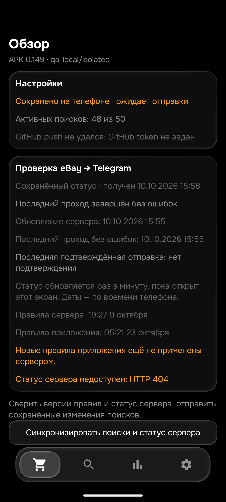

# Проверка 0.149 — iPhone и Pixel, 23 октября 2026

Общая приёмка остаётся PARTIAL: 26 товаров / 104 корзины. APK 0.149/code149, rules1792725672, History46. Этот этап не доказывает доставку за15минут или правильность всех объявлений.

## Исправленные реальные отказы

- [iPhone327408155844](https://www.ebay.de/itm/327408155844): собственное полное описание продаёт iPhone17ProMax и указывает A19Pro обычным текстом; каталог ошибочно указывает A17Pro. В148 проходили только подписанные поля Model/Processor. В149 ясное положительное описание/список характеристик тоже разрешает конфликт именно устаревшего Apple-чипа. Чужой процессор, неверная модель, противоречивый RAM, ремонт, прошлый/гипотетический/сравниваемый телефон и отрицания сохраняют отказ. Парный820258845713 прямо объявлен FAKE и по-прежнему отклонён. Эти аукционные ставки не считаются ценами покупки или продаж.
- [Pixel267813623560](https://www.ebay.de/itm/267813623560): название ProXL, собственное описание «Pixel9XLPro». Сохраняем оба модификатора при нормализации порядка. Неверное поколение, отсутствие Pro или XL по-прежнему отклоняются.

Обе причины воспроизведены до правки. 32 общих контроля процессора/контекста и10 порядка Pixel. Это синтетические граничные примеры, а не42 отдельно прочитанных объявления.

## Независимая проверка eBay

Пять новых проданных Pixel с полными собственными описаниями прочитаны через Chrome. Точные отпечатки совпали с отдельными HTML-копиями.117461222726 — исправный телефон с комплектными аксессуарами;940006576652 — ремонт/замена дисплея и батареи, отказ;267813623560 — правильный XLPro, исправленный отказ;197679939463 — новый запечатанный;336845753191 — исправный с87% батареей. См.PIXEL_SOLD_FIVE_149.json.

В текущей серии теперь10 проданных Pixel с полным own (5из148+5новых), ещё не40–50. Повтор70 проданных входов (60iPhone+10Pixel) и6 точных собственных описаний прошёл Python/Kotlin без расхождений. Это проверка релевантности с контролируемой ценой500EUR; полные старые таблицы характеристик проданных лотов не воспроизведены. Принятое предложение не раскрывает окончательную цену. Повтор не увеличивает число независимо прочитанных лотов.

## Тесты и эмулятор

539 изолированных Python PASS;453JVM/101набор,0ошибок/пропусков;assembleDebug иassembleDebugAndroidTest PASS. Эмулятор Android16 обновлён с0.140 до0.149: миграция Room7→8, добавлен priority; все50поисков и все исходные столбцы сохранены. В app_config изменился только logic_version_ts. QA-репозиторий qa-local/isolated и URL example.invalid сохранены, поэтому экран ожидаемо показывает отсутствие токена/HTTP404; это не статус production. Обзор0.149 визуально проверен. Новая физическая установка не проводилась: пользователь сейчас разрешил только эмулятор.

## Доставка и оставшаяся работа

До публикации149 сервер работал на148: последний проход06:35:46–06:41:52UTC,31попытка,0карточек,0описаний,0сообщений. Ошибки сайта/проверки доступа и исчерпанная квота API — реальная проблема получения данных. Все48поисков были попытаны за15минут, но это не48успешных проверок и не доказательство скорости доставки. HTML основной, API резервный; HTML тоже может ограничиваться сайтом.

В момент фонового чтения AyuGram открыт на другомчате; окно не активировали. GUI-подтверждения нового сообщения149 нет. Старые сообщения повторно не отправлялись. Далее: закончить живые8корзин эмулятора, внедрить149 и подтвердить применённые правила; исследовать последние сетевые отказы/очередь, продолжить Pixel до40–50, затем остальные товары. Сохранить normal/получателя/50поисков/лимиты/порядок/seen/баны; Pixelpriority18 самовольно не менять.

## Дополнение после внедрения149

Source149 bot-road264b0f34/Android-road36eec898/production52dd4916. Все7существующих защищённых файлов(source parent→commit) совпали, включая seen_ids.json; normal/получатель/поиски/цены/порядок не изменены. Сервер подтвердил rules1792725672,revisionf92: проход06:48:43–06:54:49UTC,21попытка/10полных/1606карточек/17описаний/1подтверждённая отправка,statepartial.

Настоящая отправка120143/840048433110 от06:49:13UTC: iPhone17ProMax900+6,19=906,19EUR,HTML,initial,правила149. Цена/доставка совпали с живым Chrome и эмулятором. Это подтверждение BotAPI и ленты; GUIAyuGram свёрнут и фоновое чтение требует активации, которой не было. Не выдавать это за визуальное чтение чата. Между detailsVerified и отправкой1453мс, но время снижения цены ниже910не установлено: общая задержка<=15мин не доказана. Старый IDне переотправлять.

Семь ARTтестов PASS, отдельная реальная Room-проверкаCRUD/цен/синхронизации/копирования/приоритетов PASS. Первый запуск native имел технический сбой наблюдения и вмешательство в тестовый процесс; успешный повтор без UI-ввода71,55с записан отдельно. Не считать упавшую попытку PASS. После живыхпроверок все50строк/все исходныестолбцы сохранены. Галерея отсеянных показываеткартинки; диапазон600EUR сократил24→4, лимит310не изменился; диапазон сброшен.

Живые8корзин эмулятора149 PARTIAL: iPhone906,19/986,19EUR,оба аукциона безполученногоитога;Pixel439,99/411,19EUR,оба аукциона безполученногоитога. Дополнительные запросыsite_errorво всех корзинах, поэтому это не глобальныеминимумы и не «аукционовнет». Вопрос API/HTMLограничений не решён: production-журнал прямо показывает splashui/challenge и истёкшую квотуAPI.

Независимая серия Pixel теперь45уникальныхID,см.PIXEL_SOLD_45_149.json (включая2активных многолотовых объявления с прежними продажами). Одинудалённый960088758548не включён. Полныевидимыесобственныеописанияпрочитаны;у рядамагазинов HTMLсодержит дополнительные закрытыевкладки/FAQ/рекомендации — ихнесовпадение с видимымтекстом отмечено mirrorExact=false, не выдаватьвсе45за точныйпарныйreplay. Старый70replayPASS;расширенныйточный76replayKotlinPASS. Новые23ручныхожиданияпровереныPython:2реальныхрасхождения149 и1неразрешённыйслучай.920029271156исправный9Proсцепленный,ложныйотказ;128103661042собственныйэкран«имелзаводскойдефект,этотбылпоменянпо гарантииGoogle»,ложныйдопуск. Следующий150 долженисправитьоба с отрицательнымиконтролями.278436561360:own«Pixel9XL»безPro,передрешениемсверитьхарактеристики/изображения;неподгонятьожиданиеподкод. Другиеремонтные336823889435/940006576652иразобранные168308383103/227547480220ужеотказаны. Простое прочтение45не завершаетприёмкувсехкорзин/цен/уведомлений.
