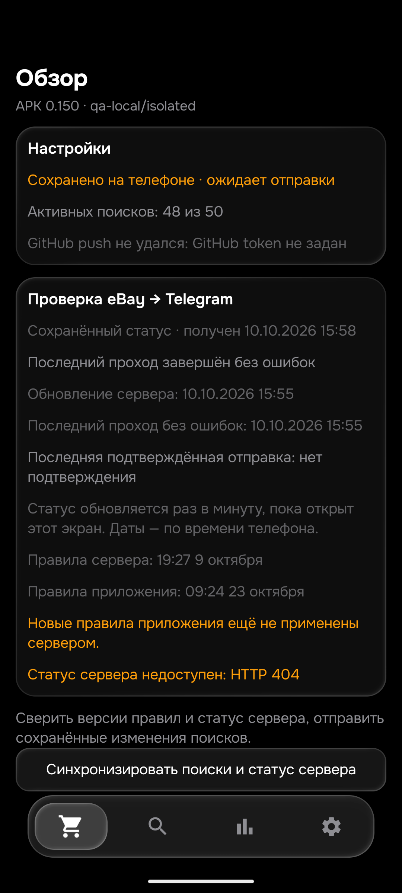

# Pixel:45 проданных объявлений и исправление0.150

Общая приёмка PARTIAL:26товаров/104корзины.0.150/code150/rules1792740297/History47. Физический телефон сейчас не использовался.

## Два новых дефекта найдены независимо в браузере

1. [920029271156](https://www.ebay.de/itm/920029271156): целый используемый Pixel9ProXL, в заголовке «9Pro» без пробела. Старые дополнительные проверки названия/признаков устройства требовали границу после9. Нормализованы только реально написанные поколение и модификаторы; Pro/XL не добавляются отсутствующим моделям. Полный отбор теперь пропускает исправный телефон.9a/8/10/безPro/безXL остаются разными моделями.
2. [128103661042](https://www.ebay.de/itm/128103661042): продавец пишет, что экран имел заводской дефект, «этот был поменян в сентябре по гарантии Google».149 пропускала замену из-за местоимения и длинного промежутка.150 связывает явный заводской дефект экрана с завершённой заменой в следующей части предложения. Не считаются ремонтом будущая гарантия, отрицание, прошлый другой телефон, заводская установка и отдельное защитное стекло. Для фактической замены сохраняется отказ, даже если новый экран теперь работает.

Python до правки:6падающих синтетических подпримеров;Kotlin тоже падал на новом наборе. Обнаружился и второй Python-порог определения устройства после первого исправления модели — полный replay продолжал падать, пока не выровняли обе проверки. Не меняли ручные ожидания для подгонки под реализацию.24новых общих контроля теперь PASS.

## Ручная серия eBay

45уникальныхID из раздела проданных:5из148+40из149. Полные видимые собственные описания прочитаны через Chrome, включая комплекты, исправные аппараты за230/250/300EUR, заменённые производителем дисплеи, дефектные/разобранные/Google-locked устройства и работающий демонстрационный аппарат. Два многолотовых объявления после прежних продаж остаются активными; это отмечено отдельно. Удалённый960088758548не засчитан.

По45входам Python совпал с независимыми выводами после150.39собственныхHTML-копий точносовпали с нормализованным браузерным текстом и прошли также Kotlin; у6магазинныхHTML есть дополнительные закрытые вкладки/FAQ/рекомендации — это не точные парные входы, не выдавать их за доказанное совпадение парсеров. Общийточныйreplay:60старыхiPhone+39Pixel=99,обе реализации0расхождений;ещё6полныхownсвыбраннымихарактеристиками0расхождений. Ни число повторов, ни24синтетическихконтроля не увеличивают45прочитанныхID. Данные/вердикты/ссылки вPIXEL_SOLD_45_150.json.

278436561360с own«Pixel9XL» дополнительно переоткрыт: заголовок и таблица характеристик говорят Pixel9ProXL, EAN0840353914513,256GB,16GBRAM. Другую модель описание не объявляет; этот сокращённый текст признан релевантным после проверкихарактеристик, код ради него не ослабляли. У307197174726own«только самовывоз»,хотяверхняякарточкадаётдоставку;городBerlinразрешёнпользователем,нобезотдельнойпроверкинеутверждатьправильностьпереключениясуммынаpickup. У800767849165/327393587620суммывSERPиоригинале различаются:444→555/360→350. Они не доказанные финальные цены сделок. ПринятыйPreisvorschlag скрывает реальную согласованную цену.

Проверка99 касается релевантности при контролируемой цене500EUR; старые полные таблицы характеристик, состояние предыдущихотправок и фактическое право уведомления каждого проданного лота не воспроизведены. Нельзя назвать45полностью принятыми уведомлениями. Реальные четыре живые корзины/всеалиасы/глобальныеминимумы и скорость остаются отдельной работой.

## Тесты и эмулятор

540 изолированныхPython PASS;454JVM/101набор,0fail/error/skip;assembleDebug+assembleDebugAndroidTest PASS. На эмулятореAndroid16 установлен150, все50строк/всестолбцысохранены, внастройках изменился толькоlogic_version_ts. QAизолирован от production. ФотоОбзоранеявляетсястатусомproduction:qa-local/isolatedнамереннонеимееттокена идаёт404.

Два настоящихполныхown через AndroidARTпровереныв4форматах:8контролейснейтральнойценой500/лимитом910 и8контролейснастоящимлимитомPixel310. Исправный9Pro при250+5,45=255,45прошёл все4;ремонтныйпри искусственно сниженной250+6,19=256,19отказан во всех4. Это контролируемыеисторическиевходы, не настоящиеставки/цены этихпроданныхаукционов и не отправкиTelegram. Исходные QAфайлыпослеаудитавосстановлены.16/16PASS.

## Сервер и доставка

149 уже применена:06:48:43–06:54:49UTC,21попытка/10полных/1606карточек/17описаний/1доставка. Настоящий120143/840048433110:900+6,19=906,19EUR,лимит910,HTML,initial. Цена совпала Chrome/эмулятор/подтверждённаялента; собственноеописаниепрочитано заново,отпечаток772/fe0ff534f5283fe7совпал. Царапинытамтольконазащитномстекле. Повторно не отправлять. GUIAyuGramнепрочитан:другойчат/свёрнутоеокно,ПКнеактивировали.1453мсdescription→sendне доказываютполнуюзадержку<=15минут.

150 опубликована: source fbd3d013adef68d5641720508503e631bfc57fae. Применение подтверждено checkpoint f96c72b69c223ff3d5200c604a233a10996cb192: проход 07:33:41–07:39:48 UTC, 14 попыток / 692 карточки / 18 описаний / 0 отправок. Все 7 защищённых blobs при публикации неизменны; mode normal и ревизия f92 сохранены. См. DEPLOYMENT_150.json. После неё сохранитьnormal/получателя/50поисков/лимиты/порядок/seen/баны. HTMLосновной,APIрезервный,ноHTMLтожеограничиваетсяeBay:production-журналпоказываетsplashui/challenge. Последний149эмуляторныйпрогон8корзинPARTIALиз-заsite_error,не«не найдено». Дальше:подтвердитьproduction150,повторитьактуальныекорзины,разобратьсерверныедоступ/очередьискорость,затемостальныетовары. Общаяприёмканезавершена.
