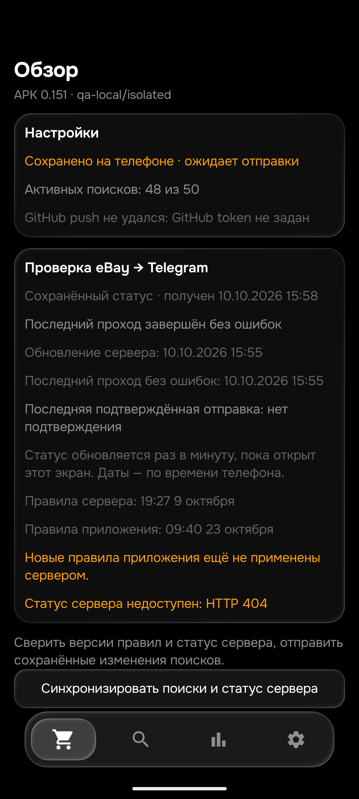
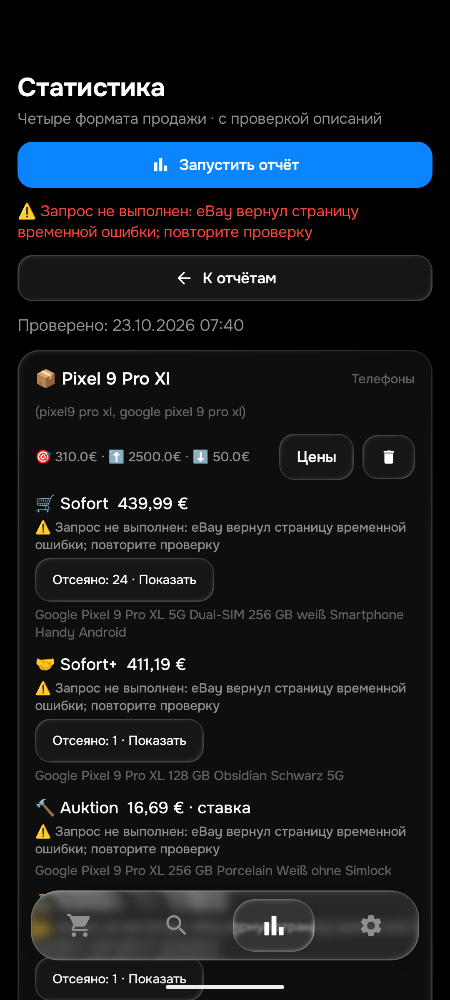

# 0.151: готовый лот больше не ждёт за всей очередью аукционов без часов

Общая приёмка остаётся PARTIAL (26 товаров / 104 корзины). Приоритет — iPhone 17 Pro Max до 910 EUR и Pixel 9 Pro XL до 310 EUR. Физический телефон не использовался. Версии: APK 0.151/code151, rules1792741229, History47.

## Реальный источник задержки

В журнале 06:23:25 UTC лот [840048433110](https://www.ebay.de/itm/840048433110) уже удовлетворял предварительным правилам карточки, но стоял десятым: перед ним восемь аукционов без времени окончания и ещё один старый кандидат. На запрос доступны два места полной проверки. Их занимали аукционы, а готовый повторный кандидат откладывался.

Telegram подтвердил этот iPhone (120143, 906,19 EUR) в 06:49:13.520 UTC — через 25 мин 48 с после той очереди. Это доказанный интервал ожидания после предварительной готовности, а не время появления объявления. Свежая браузерная [история изменений](https://www.ebay.de/rvh/840048433110?rt=nc) показывает последнюю правку фиксированной цены в 05:24:03 UTC: до отправки 85 мин 10,52 с. История не показывает числовые цены до/после, поэтому точный момент пересечения лимита 910 EUR не доказан. 1453 мс от завершённого описания до отправки нельзя выдавать за полную скорость обнаружения.

## Исправление

Если свежих готовых лотов нет, но есть новые кандидаты с неизвестными часами и ранее не завершённые готовые кандидаты, одно место отдаётся самому давно проверявшемуся готовому кандидату. Второе остаётся для выяснения времени аукциона. Повторные кандидаты чередуются по уже сохраняемому checked_at; новые данные состояния не добавлены.

Свежие готовые лоты сохраняют высший приоритет. Полное описание, правильная модель, цена, доставка, время аукциона, прежние отправки и защита от дублей проверяются как прежде. Без собственного описания доставка не происходит. Обычный аукцион по-прежнему ждёт своего 24-часового окна. Пользовательские лимиты и приоритет Pixel18 не менялись.

Два новых регрессионных теста до исправления падали. После — PASS, включая отсутствие отправки при недоступном описании и чередование двух готовых повторов без захвата обоих мест у аукционов. Полный Python: 542 PASS. Android: 454 теста / 101 набор, 0 failures/errors/skips; assembleDebug и assembleDebugAndroidTest PASS. 151 меняет серверную очередь и метаданные приложения; фильтры совпадают с 150. 99 точных sold и 6 полных own повторно проверены в 150; 16 контролируемых ART-сценариев тоже относятся к 150, не выдавать их за новый запуск 151.

## Эмулятор и живая выдача

На Android16 эмуляторе обновление 150→151 сохранило все 50 строк и все столбцы поисков. Room8→8; в app_config изменился только logic_version_ts. Обзор визуально проверен. Его qa-local/isolated и HTTP404 намеренно изолированы от production; это не ошибка рабочего сервера. На физическом телефоне последняя версия148, его не трогали.

Последний живой прогон 150 по четырём корзинам каждого приоритетного товара завершён. Получены кандидаты: iPhone969 / 986,19 / 263,90 / 904,79 EUR; Pixel439,99 / 411,19 / 16,69 / без кандидата. Во всех восьми корзинах есть site_error либо403 хотя бы одного запроса. Поэтому это частичные результаты, не доказанные глобальные минимумы; пустой Auktion+ Pixel не означает «не найдено». Суммы аукционов — текущие ставки и расходы, не цены покупки и не медиана продаж. URL и точные ошибки — LIVE_IPHONE_150.json и LIVE_PIXEL_150.json.

150 уже применена сервером: checkpoint f96c72b69c223ff3d5200c604a233a10996cb192, 07:33:41–07:39:48 UTC, 14 попыток / 692 карточки / 18 описаний / 0 сообщений; state partial, mode normal, settingsRevision f92be8e8-8345-4d11-9078-4bffa9fa17df. При публикации источника все 7 защищённых blobs сохранены.

151 пока ожидает публикации и отдельного подтверждения применения. Настоящая доставка 149 подтверждена BotAPI+feed и сверена с собственным описанием Chrome/ценой эмулятора; GUI AyuGram не подтверждён, окно не активировали. Новая доставка 150/151 не доказана. Нельзя переотправлять старый120143 ради проверки версии.

## Дальше

Подтвердить production151 и фактическую очередность в новом журнале; сохранять normal, получателя, все 50 поисков, лимиты, порядок, seen, баны и историю. HTML остаётся основным, API — резервным; HTML также получает проверки доступа и ошибки eBay, API-квота исчерпана. Не маскировать это нулевой выдачей и не обещать неограниченный HTML. Цель <=15 минут пока не доказана: исправлена одна воспроизведённая причина, остаются расписание, доступ и описание. После этих двух телефонов продолжать остальные товары и неполные аспекты/форматы/самовывоз. Все 26/104 и все фильтры не приняты.
