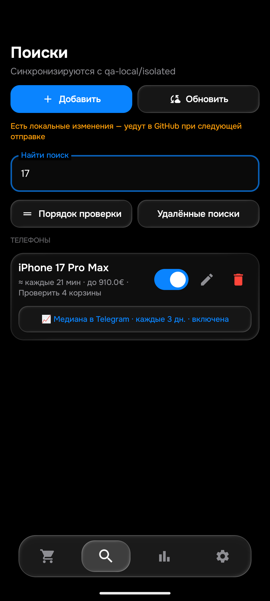
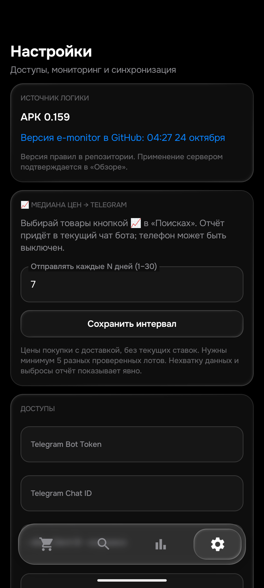
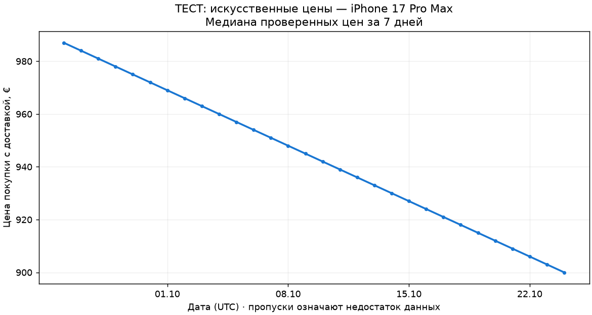

# APK 0.159: подписка на медиану цен

Общая проверка поисков остаётся незавершённой: [таблица всех26товаров](../../OPEN_ACCEPTANCE.md). Завершение этого этапа не означает приёмку всего проекта.

## Как пользоваться

В «Поисках» у товара есть кнопка **📈 Медиана в Telegram**. Нажатие включает или выключает отдельную подписку, сохраняя цены, фильтры и варианты продажи. В «Настройках → 📈 Медиана цен → Telegram» задаётся интервал от1до30дней, по умолчанию7. Используется текущий чат бота, телефон для плановой отправки не нужен. Все отключённые варианты товара сохраняются; при отключении всех поисков товара отчёты приостанавливаются.

При включении первый отчёт приходит на доступном обычном проходе. Если данных меньше5, это текст о сборе данных. Следующий — через выбранный интервал после попытки отправки; смена интервала учитывается от последнего отчёта. Неопределённый результат отправки не повторяется автоматически, чтобы не дублировать сообщение. Код429 с подтверждённым отказом допускает безопасный отложенный повтор.

## Что измеряется

Медиана выставленных **цен покупки с доставкой в евро** за последние7дней, график за30дней. Только объявления после полного собственного описания, проверки модели/назначения/дефектов, обновления цены и повторных структурных фильтров. Лимит уведомления и already-sent не определяют цену рынка. У гибрида используется только известная цена BIN; текущая ставка не становится ценой покупки. Sofort+ означает выставленную цену, а не неизвестную согласованную скидку. Оценки импортных сборов исключены.

Повторные проверки и алиасы не увеличивают вес одного itemID: в окне учитывается его последняя проверенная цена. Выбросы определяются по медиане и MAD с широким порогом не меньше25% центральной цены. Пример:100/900/920/940/960/980/1000/5000 → исключены100и5000, медиана950по6разным лотам. После отсева нужно минимум5. Малую выборку не заменяем выдуманной ценой; недостающие дни показаны разрывом.

Низкая цена сама по себе не доказывает, что продаётся чехол. Семантические фильтры остаются основным барьером; устойчивый расчёт дополнительно защищает от единичных пропусков. Если неподходящие объявления составляют большинство, статистика не заменяет исправление фильтра. Это **выборка проверенных объявлений**, не все продажи eBay. Обычная очередь сначала проверяет потенциальные уведомления, поэтому возможен сдвиг выборки к доступным и более дешёвым лотам. Не утверждаем независимую полную рыночную медиану. Разные объёмы памяти и состояния объединяются, если их объединяют условия поиска.

Новых запросов eBay нет. Сбор использует существующие проверки, отчёт строится после прохода и не занимает место готового уведомления. Максимум один плановый отчёт за проход. Своя таблица median_observations/версия1 в price_history.db, отдельная от старых агрегатов. History51 правил отбора сохранена. Старые подсказки скидки по существующим полным snapshots не являются данными нового графика и могут отличаться по выборке.

## Синхронизация и доставка

JSONschema1 сохранена. Два необязательных поля config: median_products — строка JSON-массива ID, median_interval_days — строка целого числа. Сервер хранит их как list/int, без перезаписи отсутствующих полей старым клиентом. Явный [] выключает подписки. Неверный интервал/массив не заменяет рабочую конфигурацию. Отправка привязана к применённой конфигурации монитора и обычной settingsRevision.

Перед Telegram сервер сохраняет claim в mobile/median_delivery.json через GitHub CAS. Неопределённый ответ при записи claim не приводит к отправке. Неопределённый ответ Telegram удерживается без слепого повтора. Режим/получатель не меняются, ledger содержит хеши маршрута и группы, статусы, времена и IDсообщений. Файл исключён из Cloud-синхронизации production-данных. В runtime.medianReports доступны счётчики и время; APK показывает их в настройках.

## Проверено

| Проверка | Результат |
|---|---|
| Изолированный Python |573PASS,145,396с;20новых проверок медианы|
| JVM |463уникальные проверки,104набора,0ошибок; единственный начальный skip выполнен отдельным запуском|
| Прежние собственные описания |104повтора,0расхождений; не104новыхпросмотра|
| Сборка |Debug иAndroidTest PASS|
| Android16 |2nativeтеста: Room/экспорт/старыйACK/варианты/off и25seller-входов|
| Интерфейс эмулятора |Включение iPhone17,3дня, перезапуск, сохранение; затем восстановлено[]/7|
| Данные эмулятора |Все50строк и столбцы поисков, зашифрованные ключи сохранены|
| Telegram |Тест120163 с фото подтверждёнBotAPI; GUIПК не подтверждён|

Тест120163 и картинка ниже содержат **искусственные цены** и не доказывают рынок iPhone. Только проверка формирования и настоящей доставки изображения. Повторно не отправляли.

Версия0.159/code159/rules1792808864; SHA256APK:dad89e359f8b0da6e341957442afd180769793e3cdfef25f2b081dfd6c4e826d. Физический телефон не использовался; новая версия установлена только на emulator-5580. QA GitHub изолирован; сообщения о его отсутствующем токене/404 не являются ошибками рабочего сервера. Production-подписки автоматически не включены.

Публикация:применена сервером. Sourcecommits:{"bot": "858aa88d9e601c6c984317264f00e230a8044f72", "bot-cloud": "7dbfc29eca9e2dab6b2302b81751eddfc0065352", "android-cloud": "d559536713911c18da3a694875bb9af2820054fd"}. Normal/f92/получатель/50поисков48активных/цены/порядок/seen/баны сохранены. HTML остаётся основным, API резервным. Неполный доступ eBay и <=15мин не исправлены этим этапом. Реальный сбор рыночных данных и ожидание календарного интервала на production ещё не приняты. Подробности DEPLOYMENT_159.json.

## Продолжение исходной проверки: LG OLED

Свежая проверка159 завершена за43,367с: все4корзины вернули site_error, положительного результата нет. Одновременно настоящий Chrome показал явный ноль точных аукционов по обоим настроенным вариантам27GX790A и32GS95UE OLED; рекомендации ниже относятся к другим моделям и не доказывают наличие нужного товара. На DOM-фрагменте первой настоящей страницы Python правильно вернул0безошибки. Это не исходный полный HTTP-ответ Android: он не сохранён, поэтому утверждать ложное распознавание именно его ошибки нельзя. Нужно отдельно диагностировать транспорт приложения. Эта проверка не означает отсутствия всех лотов LG в Sofort и не закрывает товар.
