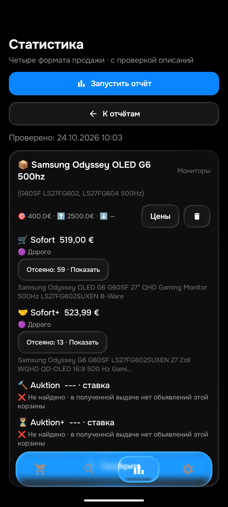
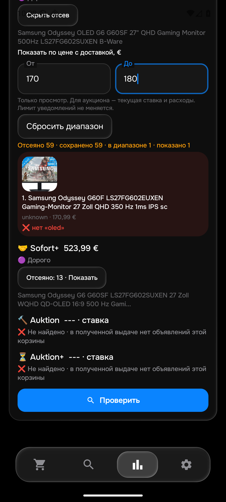

# 0.161: пустая выдача, Asus и Samsung 500 Гц

Общая цель «продолжай оставшиеся товары» активна. Все26товаров/104корзины и скорость уведомлений≤15мин ещё не приняты. Этап160 был только аудитом; номер версии приложения160не использован. Новая сборка0.161/code161/правила1792835733/History51 **применена сервером**.

## Найденный дефект и исправление

Подтверждённый ноль не попадал в короткий90-секундный кэш HTML, хотя непустой успешный ответ попадал. Если один дополнительный вариант запроса не загрузился, повторное получение формата заново запрашивало уже проверенный пустой вариант. Это расходовало HTTP/WebView-загрузки на телефоне и эмуляторе. Ошибки по-прежнему не кэшируются; новый набор условий имеет другой ключ, ручная кнопка «Проверить» очищает кэш. Срок кэша не увеличен. Семантика фильтров и серверная очередь уведомлений на этом этапе не менялись.

Два новых контроля падали на прежнем коде: подтверждённый ноль вызывал4HTTPзапроса вместо2. После правки проходят; провалившийся соседний вариант действительно повторяется, новый формат/потолок и ручной сброс не берут старый ноль. На живом Android точный повтор успешной пустой выдачи добавил **0HTTPзапросов и0загрузок WebView**. Последующая отдельная загрузка той же страницы дала временную ошибку: это другой ответ, он не выдаётся за исходный ноль.

Сохранены реальные HTTP403 и компактный DOM WebView с явным0по основному Asus-запросу. Python и Android читают одинаковый244-байтный DOM как0безошибки. Это не полный исходныйHTTPответ, не Chrome и не проверка всех алиасов. Логи прежнего общего прогона фиксируют исчерпание8загрузок WebView; новый клиент с отдельным запросом смог получить ноль. Не объявлять всякий403 ложной ошибкой: блокировки и временные ошибки eBay сохраняются.

## Свежие четыре корзины

|Товар|Sofort|Sofort+|Auktion|Auktion+|
|---|---|---|---|---|
|Asus Vivobook14X OLED, лимит425€|29отсеянных, подходящих нет|32отсеянных, подходящих нет|Нет лотов корзины в полученной выдаче|Нет лотов корзины в полученной выдаче|
|Samsung Odyssey OLED G6 500Hz, лимит400€|[519€](https://www.ebay.de/itm/307167578900), дорого|[523,99€](https://www.ebay.de/itm/398162444700), дорого|Нет лотов корзины в полученной выдаче|Нет лотов корзины в полученной выдаче|

Asus52,209с, Samsung68,186с. Во всех8корзинах этого прогона отсутствуют ошибки запроса; это не доказательство глобальных минимумов или полноты eBay. Разные прогоны дают разные наборы карточек, поэтому всё изменение времени/результатов нельзя приписать кэшу. Подробности ASUS_SCAN_161.json и SAMSUNG_SCAN_161.json.

AsusM7400QC без3050взаголовке не является новым найденным багом: соответствие M7400QC→RTX3050 уже поддерживалось. Три старых полных входа повторены с настоящими сохранёнными обязательными/запрещёнными словами в Python и Android ART; нужный14X принят, чужие16-дюймовые Vivobook/ProArt отклонены. Подготовленные цены этих трёх контрольных входов не считаются рынком или правом отправки. Ещё25прежних native-входов прошли отдельно, исходные фикстуры восстановлены.

По двум выбранным Samsung прочитаны реальные сохранённые Android-входы: товарный текст3896знаков с правильнымиSKU/OLED500Hz и155знаков с заявленной работой безpixelerrors/царапин. Это **не независимый новый просмотр Chrome**. Оба ID уже были в старой ручной серии; счётчик уникальных описаний не увеличен. Цена519+0и500+23,99совпала с отчётом, Python подтвердил релевантность; оба выше400и не имеют права уведомления.

Старый неверный [IPS350Гц за170,99€](https://www.ebay.de/itm/147486582559) реально присутствует в свежей выдаче и отклонён: нетOLED. Это подтверждено в приложении и предварительной фильтрациейPython. В GUI показана его миниатюра; диапазон170–180оставил1из59, сброс вернул59(первые15наэкране). Цена уведомления400не изменилась.

## Проверки и сохранность

573изолированныхPythonпроверкиPASS(102,963с);465JVM/104набораPASS/0skip. Включены104прежних seller-входа с0расхождений, это не новые чтения. Обе сборкиPASS. Native:3Asusснастоящимиword-фильтрами,25прежнихвходов, два отдельных сетевых захвата; завершение сетевого теста само по себе не равно успехуeBay. Установка161наemulator-5580:Room8→8,50поисков/все столбцы и зашифрованные ключи сохранены, изменён толькоlogic_version_ts. Физический телефон не использовался. Эмулятор qa-local/isolated,notify=false; его старый статус/404/ошибка отсутствующего токена не являются состояниемproduction.

SHA256APK:8330e07687dd7a39b013bbb15caf3359a76eef1d60fe0aedf65b5f0265d8f195. Sourcecommits:{"bot": "172ee9f07a4cc78f976b5dbd0d9b11b339119985", "bot-cloud": "9f49c19c21a829b01033ba1f6ec35ba02336250d", "android-cloud": "f96773fc33554910c99f4671a68324fb8e09b63d"}. При публикации7защищённых production-файлов не менялись. Normal/f92/получатель/50поисков48активных/цены/порядок/seen/баны сохранены. Новых Telegram-тестов не отправляли. Применение сервера проверяется отдельно по DEPLOYMENT_161.json; до runtimeApplied=true нельзя считать публикацию внедрением. Новая настоящая доставка161и GUITelegram наПК пока не подтверждены. В наблюдённом проходе1полностьюуспешныйпоиск из14попыток не означает13сетевыхошибок: отдельно зафиксированы20записей незавершённых проверок и5searchIssues(site_error: iPhone17,4060OLED,Superlight2auction,Superstrikeauction,Z70auction). Это разные счётчики; исходные данные в RUNTIME_QUEUE_161.json.

## Осталось

Chrome по-прежнему не доступен: ожидается ответ на открытие Chrome или отдельный IAB; окнаПК не активировались. Исторические Asus23страницы/17полныхописаний и Samsung12страниц/11непустыхтекстов не превращены в40–50. У Samsung в старой серии есть магазинныйFAQ и обрезанный юридический хвост, поэтому11не равно11подробнымописаниямэкземпляра. Продолжить независимые страницы Asus и Samsung, затем группы без установленного счётчика в OPEN_ACCEPTANCE.md. Полные raw/own,БД и ключи приватны. СкоростьTelegram≤15мин, всеалиасы/категории и вся26/104приёмка остаются открытыми.
