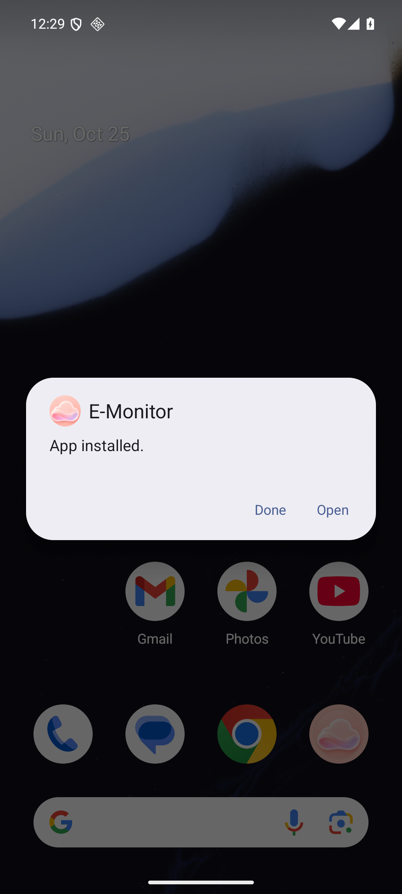
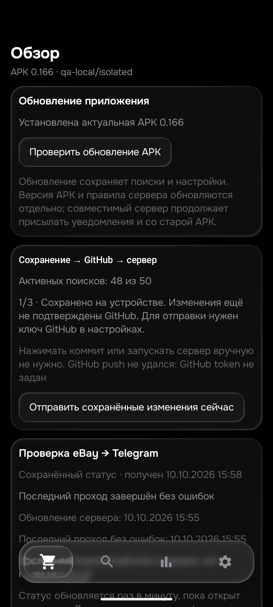
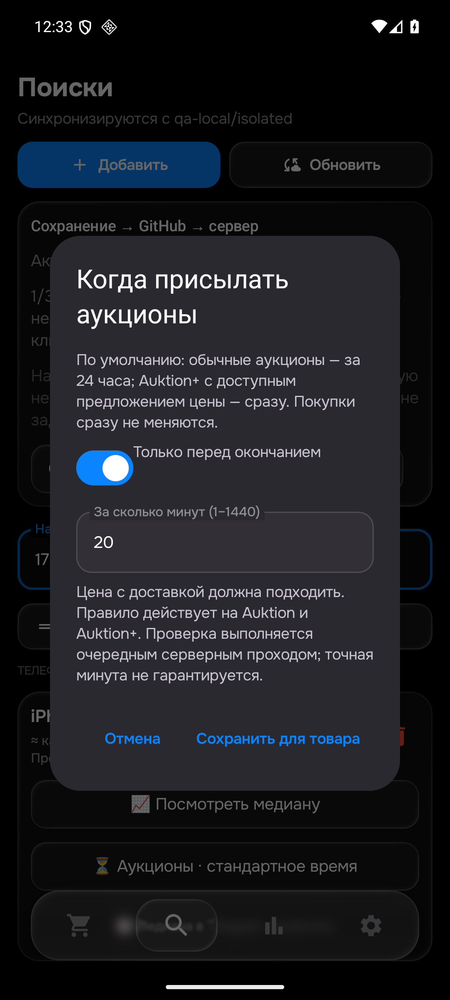

# APK 0.166 — обновления, медиана и время аукционов

25 октября 2026. Общая приёмка 26 товаров / 104 корзин НЕ завершена.

## Изменения

- При открытии APK проверяет последнюю опубликованную версию на GitHub. «Обзор» показывает «Обновить Android» и процент загрузки. Сравнение по Android versionCode, отдельно от серверных правил.
- Android repo закрытый. Загрузка asset идёт через GitHub API с настроенным ключом, имеющим read-доступ к e-monitor-android. Репозиторий публичным не делали. Ключ не включается в URL и не передаётся при перенаправлении на другой хост.
- Проверяются размер, SHA-256, пакет, код/имя версии, совпадение сертификата установленной APK. Затем стандартное подтверждение Android. Ошибка сохраняет приложение и данные.
- «Поиски» → товар → «Посмотреть медиану»: та же серверная функция trend(), что Telegram, число разных лотов, отсев выбросов, дата и график 30 дней с окном 7 дней. Подписка Telegram — отдельная кнопка.
- Проверенные наблюдения теперь собираются для всех товаров независимо от подписки. Только цены покупки с доставкой; без ставок, неподтверждённых описаний, неизвестного BIN и оценок импорта. Минимум 5 разных лотов после MAD-отсева. Старые сомнительные агрегаты не импортированы.
- «Аукционы»: прежний режим по умолчанию либо только за N минут до конца (1–1440, включая 20/30). Одна транзакция обновляет все варианты, включая выключенные. Цена и покупки сразу сохраняются. При custom Auktion+ тоже ждёт. Очередь учитывает новое время входа, но точная минута прохода не обещается.
- JSON schema 1: необязательное auctionNotifyMinutes ↔ filters.auction_notify_minutes. Старый клиент, опуская поле, сохраняет серверное значение; явный null возвращает стандартное. Неверное значение не заменяет рабочий config.
- Статусы 1/3 сохранено на устройстве → 2/3 отправлено в GitHub → 3/3 применено сервером видны в «Поисках» и «Обзоре». Старый ACK не подтверждает новую ревизию. Объяснены автоотправка, отсутствие ключа, выключенная синхронизация и отсутствие необходимости ручного коммита.
- Telegram: поиск HTML/API — текстовая ссылка с фактически выполненным запросом. Кнопка под сообщением открывает сам лот. Дублирующая текстовая «Ссылка» убрана; «Скрыть» и «Бан» сохранены.
- Telegram работает на сервере независимо от локальной APK. Schema 1 совместима; разные версии правил могут давать другой локальный отсев, для совпадения нужна свежая APK.

## Проверки

| Проверка | Результат |
|---|---|
| Изолированные Python | 583 PASS, 117,006 с |
| Android JVM | 472 теста / 107 наборов / 0 ошибок и пропусков |
| Исторические полные seller-входы JVM | 104 прежних, 0 расхождений; не новые просмотры |
| Обе сборки | PASS |
| Native Room / все варианты / старый ACK / сброс окна | 1 PASS, отдельная in-memory база |
| Native UI окна и медианы | 2 PASS; 950 € — контрольные данные |
| Native прежние own | 25 входов, 1 PASS; не новые чтения |
| Настоящее скачивание закрытого release в Android | 1 PASS, 70 383 955 байт; hash/package/version/signature проверены |
| Неверный размер и SHA-256 | Отказ Android |
| Стандартная установка скачанного файла | Update → App installed → установлен code166 |
| Повторное открытие APK | «Установлена актуальная APK 0.166» |
| Данные эмулятора | Room8→9; 50 поисков/все старые столбцы, seen/feed/история/баны/зашифрованные ключи сохранены |

QA notify=false, qa-local/isolated. Физический телефон и окна ПК не использовались. Для приватной сетевой приёмки ключ передан разово только скачивателю; временные файлы удалены, основной key store не менялся.

Один native-запуск прерван нашим открытием MainActivity во время инструментации с пустым Application; это не production-ошибка. Все наборы затем отдельно PASS. Драйвер установки держал provider до системного окна; замена приложения завершает его процесс и не считается отдельным зелёным unit-тестом.

## Версии и сервер

APK0.166/code166/rules1792887021/History53. SHA256: 1a7b4117a4f833c9dfb2c449ac34b7cb1aa77698746cabb427565181d02661ee.

[Закрытый GitHub release](https://github.com/GitGayHub/e-monitor-android/releases/tag/v0.166). APK до обновлятора требует одной обычной установки этой версии с сохранением данных. 164/165 — промежуточные QA; release165 не объявлен обновлятору и оставлен закрытым черновиком.

Сервер применил правила на checkpoint532270b1fcb8a203f5e656b3b8e26f68ddd7aea0, runtime25.10 00:25:52UTC. Normal/f92be8e8-8345-4d11-9078-4bffa9fa17df/50поисков48активных сохранены. Все окна стандартные, подписки автоматически не включены. Публикации не меняли 7 защищённых файлов состояния.

Опубликовано26 наборов медианы. На этом checkpoint ни одному ещё не хватает5 проверенных покупок: числовую медиану не выдумываем, данные накапливаются обычными проходами. Последний проход14запросов/2полностью успешных/571карточка/16описаний/0уведомлений,4проблемы выдачи; разность14−2 не означает12сетевых ошибок.

## Что не принято

Живой Telegram с новой раскладкой и GUI ПК не подтверждены; формат проверен тестами отправщика, дополнительных сообщений не посылали. Физический телефон не проверен. ≤15мин, весь рынок, все26товаров/104корзины и40–50own на каждый не приняты.

Сохранён завершённый прежний XM6scan163:846,175с;284,82/256,19/223,60/265,19€; последние2ставки, все>200. Это не свежая приёмка166. Четыре исторических ложных XM6отказа (WH1000XM6 и целые комплекты+чехол) пока НЕ исправлены. Следом они, затем STD/DEX Superlight и остальные. Новых независимых Chromeown0.

## Снимки QA эмулятора

