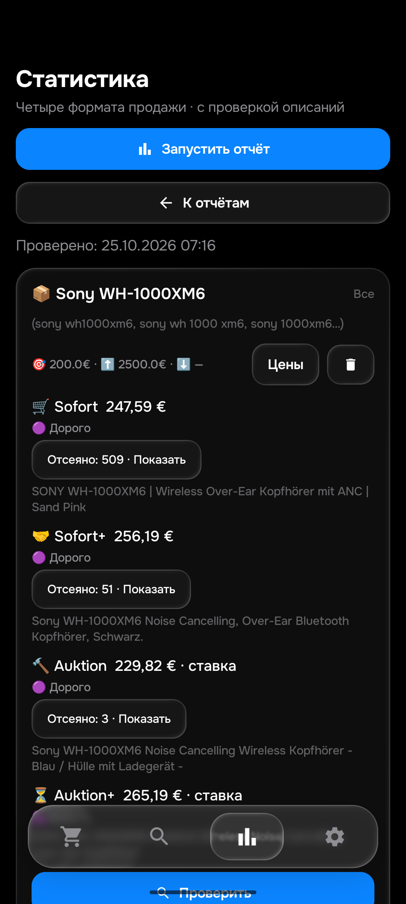

# XM6 и оставшиеся товары — APK0.168,25 октября2026

Общая приёмка26товаров/104корзин остаётся открытой. Этот этап исправляет четыре
исторических ложных отказа Sony WH‑1000XM6; повтор45описаний не является45новыми
чтениями сайта. Физический телефон и окнаПК не использовались.

## Найденные причины и исправления

1. WH1000XM6 и WH‑1000XM6 попадали в разные токены обязательного запроса.
   Канонизация выполняется только при сопоставлении идентификатора модели в
   Python/Kotlin. Исходные заголовки, пользовательские стоп-слова и hashes не
   переписываются. Семейства WH/WF и поколения5/6 остаются разными.
2. Для целых наушников с чехлом требовалось слово «наушники» в собственном
   описании, даже когда заголовок уже прямо называл устройство. Поэтому отказ
   получали короткое итальянское описание состояния и текст «Sony WH1000XM6
   with case». Теперь точное имя модели также служит подтверждением устройства;
   явный заголовок устройства допускает короткий текст состояния. Для
   неоднозначного «модель | case» подтверждение включённых наушников обязательно.
   Чехол первым предметом, «только чехол», отсутствие наушников, чужая модель,
   запчасти, дефекты и пустое описание остаются отказами.

Исторические лоты:[189045616652](https://www.ebay.de/itm/189045616652),
[820081834730](https://www.ebay.de/itm/820081834730),
[358691487664](https://www.ebay.de/itm/358691487664),
[206583627055](https://www.ebay.de/itm/206583627055).
На исходной167:45точных входов,4расхождения. После:45входов,0расхождений;
43целых устройства,1другая модель,1самовывоз с отдельным ограничением доставки.
В этом повторе цена/регион подготовлены нейтральными, это не доказательство
реальных цен или права доставки. Хэши исходных описаний и оценок сохранены.

## Проверки

- 16общих примеров ×2категории ×4формата =128сочетаний на каждую реализацию;
  отдельно18пар написания модели и12отрицательных проверок семейства/поколения.
  До исправления Python дал40провалов подслучаев, Kotlin новый тест падал.
- 594изолированных Python PASS,123,209с.
- 475Android JVM PASS/108наборов/0skip, включая104прежних own без расхождений.
  Обе сборки PASS. Native167 воспроизводит отказ189045616652; native168 все45
  XM6 PASS, затем прежние25own PASS. Прежний набор восстановлен.
- Исходные3970снимков не переписаны. Для13снимков явно проверены названия
  WH1000XM6 и неизменённые суммы выше200: причина отказа исправлена отдельным
  файлом с «filtered» на «over_limit». Нет own — нет утверждения о доставке.
- Обновление на эмуляторе:50поисков/все столбцы,seen/feed/история/баны и
  зашифрованные настройки сохранены. Room9→9. QAnotifyfalse/qa-local/isolated.
- History53 сохранён: исправлены ложные отказы, основания исключать прежние
  подтверждённые покупные наблюдения не обнаружены. История не удалялась.

## Свежие проверки эмулятора

|Товар|Sofort|Sofort+|Auktion:ставка|Auktion+:ставка|Результат|
|---|---|---|---|---|---|
|Sony WH-1000XM6|[247.59€](https://www.ebay.de/itm/128154430474?_skw=sony+wh-1000xm6&hash=item1dd6996c0a:g:LA8AAeSwmjNq3Rnh)|[256.19€](https://www.ebay.de/itm/800821116378?_skw=sony+wh-1000xm6&hash=itemba74a87dda:g:phEAAeSw4vRq2K6M)|[229.82€](https://www.ebay.de/itm/227575958817?_skw=sony+wh-1000xm6&hash=item34fc958d21:g:qjQAAeSwscdq17~s)|[265.19€](https://www.ebay.de/itm/336857833225?_skw=sony+wh-1000xm6&hash=item4e6e4a9f09:g:07oAAeSwWSVqvWJH)|165.961с; лимит200.0€|
|Logitech Superlight 2|[74.90€](https://www.ebay.de/itm/298232475701?_skw=logitech+g+pro+x+superlight+2&hash=item45700a7035:g:B5cAAeSwJy5p4NyY)|[64.18€](https://www.ebay.de/itm/137872306697?_skw=logitech+g+pro+x+superlight+2&hash=item2019d47209:g:9osAAeSwFppq3S4j)|❌ Не найдено подходящих · Отсев кандидатов (8): нет Superlight 2 ×8|[56.19€](https://www.ebay.de/itm/920071979595)|105.097с; лимит45.0€|
|Logitech Superlight 2 Dex|[80.91€](https://www.ebay.de/itm/406218262078?_skw=logitech+superlight+2+dex&hash=item5e947ec63e:g:BLsAAeSwIqRoyYPT)|[82.18€](https://www.ebay.de/itm/287501902036?_skw=logitech+superlight+2+dex&hash=item42f072e0d4:g:HAoAAeSwl85qcT60)|⚠️ Запрос не выполнен: сайт eBay отклонил запрос (403)|⚠️ Запрос не выполнен: сайт eBay отклонил запрос (403)|203.747с; лимит65.0€|

XM6:четыре корзины за165,961с, ошибок запросов нет. Все суммы выше200€.
Собственные тексты четырёх минимумов прочитаны полностью из фактического Android
кэша: целые наушники с комплектом, заявленных функциональных дефектов нет.
Python на тех же подробностях согласен с моделью, ценой/доставкой/импортом и
отсутствием права уведомления во всех4. Для сравнения представлен Money вместо
внутреннего числового EUR, суммы не менялись. Начальная обёртка восстановлена,
а не выдана за оригинальную SERP. Это не отдельное независимое Chrome-чтение.

Обычная Superlight2:105,097с,74,90/64,18/нетподходящих/56,19€;последняяставка,
все найденные выше45. Три own прочитаны и повтореныPython: суммы/модель/нет
правауведомления совпали. В обычной аукционной выдаче8отказов:чужойбренд,
Superlightбез2,G305,Superstrike. Три неоднозначных заголовка отдельно открыты
настоящими страницами, потом Chrome: в описаниях/характеристиках нет
подтверждения второго поколения. У137859787402 диагностическая причина
«запчасть/состояние» слишком общая; поиск причины остаётся открытым. У двух
из них гибрид:37€/55€ и32€/45€ — ставка/покупка, не изменение цены между ними.
Тонкая обёртка direct diagnostic не доказывает правильность цены гибрида.

DEX:203,747с,80,91/82,18€ выше65;двааукциона403. Оба own прочитаны, это целые
DEX;Refurbished разрешён для мышей, собственный текст75,99€ короткий, но модель
прямо подтверждена. Ошибки403 не объявлены нулём. Изолированный эмулятор не имеет
APIключей: резерв предусмотрен кодом, но на этом устройстве не мог сработать.
Ключи production в него не переносились.

## Повтор через подключённый Chrome

После просьбы пользователя25октября Chrome подключён. Посещено16разных ID:
полные видимые собственные тексты прочитаны у15;206583627055 перенаправляется в
каталог с другим лотом, его текст повторно не подтверждён.189045616652 завершён,
исходное описание раскрыто кнопкойOriginalangebot;358691487664 не в наличии,
но собственное описание доступно. Это не разрешение отправлять завершённые
или распроданные товары. Тексты15свежих Chrome входов повтореныPython/ART:
0расхождений по релевантности (12правильных устройств,3неподтверждённыхSuperlight2).
Цена/регион/доступность в этом повторе подготовлены; он не подтверждает уведомления.
Не суммировать эти пересекающиеся ID с45историческими как60новых товаров.

В Chrome DEX/world/Auktion явно0точных результатов и рекомендации ниже.
Это независимый ноль именно полученной браузером страницы, а не основание
переименовать реально полученный APK403 в ноль. В покупной выдаче при
«NiedrigsterPreisinkl.Versand»49точных карточек отделены видимой границей
«ErgebnissefürwenigerSuchbegriffe» от дополнительных рекомендаций. Первые8—
глайды/PCB/кабель/донгл; следующие два целых устройства совпадают сAPK80,91/82,18€.
49карточек не выданы за49прочитанных описаний. Проданные на этом этапе ещё
не перепроверены; новая общая просьба перепроверить безChrome-проверки остаётся
активной для остальных товаров.

Первоначальная гипотеза о доставке6,19€ у227575958817 ОТОЗВАНА. Сохранённый
вход APK:203,76+26,06=229,82€. Новый Chrome и повтор прямой Android загрузки:
223,28+26,87+0импорт=250,15€. В первом комментарии новая ставка была ошибочно
сопоставлена со старым итогом; это ошибка нашей сверки, не подтверждённый дефект
доставки продукта. Rawнепереписаны; изменение сумм фиксируется отдельно.

## Внедрение и ограничения

APK0.168/code168/rules1792912318/History53, SHA256
`afa63e43bf5d9c445bb8d5744afaa1fc210c4feefc513c3b3de65258e4b5f4c4`.
[Закрытый release](https://github.com/GitGayHub/e-monitor-android/releases/tag/v0.168).

Сервер подтвердил применение: 2026-10-25T07:25:10+00:00

Normal,f92,получатель,50поисков48активных,лимиты и порядок сохранены.
Исходная публикация не изменяет config,seen,feed,базы или настройки. HTMLосновной,
APIрезервный, два рабочих ключа из KEY2_167 сохранены. Дополнительные тестовые
Telegram сообщения на этом этапе не отправлялись; GUIдоставка и≤15мин не доказаны.

Chrome подключён пользователем и использован через браузерный инструмент,
без нативной активации окна. AyuGram в другом чате не переключался.
Результат одного скана не доказывает весь рынок и все алиасы.
Остальные товары, вся26/104приёмка и40–50own/product остаются открыты.
Consumer запросов удаления и исторические копии Git из KEY2_167 также открыты;
никакие реальные deletion события этим этапом не подтверждались/неудалялись.
Отзыв ложной гипотезы mojibake162 сохранён.
