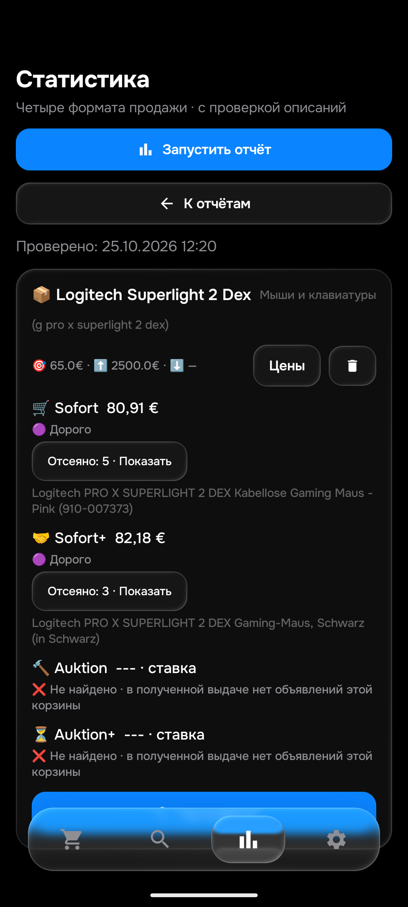

# APK0.171 — характеристики целой мыши и независимая DEX-сверка

25октября2026. Продолжение [REVIEW_170](REVIEW_170.md). Общая26/104 приёмка остаётся открытой.

## Что исправлено

Все7расхождений этапа170 разобраны и устранены:127834153963,198727394973,407061585634,407186922492,137845524615,257767344896,127834180388.

| Причина | Новое поведение |
|---|---|
| kabelgebunden/kabelgebundene считалось отдельным Kabel | В названии, которое начинается с модели и прямо называет товар мышью, проводное подключение считается характеристикой. Отдельное существительное Kabel, запчасти, совместимость и ремонт сохраняют отказ. |
| OpenBox считалось продаваемой коробкой | После явного названия целой мыши это состояние упаковки. NurBox/безмыши/коробка перед моделью остаются отказами. |
| 95hAkku считалось отдельным аккумулятором, включая сохранённое стоп-слово | Точная характеристика времени работы рядом с Wireless/кабеллос/DPI не является запчастью. Ersatzakku, аккумулятор без устройства, прочие стоп-слова и дефекты сохраняют отказ. Сохранённые списки слов не переписывались. |
| Усечённое «GamingMausfür» безLogitech считалось аксессуаром | Модель и явная мышь передfür подтверждают назначение; последующие правила всё равно отсекают настоящие детали и неправильную модель. |

Правила одинаковы вPython/Kotlin и действуют для подходящих заголовков STD/DEX/SE/Superstrike. Они локально маскируют точную характеристику, не переписывая показанное название и не пропуская проверку собственного описания.20общихконтролей включают кабели,аккумуляторы,пустые коробки,PCB,другую редакцию и дефекты. До6Python-провалов/JVMFAIL/native0.170FAIL; послеPASS.

## Независимые тексты и проверки

- Все49точных уникальныхID из сохранённой покупной DEX-выдачи открыты вChrome, полные видимые собственные описания прочитаны.39целыхDEX,8деталей,1обычнаяSuperlight2,1DEXSE. [Таблица49карточек](DEX_171_CASES.md).
- С учётом7XM6 и6STD получен набор62описаний. Он сходится вPython и AndroidART;62 включает прежние53/37/24, эти количества не складываются.
- ВChrome открыт раздел проданных:43карточки/41разныйID. У3первых отдельно раскрытоOriginalangebot, прочитаны sellerописания. Все3—детали и правильно отвергнуты. Расширенный набор65Python/ART—0расхождений. Остальные38уникальных проданных ещё не приняты; soldаукционы пока не открывались.
- Все модельные replay используют подготовленную цену/регион/доступность. Это проверка релевантности, не доказательство уведомления по завершённому лоту.206583627055 по-прежнему перенаправлен на другой товар, его own не подтверждён.960048498813 имеет снятые магнитыPowerplay, не выдавать за заводской комплект.
- 598изолированныхPythonPASS,97,573с.479JVM/111наборов/0skip,104прежнихown0расхождений;обе сборкиPASS54с.
- Native0.171:20контролей+25старыхown+62→65ChromePASS. Нативные прогоны завершены, не ожидать их как работающие.
- Старые3970снимков сохранены.8ожиданий для5прочитанных целыхDEX явно скорректированы в отдельной таблице:filtered→over_limit, суммы и accepted=false неизменны. Первый полный прогон обнаружил эти8Python/2JVMотказа; это не разрешение Telegram без описания.

## Свежая проверка четырёх корзин

Один прогон толькоDEX, APK0.171,106,513с. HTMLосновной,QAбезAPIключей,уведомления выключены.

| Корзина | Результат |
|---|---|
| Sofort | [406218262078](https://www.ebay.de/itm/406218262078),80,91€, доставка0; Дорого при лимите65€ |
| Sofort+ | [287501902036](https://www.ebay.de/itm/287501902036),75,99+6,19=82,18€; Дорого |
| Auktion | Получена пустая выдача корзины, ошибки запроса нет |
| Auktion+ | Получена пустая выдача корзины, ошибки запроса нет |

Свежие собственные описания обоих минимумов прочитаны из Androidкэша; Python подтвердил модель,полную цену с доставкой и запрет уведомления по65€. Начальная обёртка восстановлена из отчёта, это не сыройSERP. Chrome ранее показал те же минимумы и явный0аукционов. Прежние реальные403 этапа168 не переименованы в0: в новом запросе доступ восстановился, универсальное устранение блокировок не доказано.

## Выпуск и сохранность

APK0.171/code171/rules1792930335/History53/Room9. SHA256`ad0bae97cb8fbc21fe86b7c088fbe05e346c7c3bbb326f7c77b499599ca7f800`.
[Закрытый release](https://github.com/GitGayHub/e-monitor-android/releases/tag/v0.171). Прежняя подпись, установка с сохранением данных только emulator-5580. Физический телефон и нативные окна ПК не использовались. ТестовTelegram не отправляли.

Сервер подтвердил применение 2026-10-25T12:27:57+00:00
Применение предыдущей0.170 отдельно подтверждено12:02:08UTC25октября. Normal/f92/50поисков48активных/получатель/цены/порядок сохранены; публикация исходников не менялаproductionconfig,seen,feed,историю.

Сохранность проверена приустановке/нативных повторах и после свежей статистики:50строк/все столбцы,зашифрованные настройки,seen/feed/история/баны прежние,Room9→9. Новых price_snapshots вQA:0; изменён толькоlogic_version_ts. QAqa-local/isolated,notify=false,worker=false,безAPIключей; QAнепубликовался. После дополнительного65повтора восстановлены дваQAфайла с прежними25примерами, MainActivity можно открыть после завершенияinstrumentation.

## Что дальше

Продолжить41уникальный soldDEX:сейчас прочитаны3, далее187320103757/187286217182/157333731141 и остальные; отдельно дешёвые406777772858(заявлен сломанный скролл),358824982052/327241466633(назначение/состояние ещё проверить). Цену принятого предложения нельзя считать известной по зачёркнутой или показанной исходной цене.

Затем пройти soldаукционы/остальные товары, включая оставшуюся независимую проверкуSTD,Asus,Samsung500Гц,Sony/RayBan. Общие26товаров/104корзины/40–50ownнакаждый,≤15мин,новыйTelegramGUI и consumer реальныхdeletionсобытий/историческиеGitкопии ещё открыты. Дварабочихключа/Worker сохранены. Мнимыеошибкиmojibake162 и доставки6,19€227575958817 остаются отозванными. Не повторять завершённыеguard168/171безпричины.
