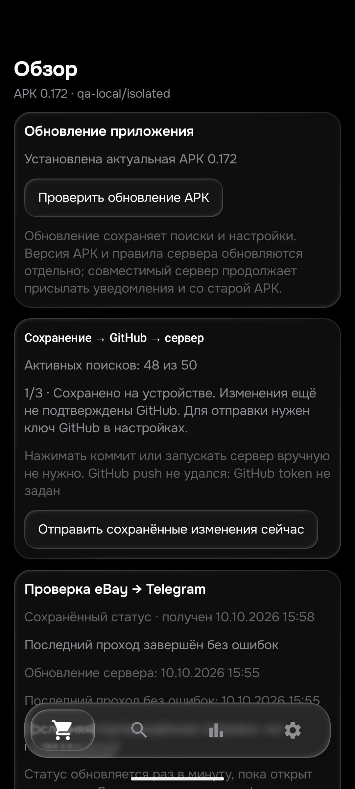

# APK0.172 — проданные DEX и дефект предыдущей мыши

25 октября2026. Продолжение [REVIEW_171](REVIEW_171.md). Общая приёмка26товаров/104корзин остаётся открытой.

## Подтверждённая ошибка и исправление

У [407097409757](https://www.ebay.de/itm/407097409757) вChrome раскрыто собственное описание: продаётся новая нераспечатанная замена от производителя, а дефект был у прежней DEX.0.171 ошибочно отвергала её по словуDefekt.

Python/Kotlin теперь снимают только точную фразу о прошлой неисправной мыши при явном контексте новой запечатанной замены от производителя. Отрицание, условное обещание, отсутствие подтверждения новой замены и любые поломки продаваемого устройства сохраняют отказ. Списки стоп-слов не переписаны. Отдельные коробки, неправильная редакция и неполное описание проходят остальные прежние проверки.

14общихконтролей. До:2Python-провала,1JVM-провал, настоящийnative0.171FAIL на исходном случае. После:Python/JVM/nativePASS, включая поломку новой мыши в следующем и том же предложении, отрицание, гипотетическую замену и ремонт вместо замены.

## Независимая проверка Chrome

- Исходная sold-покупная выдача:43карточки/41уникальныйID. Все41страницы открыты,40собственных описаний прочитаны. [178426866768](https://www.ebay.de/itm/178426866768) перенаправляет вкаталог обычнойSuperlight2; исходное объявление не подтверждено. Дубли186694087518/186674446101 не увеличивают счётчик.
- Дополнительно открыт sold-аукцион:1точный DEX перед«Ergebnisse für weniger Suchbegriffe». [278371345532](https://www.ebay.de/itm/278371345532): исправная мышь с оригинальными аксессуарами, показано65€+6,19доставки=71,19€, выше лимита65. Описание прочитано. Для завершённого лота уведомление не разрешено.
- Итого sold:42разныхID/41прочитанное описание,25подходят по модели/состоянию,16отказов. [Все41вердикт и одна недоступная страница](DEX_SOLD_172_CASES.md). Это проверка релевантности; показанная цена при принятомoffer не доказывает фактическую сумму сделки.
- С прежними49активными DEX и6пересечениями получается85разных DEX-ID/84own. Плюс7XM6/6STD—97разных прочитанныхID. Прогоны65и41 содержат9пересечений;106проверочных входов нельзя объявлять106уникальными объявлениями.
- [406777772858](https://www.ebay.de/itm/406777772858) действительно имеет неисправный скролл, без приёмника. У рабочей [358824982052](https://www.ebay.de/itm/358824982052)60€+6,19=66,19€, тоже выше65. Новые ножки у327241466633/267810724913 и коробка с повреждением у237126774150 не превращают целую мышь в запчасть.
- [389614096225](https://www.ebay.de/itm/389614096225): заголовок/полеModelDEX, но собственный текст одновременно утверждает86г/AA/HERO25K/300часов и60г/USB-C/HERO2/95часов. Конкретная комплектация не подтверждена, отказ сохранён; по стоковой фотографии нельзя объявлять настоящую другую модель доказанной.
- В двух пустых встроенныхiframe полный текст открылся по настоящему видимому адресуiframe. Это наблюдение браузера, не доказанный дефект production-загрузчика.
- Повтор обычной аукционной выдачи вернул настоящуюSORRY«Something went wrong on our end». Ранее удачный запрос не был переписан вошибку, ошибка повтора не превращена вноль. Новый комбинированныйsoldAuction+BO снова дал тотже1лот, но интерфейс не подтвердил отдельный фильтр предложения цены: его историческийbestOffer не доказан одним параметромURL.

## Проверки и выпуск

-599PythonPASS,94,895с;480JVM/112наборов/0skip.104старыхown:0расхождений. Обе сборкиPASS, финальная63с.
- Python40sold:1расхождение до→0после. Дополнительныйаукцион расширил набор до41. Native0.172:14контролей,25старыхown,41sold и65прежнихChrome PASS. Проверки65/41 используют подготовленные цену/регион/доступность, не доказывают реальные условия отправки или актуальные минимумы.
-3970старыхснимков/прежние таблицы ожиданий не менялись. Новых сетевых4корзинныхсканов172не делали; свежий171DEX106,513с80,91/82,18/пусто/пусто остаётся отдельным результатом, не новым172сканом. Завершённыеguard171не повторялись.

APK0.172/code172/rules1792933111/History53/Room9. SHA256`e8c589600d686ba9a52b3ac3775bfec4bec9d17313eb431024e430a2fca7e913`.
[Закрытыйrelease](https://github.com/GitGayHub/e-monitor-android/releases/tag/v0.172). Установлена с прежней подписью толькоemulator-5580. Сервер подтвердил применение 2026-10-25T13:07:07+00:00.

50строк и все столбцы, зашифрованные ключи,seen/feed/история/баны сохранены. Room9→9; новыхQAprice_snapshots0; изменён толькоlogic_version_ts. QAqa-local/isolated,notify/worker/автосинхронизация выключены,APIключейнет; QAне публиковался. Послеnative восстановлены дваQAфайла с25старыми примерами. Экран«Обзор»0.172 проверен; старый runtime10октября вQA явно подписан сохранённым и не выдаётся за production.

Исходники опубликованы вmainбота и обеихcodex/cloud-work. Никаких productionрежима/получателя/50поисков48активных/f92/цен/порядка/seen/банов/ключей не изменяли. Настоящих новых тестовTelegram не отправляли, GUIдоставка и≤15мин не подтверждены.

## Продолжение

Оставшаяся независимая Chrome-сверка STD,Asus,Samsung500Гц,Sony/RayBan и остальных товаров. Не считать старые повторы новыми чтениями. Глобальная26/104/40–50ownнакаждыйтовар,≤15мин,свежаядоставкаTelegramнаПК и consumer реальныхdeletionсобытий/историческиеGitкопии ещё открыты. Два рабочихAPIключа иWorker сохранены. Отзывы гипотезmojibake162 и доставки6,19€227575958817 действуют.
