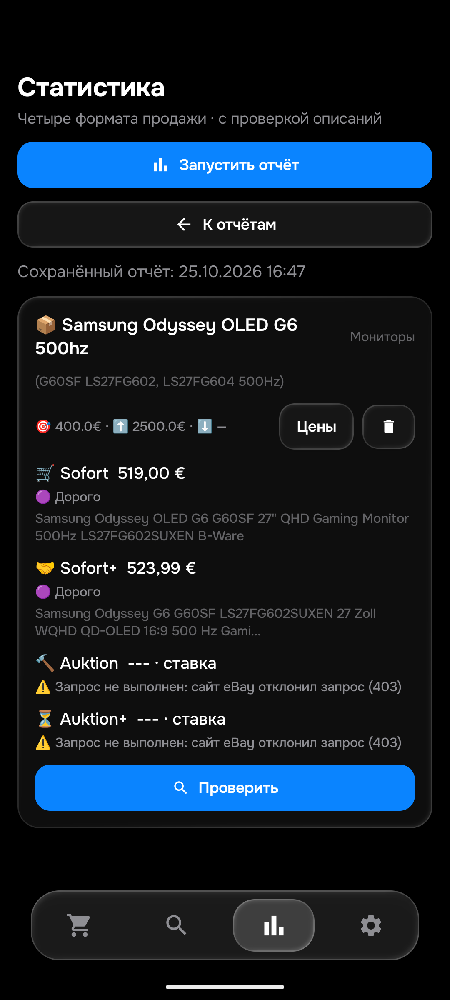

# Этап174 — Samsung500Гц, Asus и контрольный Leading; APK0.172

25октября2026. Это этап приёмки, новойAPK0.174нет. Исходники не менялись. APK0.172/code172/rules1792933111/History53/Room9, SHA256`e8c589600d686ba9a52b3ac3775bfec4bec9d17313eb431024e430a2fca7e913` сохранены. Предыдущие599Python/480JVM относятся к выпуску172; новый этап не выдаётся за повтор полногонабора.

## Asus: где теряются два кандидата

Из свежего173отсева восстановлены точныеID. [297923526267](https://www.ebay.de/itm/297923526267) открыт вChrome, собственноеописаниепрочитано: VivoBook18X/18дюймов/IPS/AMD Radeon, ане14X/OLED/RTX3050. Это действительно другая конфигурация, не пропущенныйцелевойM7400. Python и настоящийAndroidART подтвердили отказ на точномтексте.

Второй [266912728806](https://www.ebay.de/itm/266912728806) имеет в карточкеM1605YA/16дюймов/matt/Ryzen5, но собственнаястраница вChrome вернула настоящуюSORRY. Егоописание не подтверждено; по одной карточке не заявляется полная проверкаэкземпляра.

Ранее зависший активный Asus-аукционный запрос прочитан вChrome:0/Keine exakten Treffer gefunden, рекомендации ниже. Это конкретный основнойзапрос с видимымиусловиями, не всеалиасы и не тотжеответ, который APKполучила как403. Старый173sold0 не был подставлен вместо этого нового наблюдения.

Затем соединение Chrome после прерывания потеряло возможность читатьстраницы(Debugger unattached), хотя инвентаризация видела вкладку. Документированныепереподключение и перезагрузка не помогли; строгофоноваяноваявкладка недоступна. ОкнаПК не активировались. Пользователь сообщил о перезапускеChrome; соединение требуется проверить заново. НовыхChromeописаний наэтапе1, не19.

## Samsung: актуальная цена и состояние

Один новый изолированный прогон APK0.172:76,303с, HTMLосновной,APIключейвQAнет.

|Корзина|Свежий результат|
|---|---|
|Sofort|[307167578900](https://www.ebay.de/itm/307167578900),519+0=519€, Дорого при400|
|Sofort+|[398162444700](https://www.ebay.de/itm/398162444700),500+23,99=523,99€, Дорого|
|Auktion|Настоящий403 в полномпрогоне, не ноль|
|Auktion+|Настоящий403 в полномпрогоне, не ноль|

Два собственныхописания изнастоящего Androidкэша прочитаны: правильныеOLED/500Hz/S-SKU; у частного продавца явно нетpixelerrors/царапин, работаисправна. Python повторно извлёк цену/доставку изподробностей, подтвердил суммы и запретуведомления выше400. Начальнаяобёртка восстановлена, не сыройSERP; числовыеEURполяAndroid преобразованы вPythonMoney без изменения сумм.

Восстановлены18точных **исторических** SamsungChromeтекстов6октября с сохранёнными независимымивердиктами.13целыхподходящих,3явныхнеподходящих(IPS350/двезащитныеплёнки),2неподтверждённыхназначенияkompatibelmit. Точные собственныехарактеристики изстарогоChrome также сохранены. Python иAndroidART повторили18безрасхождений. Это не18новыхпосещений, не автоматическоеувеличениесчётчикаполныхручныхчтений и не полныйновыйкаталог. ВместесновымAsus—19входов,0расхождений вкаждойреализации. ОфициальныйSamsungFAQ127332124787 внеэтого18набора; прежняяоговорка онеподробномFAQиобрезанномюридическомхвосте действует.

## Три аукционных названия: конкретная причина неполноты

Для каждого отдельно выполнена ограниченнаядиагностика обычногоHTML-клиента APK с его реальнымURL и свежимбюджетом WebView; затем одно **другое по времени** открытие тойжестраницы. Лог/полныйHTML/видимыетексты сохранены приватно. HTTPвсе6ответов403, безchallenge-маркера; обычныйWebView показывает другойрезультат.

|Вариант|Обычная проверка|Следующее отдельноеоткрытие|
|---|---|---|
|samsung odyssey oled g6 500hz|Подтверждённый0|SORRY/временнаяошибка|
|G60SF LS27FG602|Подтверждённый0|Подтверждённый0|
|LS27FG604 500Hz|SORRY/временнаяошибка|Подтверждённый0|

Итого обычныйпроход2из3точныхпопуляцийуспешны. Это доказывает нестабильность ответов, ане отсутствие лотов во всехвременах. Последующий0не переписывает предыдущуюошибку. Все403полногоотчёта не объявленыисправленными; кодради получениязелёногостатуса не менялся.

При полномпрогоне использованпредел8WebViewнапродукт, вконцелога есть пропускочереднойзагрузки прибюджете8. Однако первичныйзапрос доэтого реальноуспевалполучить0, другойalias—SORRY. Диагностикасновымбюджетом также даётSORRY. Следовательно, весьсбой нельзя приписать одномулимиту и бездоказательствсниматьограничениепамяти. ВQAAPIрезервнеподключался, productionдваключасохранены.

## Контрольный Nubia Z80 Ultra Leading

Одинновыйпрогон4корзин,51,431с:все4получили настоящуюстраницувременнойошибки eBay. Это **не подтверждённое «Не найдено»**, результатконтрольнойприёмки остаётсяоткрытым.

Отдельнаяограниченнаядиагностика толькоосновногоаукционногоalias дала обычныйWebView0, следующееоткрытие—SORRY; HTTP403. Значит, явныйноль уже распознаётся какуспешнаяпустаяпопуляция, но нельзя им подтверждатьнепроверенныеостальныеалиасы/форматы. Отсутствиеособоймодели не используется дляподмены ошибкизагрузки заранееизвестнымответом.

## Настоящий Telegram наПК

В открытомAyuGram безактивацииокна независимо прочитаны11сообщений0.172 и совпали с подтверждённойлентой по лоту/товарнойцене/доставке/итогу/этапу/версии.5HTML и6API, укаждого тип«Фотография». Раннийчасовойэтап120214 найден вотдельномисторическомcheckpoint, поскольку текущаялентасохраняетпоследнийэтапналот. [Таблица11доставок, точнаясверкаиограничения](TELEGRAM_174.md).

Это новое подтверждениетекстового наличиясообщений вреальномклиенте, ане толькоуспехBotAPI. Полученныйснимокотносилсякперекрывающемуокну, поэтому визуальнуюпроверкуфото/ссылок/кнопокнеобъявляемпройденной. Новыхсообщенийнепосылали. Исходныеполяпродукта не меняли из-запервоначальных ошибокQAразбораденег/историческойзаписи.

## Сохранность и следующий шаг

Эмуляторвначалеэтапа былвыключен—отсутствиепроцессапроверено. Перезапущен прежнийEMonitor_QA_API36/5580 строгобезокна, безсбросаданных. После boot_completed=1 подтвержденыAPK172 итеже50строк/ключи отэтапа173. Native19и4сетевыедиагностикизавершены; guardобоих4корзинныхпрогонов завершён, summary/reportсохранены. Не перезапускать ихвслепую.

Первыйснимокпослеnativeзахватилещёнеготовыйэкран; XMLdumpнесоздался, это не объявленобагомприложения. Послеотдельногостарта/ожиданияготовности отчётоткрыт и визуальнопроверен. Нативныйдиагностическийэкран не смешивался сMainActivityво время теста.

После всехпроверок:Room9→9,50поисков/всестолбцы/app_config/seen/feed/история/баны/зашифрованныеключисохранены, QAцен0новых. ДваQAфайласпрежними25примерамивосстановлены. QAqa-local/isolated,notify/worker/автосинхронизациявыключены,APIключейнет; QAнепубликовался. Физическийтелефон/нативныеокнаПКнеиспользовались. Исходники/версиянеповышались.

Серверповторноподтвердил172:runtime16:52:44UTC25октября,normal/f92/50поисков48активных. Последнийпроход13попыток/6полныхуспехов/21описание/0новыхподтвержденийTelegram; 13−6неравночислусетевыхошибок. Последнееизвестноеподтверждениенаснимкеruntime16:38:18UTC; отдельно текстовое чтениеAyuGramподтвердило11сообщений172. Снимкиполученывразноевремя;визуальныйскринTelegramнеподтверждён. Скорость≤15миннеподтверждена.

Далее:восстановитьChromeпослеперезапуска, закончитьактуальныенезависимыеSamsung/Asus ирасширитьгруппыбезсчётчиков, затемSTD/остальные. Общая26/104/40–50ownкаждого/≤15мин/новыйTelegramGUI/deletionconsumerGitостаётсяоткрытой. Не складыватьповторывновыеID. Отзывыmojibake162/доставки6,19€и2рабочихAPIключа/Workerсохранены.
