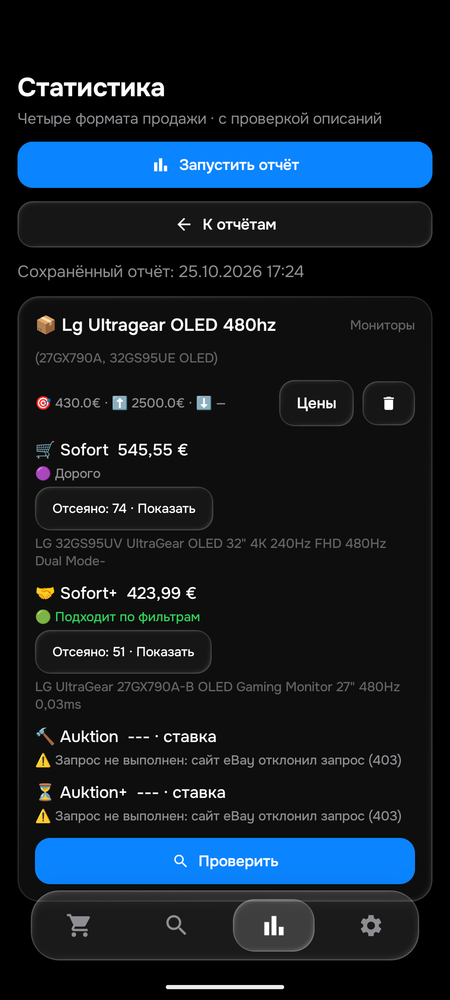

# Этап175: LG480Гц и наблюдаемая доставка

25октября2026. Аудит актуальной APK0.172/code172/rules1792933111/History53/Room9; новой APK175 нет. [Предыдущий этап](REVIEW_174.md). Общая26товаров/104корзины/полная ручная приёмка и доставка от публикации≤15мин ещё открыты.

## Свежие четыре корзины на эмуляторе

Один законченный прогон,100,013с, HTML основной. QA изолирован: без API-ключей, notify/worker/autosync выключены. Ошибки QA без API не доказывают отсутствие резервного источника в production.

| Корзина | Фактический результат |
|---|---|
| Sofort | [336859330555](https://www.ebay.de/itm/336859330555),500+45,55=545,55€,дороже430. Италия; целый исправный32GS95UV OLED с dual-mode480Гц. |
| Sofort+ | [800366377085](https://www.ebay.de/itm/800366377085),405+18,99=423,99€,ниже430. Германия; целый27GX790A-B, собственное описание прочитано. |
| Auktion | Настоящий отказ eBay403. Не ноль результатов. |
| Auktion+ | Настоящий отказ eBay403. Не ноль результатов. |

Два собственных описания прочитаны из актуального Android-кэша. Python заново применил описание, обновлённую цену и доставку: суммы равны Android. Денежное поле htmlShippingCost детерминированно преобразовано из числаEUR в объектMoney; исходные суммы сохранены. Начальная обёртка реконструирована, первоначальнаяSERP не доказана. Проверка цены/времени проходит для423,99€; production seen/баны/доставка этим replay не проверяются, настоящий Telegram не отправлялся.

Отчёт открыт в обычном интерфейсе после завершения instrumentation, снимок визуально проверен.

## Точные сохранённые описания

23исторических Chrome-записи5–6октября повторно прочитаны и сопоставлены с текущими Python/AndroidART:14положительных по модели/состоянию,9отказов,0расхождений. Три из23 имеют пустое/N/a описание и остаются непроверенными; это20непустых собственных текстов, не23новых чтенияChrome и не доказанная выборка40–50. Счётчик общей приёмки не увеличен. Метаданные цены/региона/доступности подготовлены только для проверки релевантности.

Первая независимая оценка227242702853 поверила продавцу:«27GX700A-B480Hz». До повторной реализации она сохранена отдельно; Python её отверг. Затем первичный источник [официальная спецификацияLG27GX700A](https://www.lge.co.kr/product/monitors/27gx700a) подтвердил максимум2560×1440@280Hz. Исправлена наша оценка, код фильтра не менялся. Это не ложный отказ480Гц. У278435824228 продавец прямо пишетIPS в основном названии и таблице: отказ сохранён, модельный код не отменяет противоречивое описание.

| Лот | Независимый итог | Python/ART |
|---|---|---|
| [800366377085](https://www.ebay.de/itm/800366377085) | Подходит по модели/состоянию | PASS |
| [800461000257](https://www.ebay.de/itm/800461000257) | Seller body N/a: unverified | PASS |
| [406982298991](https://www.ebay.de/itm/406982298991) | Подходит по модели/состоянию | PASS |
| [278435824228](https://www.ebay.de/itm/278435824228) | IPS explicitly claimed in sold item heading and seller panel table; OLED conflict | PASS |
| [187394349697](https://www.ebay.de/itm/187394349697) | Подходит по модели/состоянию | PASS |
| [405736889294](https://www.ebay.de/itm/405736889294) | Подходит по модели/состоянию | PASS |
| [287396108161](https://www.ebay.de/itm/287396108161) | Подходит по модели/состоянию | PASS |
| [188554142216](https://www.ebay.de/itm/188554142216) | Подходит по модели/состоянию | PASS |
| [206457508013](https://www.ebay.de/itm/206457508013) | Подходит по модели/состоянию | PASS |
| [388012224993](https://www.ebay.de/itm/388012224993) | Подходит по модели/состоянию | PASS |
| [397931913066](https://www.ebay.de/itm/397931913066) | Подходит по модели/состоянию | PASS |
| [227242702853](https://www.ebay.de/itm/227242702853) | 27GX700A: official LG maximum 2560x1440 at 280Hz; seller title 480Hz is wrong | PASS |
| [800475279971](https://www.ebay.de/itm/800475279971) | 27GX704A, 240Hz, not requested 480Hz | PASS |
| [800461000171](https://www.ebay.de/itm/800461000171) | 34GX900A, 240Hz, not requested 480Hz | PASS |
| [146610218933](https://www.ebay.de/itm/146610218933) | Подходит по модели/состоянию | PASS |
| [397791212905](https://www.ebay.de/itm/397791212905) | Подходит по модели/состоянию | PASS |
| [198664348403](https://www.ebay.de/itm/198664348403) | Подходит по модели/состоянию | PASS |
| [168097472160](https://www.ebay.de/itm/168097472160) | Подходит по модели/состоянию | PASS |
| [800461000197](https://www.ebay.de/itm/800461000197) | Seller body N/a: unverified | PASS |
| [176583016765](https://www.ebay.de/itm/176583016765) | Подходит по модели/состоянию | PASS |
| [177973805605](https://www.ebay.de/itm/177973805605) | Empty own body: unverified | PASS |
| [287434681402](https://www.ebay.de/itm/287434681402) | Only stand base | PASS |
| [377163630632](https://www.ebay.de/itm/377163630632) | Replacement stand, explicitly no other parts included | PASS |

## Время Telegram

Для11сообщений, независимо прочитанных в клиенте на этапе174, интервал от финальной проверки до подтверждения Telegram составил0,547–1,366с, медиана0,880с. Это ответ Telegram, не измеренная полная доставка от публикации eBay до пользователя. Первое обнаружение некоторых лотов было задолго до напоминания; возраст записи включает ожидание окна аукциона/повторный этап и не является временем обработки. Цена и право уведомления в момент первого обнаружения не восстановлены, время публикации неизвестно. Поэтому≤15мин не объявляется выполненным.

## Сохранность и ограничения

Все50поисков/все столбцы,app_config,seen,feed,история,баны,зашифрованные ключи сохранены,Room9→9. Новых QA-цен0. Два прежнихQAфайла с25контролями восстановлены после23нативных примеров. ПрогонLG и instrumentation завершены,guard не повторять вслепую;MainActivity открыта.

Пользователь подтвердил повторное открытиеChrome, но после ответа инструмент по-прежнему не перечислил Chrome ни среди подключённых браузеров, ни среди окон. ОкнаПК не активировались, физический телефон не использовался. НовыхChromeнаблюдений на этапе175 нет. Это ограничение подключения; независимую живую приёмку не подменяли архивом. Новый вопрос пользователю повторно не задан.

Исходники приложения/бота не изменялись;599Python/480JVM — результаты выпуска172, а не новые полные прогоны175. В175 отдельно выполнены23Python-сверки и23ART-примера, свежие4корзины и2проверки обновлённых сумм. Настоящие eBay403 сохраняют ошибку, никакой универсальный фикс доступа не заявлен. ДваAPIключа/Worker и режимnormal/f92/50/48 production не менялись.
