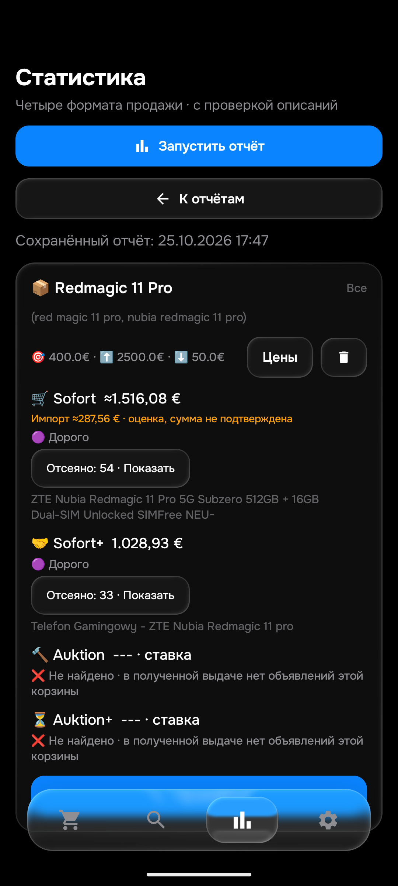
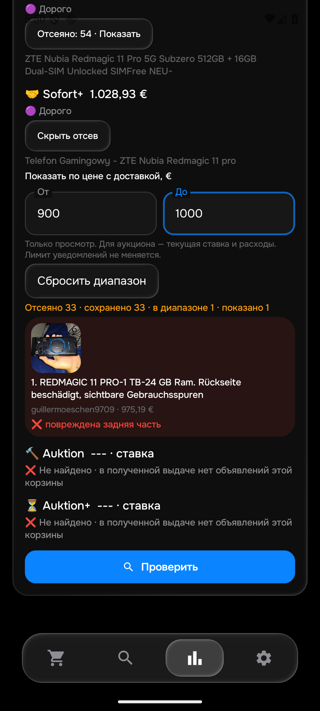

# APK0.173 — причина повреждения и Redmagic

Этап176,25октября2026. APK0.173/code173/rules1792950155/History53/Room9. SHA256 `a991895763e588de446d2ff1c05a9b33ee2831fb3a0f655f495b439c5934b35e`. Установлена толькоemulator-5580. [APK0.173 опубликована](https://github.com/GitGayHub/e-monitor-android/releases/tag/v0.173),авторизованное скачивание проверено поSHA256. Сервер подтвердил новые правила в2026-10-25T18:03:28+00:00,источники в рабочемcheckpoint совпали. normal/f92/50поисков48активных/цены/порядок/seen/баны/ключи сохранены.

## Исправлена реальная ошибка пояснения

Свежий скан172 ошибочно называл [целый Redmagic11Pro287678176214](https://www.ebay.de/itm/287678176214) «аксессуар/запчасть». Название сообщает повреждение задней части, не продажу отдельной крышки. Прямая загрузка собственного описания на Android подтвердила: повреждена только задняя часть, остальной телефон исправен, есть следы использования.969+6,19=975,19€,Sofort+. Собственное описание116символов,получениеCOMPLETE,проверка описания отвергла повреждение.

Теперь у целого телефона с моделью в начале и явным повреждением задней части показывается «повреждена задняя часть» с цитатой названия. Явные предложения Ersatz/replacement/запчастей остаются аксессуарами. Исходный лот по-прежнему исключён: исправлена причина, повреждённый телефон не разрешён. Python не менял предикаты: собственное описание и там остаётся отказом. История53/JSONschema1/Room9 сохранены.

На установленной172 нативная проверка этой причины упала; на173 прошла для четырёх форматов. JVM также воспроизвёл ошибку до исправления. После исправления проверены Redmagic/Pixel9ProXL/iPhone17ProMax×четыре формата, отдельные крышки и отрицание повреждения в состоянии. Первая локальная попытка упёрлась в цитирование ü/ue; исправлена привязка к исходному слову, затем все проверки прошли.

## Свежие живые выдачи

| Версия/товар | Sofort | Sofort+ | Auktion | Auktion+ |
|---|---|---|---|---|
|172/Redmagic11Pro,140,514с|[≈1516,08€](https://www.ebay.de/itm/307243827448)|[1028,93€](https://www.ebay.de/itm/237093350026)|403|403|
|172/Redmagic11SPro,96,708с|[≈2485,28€](https://www.ebay.de/itm/128050237207)|26отказов,нет подходящего|403|403|
|173/Redmagic11Pro,113,810с|[≈1516,08€](https://www.ebay.de/itm/307243827448)|[1028,93€](https://www.ebay.de/itm/237093350026)|Успех,нет объявлений этой корзины в полученной выдаче|Успех,нет объявлений этой корзины в полученной выдаче|

Новые успешные аукционные ответы не исправляют задним числом старые403 и не доказывают универсальный доступ. Изменение количества кандидатов146→87 относится к разным ответам eBay, не объявляется эффектом исправления подписи. HTML основной;QA без API-ключей не проверяет productionfallback. Повреждённый975,19€ в новом настоящем скане173 сохранён среди отказов с правильной причиной.

Три собственных описания минимумов получены из настоящего Android-кэша, прочитаны и повторены вPython: модель/состояние/итоговые суммы согласны. Оба британских лота содержат оценки импорта287,56€/468,79€,не подтверждённые сборы; польский1022,12+6,81=1028,93€ без импорта. Всё выше лимитов400/450. ПервоначальныйQAадаптер ошибочно задалDE и выключил импорт: его расхождение исправлено использованием фактической страны собственного адреса и сохранённых настроек, не изменением денежных сумм продукта. Начальные обёртки реконструированы;productionseen/баны и первоначальнаяSERP этим не доказаны. РеальныеTelegram в176 не отправлялись.

## Независимые сохранённые описания

Повторно прочитаны6исторических Chromeown6октября:2для11Pro,4для11SPro.11проверок на6уникальныхID вPython иART сходятся:5однозначных собственных моделей подходят по релевантности,6проверок соседнего11/11Sотвергнуты. Метаданные нейтральные,это не право уведомления. Не11новых лотов,не6новых Chromeнаблюдений.

У127895019519 название«11SPro+» и120W в собственном тексте; точная региональная модификация этим набором не принята, положительной оценки для обычного11SPro не заявлено. [Официальный глобальный11SPro](https://global.redmagic.gg/pages/redmagic-11s-pro) указывает80W. Отсутствие другой модификации в глобальном каталоге само по себе не доказывает её несуществование. Этот вопрос и расширение живой выборки остаются открытыми.

## Проверки и интерфейс

-599PythonPASS96,090с в отдельных файлах;483JVM/113наборов/0ошибок/0skip,включая104старыхown0расхождений. Первоначальный прогон пропустил privateSold: я не передал сохранённый файл. Повтор с исходной выборкой104 выполнил его, ожидания не менялись.
-Обе сборкиPASS47с. Нативные:причина172FAIL→173PASS,11модельных случаев и25старыхконтролейPASS. ДваQAфайла восстановлены точно.
-В обычном интерфейсе открыт настоящий новый отчёт173. В отсеянныхSofort+ введён диапазон900–1000€,33→1карточка. Фото загрузилось, цена975,19€ и причина повреждения видны. Это фильтр просмотра,лимит уведомлений400€ не изменился.
-Все50поисков/все столбцы/порядок/seen/feed/история/баны/зашифрованные ключи сохранены,Room9→9,новыхQAцен0. Вapp_config изменён толькоlogic_version_ts. Три живых прогона и один прямой diagnostic завершены,не перезапускать по старомуguard.

## Что не принято

Chrome всё ещё не подключён к инструменту;новыхChromeчтений0. Физический телефон не использовался,окнаПК не активировались. Общие26/104 и40–50независимыхown на товар,≤15мин от публикации,визуальные медиа/ссылки Telegram иconsumerdeletionGit ещё не завершены. ДварабочихAPIключа/Worker и отзывы mojibake162/ошибки сравнения доставки6,19 сохранены. APK173 — небольшой фикс причины,не объявление полной приёмки.

## Наблюдаемая скорость — открытая часть

Вruntime17:57:04UTC все48активных поисков имели отметку попытки,31из48 — за предыдущие15минут,самая давняя попытка2603с(43мин23с). Это свежесть попыток,не успешный охват и не задержка от публикации. Последний проход14попыток/2полныхуспеха/15описаний;14−2не объявляется количеством сетевых ошибок.

Оценка текущего плана:2,12попытки/мин;приоритетныйiPhone17ProMax≈6,6мин,Pixel9ProXL≈38,2мин. Это расчёт по пропускной способности и заданным владельцем местам,не гарантия доставки. ПриоритетPixel18 и порядок не менялись. Следующая диагностика скорости должна проверять очередь/стоимость запросов,сохраняя качество и заданные места;утверждение≤15мин не выполнено. РаботающийGitHubrun40216802152 не отменялся:занятое ожидание следующего запуска не равно простоям всего монитора. Подготовка текущегоrunner доmonitor заняла25с,браузер подготовлен успешно.

Текстовое чтение правильногоTelegramчата без активации окна пока не обнаружило0.173;новая настоящая доставка173 и визуальные фото/ссылки не заявлены. Прежние11сообщений172 остаются отдельным подтверждением этапа174.
