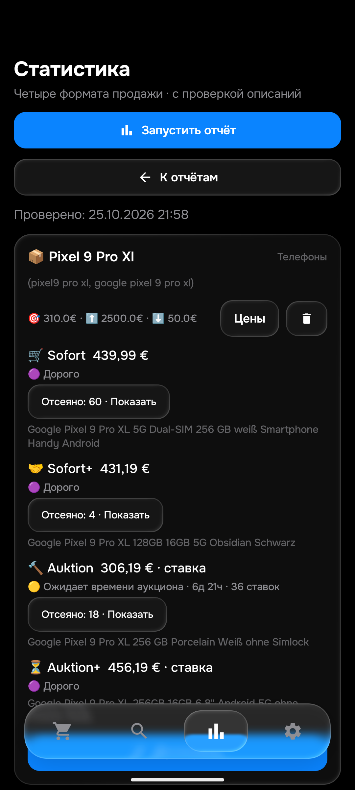
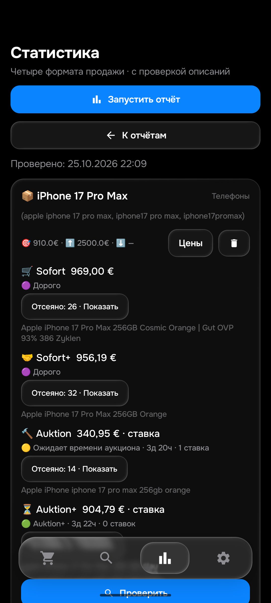

# Этап177 — метаданные карточки, APK0.174

25 октября2026. APK0.174/code174/rules1792965159/History53/Room9. SHA256 `dfc2968f550cb6b76384610fc676dbb60dfa55f2071a8a8b4dfdf88888ff283c`. [Релиз0.174](https://github.com/GitGayHub/e-monitor-android/releases/tag/v0.174) опубликован; подписанная сборка установлена только на emulator-5580, авторизованное скачивание сGitHub проверено поSHA256. Физический телефон не использовался, окнаПК не активировались. Сервер подтвердил применение в2026-10-25T22:02:06+00:00;рабочие исходники и защищённые настройки проверены.

## Исправление

В настоящемAndroidWebView на установленной0.173 воспроизведены три потери между DOM страницы и DetailsRules: собственный статус завершения/отсутствия, собственное фото и число ставок. Парсер уже распознавал эти поля, но JavaScript сокращения страницы не сохранял нужные элементы/контекст родителей. Три независимые нативные проверки упали до изменения, все три прошли на0.174.

Добавлены ровно существующие собственные селекторы статуса и фото; для изображения и количества ставок сохранён ожидаемый парсером контекст родителя. Привязка пересчитанной цены к собственному ценовому блоку, отделение описания продавца от отзывов, фильтры и правила уведомления не переписывались. Проверены четыре маркера статуса, активное количество, посторонний текст завершения, три источника своего изображения, отсутствие своего фото и чужие ставки. Запросы сети в этих проверках заблокированы. Это воспроизведение ошибки контракта обработки HTML, не доказательство ложной отправки конкретного живого лота.

Проверка старого[198669347531](https://www.ebay.de/itm/198669347531) на0.173 получила полное собственное описание354символа: модельZ70S соответствует, цена465,62+35,49€; исходные поля сохранены вraw; окончательная доступность не доказана. Начальная нейтральная обёртка не является свежей SERP, её buyNow нельзя выдавать за подтверждение действующей продажи. В отдельном опциональном наблюдателе оригинальной страницы получено `received:false`,0наблюдений; `OK` инструментального теста означал только сохранённый диагностический результат, не успешную загрузку. Не объявлять лот завершённым без собственного явного статуса.

## Живые поиски и независимые описания

СвежийZ70S0.173:73,357с;Sofort95отказов,Sofort+9отказов,Auktion/Auktion+403. Все отклонённые описания не прочитаны, поэтому отсутствие подходящих во всём рынке не подтверждено. Просмотр дешёвых35вариантных карточек показал аксессуары, а не доказанную потерю целых телефонов. Дорогие соседниеZ70/Z80 действительно другие модели. Рефилл покупки и минимальная цена в коде уже предусмотрены; предположение об их отсутствии не подтвердилось, код не изменялся по этой гипотезе.

Повторно прочитаны4исторические записи собственных описанийZ70S от5октября:198669347531,318148102248,127853945841,316863344414. Два продавцовских текста совпадают, у первых трёх записей есть отметка повторного использования. Это4старыхID/3разных текста, не4новыхChromeчтения и не принятая выборка40–50. Они описывают целые телефоны; текущая доступность/исходные цены/полная первоначальная выдача этим не подтверждены.

СканыPixel9ProXL иiPhone17ProMax завершены;итоги и границы сверки приведены ниже. Chrome по свежему инвентарю по-прежнему не подключён: видны толькоIAB/MCP. Новых независимыхChromeчтений177 нет. Отзывы прежних ошибочных выводов оmojibake162 и доставке6,19€ сохранены.

## Расход и скорость

ОфициальныйAnalytics вruntime21:49:03UTC:ключ1 использовал1880/5000,остаток3120,замер21:30:21UTC;ключ2 использовал2340/5000,остаток2660,замер21:43:02UTC. Оба без паузы/ошибки. Сумма5780 — последние отдельные замеры, не мгновенный общий остаток. Reset26октября07:00UTC. Нельзя объяснять все текущие задержки исчерпанием квоты или считать процент остатка процентом потери лотов. Два рабочих ключа иWorker сохранены.

В завершённомrun40214386874 разобраны62последовательныхdispatch:суммарно1438,163с,медиана20,372с до следующегоdispatch/конца прохода. Самый долгийiPhone17:66,086с,из них22,477до проверки описаний,10,968основная проверка,32,641последующие запросы/накладные расходы. Это не время публикация→Telegram. Дополнительные запросы окончания действительно находят новыеID; удалять их ради скорости без равнозначной замены нельзя. Изменений очереди/приоритетов не делал,Pixelpriority18 и заданный порядок сохранены.

Прежнийruntime17:57UTC имел31/48попыток за15мин,самая давняя43мин23с. Расчётные6,6минiPhone17/38,2минPixel9XL — оценки плана, не подтверждённая задержка. Цель≤15мин и полный успешный охват остаются открытыми. Работающийmonitor не отменялся; отменённыеpendingrun в истории не равны отмене действующего процесса.

## Проверки и сохранность

- 599 проверок Python: PASS за 94,679 с. Предикаты Python не менялись.
- 483 проверки JVM в 113 наборах: 0 ошибок и 0 пропусков. 104 прежних описания без расхождений; исходные 3 970 примеров сохранены.
- Обе сборки: PASS за 54 с. На Android: метаданные 3 FAIL до → 3 PASS после; 25 прежних контролей PASS с точным восстановлением двух QA-файлов.
- Режим normal, ревизия f92, 50 поисков (48 активных), получатель, цены, порядок, seen, баны и ключи не изменялись при публикации. Окончательная БД проверена после обоих сканов, подробности ниже.
- QA-настройки qa-local/notify=false/worker=false без API-ключей не публиковались. Подготовленные входы не доказывают право реального уведомления.
- Текстовое чтение правильного AyuGram без активации окна пока показывает сообщения до 0.172; новых 0.173/0.174 в видимой области нет. Это не доказательство их отсутствия в чате. Новых тестовых сообщений на этапе 177 не отправляли; визуальные фото/ссылки и новая доставка ещё не приняты.

Общая цель26товаров/104корзины/40–50own/проданные/≤15мин/визуальнаяTelegram-приёмка/deletionconsumer+историческийGit остаётся активной и не завершена. Дальше независимая ставка гибридаiPhone и оставшиеся товары;разбирать очередь по конкретным затратам без ухудшения проверки описаний.

## Завершённые проверки0.174

| Товар / лимит | Sofort | Sofort+ | Auktion | Auktion+ |
|---|---|---|---|---|
|Pixel9ProXL /310€|[439,99€](https://www.ebay.de/itm/137856724627),дорого|[431,19€](https://www.ebay.de/itm/227562767914),дорого|[306,19€](https://www.ebay.de/itm/237137966995),ставка,ждёт6д21ч|[456,19€](https://www.ebay.de/itm/128152486631),ставка,дорого|
|iPhone17ProMax /910€|[969€](https://www.ebay.de/itm/198736751866),дорого|[956,19€](https://www.ebay.de/itm/900037304968),дорого|[340,95€](https://www.ebay.de/itm/128150684813),ставка,ждёт3д20ч|[904,79€](https://www.ebay.de/itm/820266951018),ставка,проходит ценовременное правилоAuktion+|

Оба скана успешно получили все четыре корзины:197,333с и387,547с. Это новые успешные ответы, не исправление старых403. Дваguard завершены, исходные отчёты и summary сохранены; не повторять вслепую. Это не полное доказательство отсутствия пропущенных более дешёвых лотов.

Все8собственных описаний Android прочитаны и повторены вPython по модели/состоянию. УPixel227562767914 названиеObsidian,собственный текстHazel: цвет не является условием сохранённого поиска. У237137966995 упоминание10ProXL объясняет замену телефона владельцем,а продаётся9ProXL;чехлы идут вместе с телефоном. У128152486631 есть и доставка6,19€,и необязательный самовывозKiel,поэтому это не pickup-only. УiPhone128150684813 продавец отдельно предупреждает о передаче примерно через2недели; это не признак продажи запчастей.

Два более дешёвых Pixel,которые могли влиять на минимум,также проверены по собственным описаниям: [800735218801/419,99€](https://www.ebay.de/itm/800735218801) прямо сообщает трещину задней части; [800735250775/429,99€](https://www.ebay.de/itm/800735250775) — треснувшее стекло камеры. Оба действительно повреждены,отказыAndroid/Python совпали. Итого10прочитанныхAndroidown на10ID в этой серии,не10независимыхChromeописаний; прежние архивные счётчики не увеличивались автоматически.

Для5из8минимумов итоговые расходы непосредственно восстановлены изown вPython и совпали:2аукционаPixel и3iPhone. Для двух покупокPixel own-кэш не содержит отдельной доставки,поэтому суммы не «проверялись» вычитанием из готового итога. Для гибридаiPhone128150684813 own подтверждает FIXED_PRICE+AUCTION и покупку1050€+6,19€,но не currentBidPrice. Его334,76€+6,19€ из отчёта не выдаются за независимо подтверждённую ставку. В модельном повторе использована нейтральная ставка500€ с сохранением признакаhybrid: это проверяет модель/ожидание времени,не правильность реальной ставки. Следом нужна исходная живая карточка/DOM со ставкой; тонкийdirect,теряющийwasHybrid,не годится для сравнения.

ДляAuktion+820266951018 собственные899+5,79=904,79€ проходят ценовременное правило при текущем стандартном окне. Это ставка,не гарантированная цена покупки/предложения. Новое пользовательское окно аукционаnull,поведение по умолчанию сохранено. Productionseen/баны/реальная отправка этим локальнымQA не доказаны; notifyfalse.

Снимки обычного интерфейса проверены визуально. После сканов Room9→9,все50строк/все столбцы,seen/feed/seller_prices/баны/item_hashes/зашифрованные ключи сохранены. Старые снимки истории сохранены,новыхQAцен0;изapp_config изменился толькоlogic_version_ts. Два прежнихQAфайла восстановлены точно,MainActivity открыта обычным способом после всехinstrumentation.

## Применение, доставка и свежесть

Рабочийruntime подтвердил0.174 в2026-10-25T22:02:06+00:00. Проверено совпадение fingerprint фактически работающей конфигурации с её сохранённым содержимым и ревизиями config/manifest/runtime. Все50ID/лимиты/верхние цены/переключатели enabled+notify/приоритеты совпали междуGitHub-манифестом и конфигурацией;48активных,mode normal,Pixelpriority18. Исходныеprice/order/seen/баны/ключи публикацией не менялись. Полное совпадение рабочих исходников проверено наcheckpoint,а не по одному номеру версии.

Свежесть2026-10-25T22:02:06+00:00:36из48имели попытку за15мин,самая старая1672с(27мин52с);все48хотябы раз. Это не успешный охват. Последний проход20попыток/9полныхуспехов/25описаний/0новыхподтверждений. План3,02попытки/мин,iPhone≈6,6мин,Pixel≈26,8мин;это оценки,не гарантия доставки и не эффект изменения очереди(она не менялась). Подготовка новогоrunner22с,действующийrun40237666101 не отменялся.

Поfeed обнаружены11реальных подтверждений0.173,120223–120233(3HTML/8API). После окончательной проверки до подтвержденияTelegram0,635–1,481с,медиана1,234с. Это не публикация→Telegram;у части исходное обнаружение было раньше ожидания этапа аукциона. Новых тестовых отправок177 нет.0.174в выбранном снимкеfeed пока0. Текстовое чтениеAyuGram наПК видит старую область до172,поэтому не подтверждает визуальное отображение этих11сообщений,фото или ссылки. Не объявлять их отсутствующими только из-за текущего viewport.

Все текущиеguard177/after-fix иnative завершены. Общая26/104/независимые40–50own/проданные/≤15мин/новыйTelegramGUI/deletionGit приёмка остаётся открытой. Следующий шаг:исходная ставка гибридаiPhone,оставшиеся товары иqueueзатраты с сохранением порядка/качества;Chromeподключение не восстановлено.
