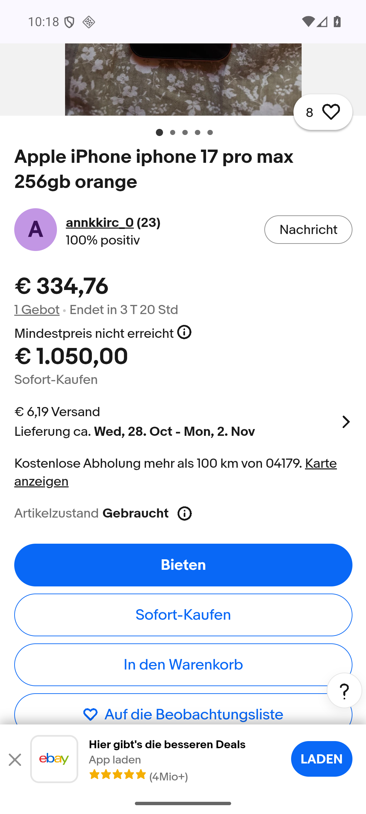

# Этап 178 — независимая сверка iPhone и Pixel в Chrome

25 октября 2026, наблюдения примерно 22:16–22:44 UTC. Рабочая версия остаётся APK **0.174 / code 174 / rules 1792965159 / History 53 / Room 9**. Нового выпуска приложения и изменения правил на этом этапе нет. Основной APK сохранил SHA256 `dfc2968f550cb6b76384610fc676dbb60dfa55f2071a8a8b4dfdf88888ff283c`.

Использован **настоящий Chrome внутри emulator-5580**, отдельно от WebView приложения. Chrome на ПК по инвентарю не подключён; это не выдаётся за проверку ПК-браузером. Физический телефон не использовался, окна ПК не активировались.

## Что подтверждено на сайте

Открыты страницы всех восьми минимумов из [этапа 177](REVIEW_177.md), по четыре на iPhone 17 Pro Max и Pixel 9 Pro XL. Прочитаны собственные описания продавцов. Это восемь разных ID в текущей серии, а не автоматическое увеличение прежних архивных счётчиков на восемь новых лотов.

| Товар | Корзина / лот | Цена товара на сайте | Доставка | Сумма в APK | Результат |
|---|---|---:|---:|---:|---|
|Pixel 9 Pro XL|[Sofort /137856724627](https://www.ebay.de/itm/137856724627)|439,99€|0€|439,99€|Совпало, исправный телефон с косметическими царапинами|
|Pixel 9 Pro XL|[Sofort+ /227562767914](https://www.ebay.de/itm/227562767914)|425€|6,19€|431,19€|Совпало, телефон с чехлами; цвет Hazel в описании, Obsidian в названии|
|Pixel 9 Pro XL|[Auktion /237137966995](https://www.ebay.de/itm/237137966995)|300€ — ставка|6,19€|306,19€|Совпало, 36 ставок, ещё около 6д20ч|
|Pixel 9 Pro XL|[Auktion+ /128152486631](https://www.ebay.de/itm/128152486631)|450€ — ставка|6,19€|456,19€|Совпало, 0 ставок; доставка и необязательный самовывоз Kiel|
|iPhone 17 Pro Max|[Sofort /198736751866](https://www.ebay.de/itm/198736751866)|969€|0€|969€|Совпало, исправный телефон, небольшие царапины, аккумулятор 93%|
|iPhone 17 Pro Max|[Sofort+ /900037304968](https://www.ebay.de/itm/900037304968)|950€|6,19€|956,19€|Совпало, целый телефон, аккумулятор 93%|
|iPhone 17 Pro Max|[Auktion /128150684813](https://www.ebay.de/itm/128150684813)|334,76€ — ставка|6,19€|340,95€|Совпало; отдельная покупка 1050€, резерв продавца ещё не достигнут|
|iPhone 17 Pro Max|[Auktion+ /820266951018](https://www.ebay.de/itm/820266951018)|899€ — ставка|5,79€|904,79€|Совпало, 0 ставок; телефон с коробкой, кабелем и чехлами|

В браузере доставка рассчитывалась для **04179**, а в наших настройках сохранён **09648**. Страна Германия совпадает, но точный адресный расчёт не принят. Таблица подтверждает показанные на сайте цены и суммы, а не равенство доставки для любого индекса. Индекс приложения не менялся.

## Полные описания и ограничения чтения

У 820266951018 и магазинного 198736751866 сайт сначала показал сокращённый текст. Открыта кнопка полного описания. У первого прочитан полный текст с комплектом и возможностью доставки. У второго после потери дерева доступности полное окно прочитано **визуально по последовательным снимкам**, включая состояние, технические характеристики и нижнюю часть с условиями продавца. Там есть рекламный блок PS4 за110€: он относится к другому предложению, не к цене или модели iPhone. В проверке приложения остались собственные969€, а не110€.

У 128150684813 продавец пишет о передаче примерно через две недели. На текущей странице отдельно виден статус **«Mindestpreis nicht erreicht»**. Сумма резерва неизвестна; цена покупки1050€ не объявляется размером резерва. В APK этот статус пока не представлен отдельно; поведение фильтра не менялось. В отчёте340,95€ обозначены именно ставкой с доставкой.

Первые автоматические диагностические вырезки в браузерном помощнике не были достаточным доказательством: одна выбрала правовой текст после ещё не загруженного iframe, другая — сокращённый текст. Они не засчитаны как полные описания. Далее собственные модальные окна открыты и прочитаны. Старые raw не переписывались.

После перезапуска Chrome появились собственные экраны об рекламных функциях. Предложение тем рекламы отклонено кнопкой No thanks; следующий информационный экран закрыт Got it. Вход в аккаунт, пароли, платежи, ставки или сообщения продавцам не выполнялись. Режим desktop включался для чтения, затем возвращён мобильный режим. Ошибку дерева доступности не назвали сетевой ошибкой eBay.

## Проверка гибрида реальными ценами

Для 128150684813 закрыта прежняя неопределённость ставки из этапа177: независимый браузер показал334,76€, покупку1050€ и доставку6,19€. На установленной0.174 нативный тест с настоящими own-данными и этой браузерной котировкой подтвердил:

- после обновления описания ставка остаётся334,76€, покупка1050€;
- корзины дают340,95€ и1056,19€ соответственно;
- обычный аукцион остаётся в ожидании24-часового окна, покупка выше лимита910€;
- корзины с Best Offer для этого объявления пусты.

В Python те же входы дали раздельные корзины покупки/аукциона. В отдельной временной SQLite-базе с одним реальным входом контрольная медиана покупки1056,19€, а аукционная340,95€. Это проверка разделения цен, **не оценка рыночной медианы по одному лоту**. Production-история не изменялась. При первом запуске QA-скрипт ошибочно ожидал один результат в normal-выдаче вне24ч; исправлен сам проверочный скрипт: normal правильно исключает такой аукцион, статистика показывает ожидание. Предикаты продукта не менялись.

Новый опциональный нативный `BrowserHybridQuoteAuditTest` прошёл на ART. Краткий `ChromeAccessibilityAuditTest` сохраняет только наблюдение: за20с —22узла и ни одного собственного заголовка. Его `OK` не засчитан как успешное чтение страницы. Длительное наблюдение browser-watch не запускалось. Начальная ошибка компиляции нового QA-теста из-за пробелов исправлена; тестовая сборка прошла. Основной APK не пересобирался и не переустанавливался, версия прежняя.

## Сохранность и следующая работа

Room9→9; все50строк и все столбцы поисков, app_config, seen, feed, seller_prices, баны, item_hashes, зашифрованные ключи сохранены без изменения. История сохранена, новых QA-цен0. Два прежних файла с25контролями не изменились. Новый временный вход нативной проверки удалён; после завершения instrumentation открыт обычный MainActivity. QA остаётся qa-local/isolated, notify=false и worker=false, без API-ключей.

Новых серверных сканов или сообщений Telegram этим этапом не запускали; источник серверных подтверждений остаётся отчёт177. Попытка ограниченного закрытия task-вкладок остановилась до первого закрытия из-за отсутствия фокуса адресной строки; чужие/старые вкладки не закрывались. Браузерные снимки/raw приватны в review178. Примеры цен без полных seller-текстов сохранены в BROWSER_178_QUOTE_CASES.json.

Полная приёмка26товаров/104корзины, независимая выборка40–50описаний на каждый товар, проданные аукционы, точная доставка09648, ≤15мин публикация→Telegram, новые визуальные медиа/ссылки Telegram и deletionconsumer/историческийGit всё ещё открыты. Следом: представление статуса резерва по настоящему HTML без угадывания цены, точный индекс браузера и продолжение проданных/оставшихся товаров. Для DEX прежние следующие ID:187320103757,187286217182,157333731141; не считать одни и те же повторные описания новыми.

