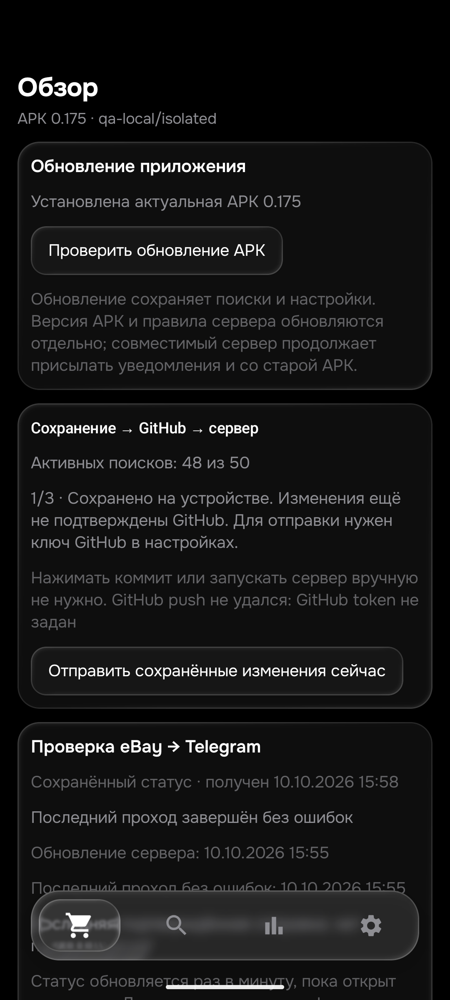

# Этап179 — проданные DEX и комплект с Powerplay, 26 октября2026

Выпущена **APK0.175/code175/rules1792982986/History53/Room9**, SHA256 `fcb1725f87e4a68fd24cbba5bfe54d6a14eeac13fe88ec825b05a2beac3c065b`. Установлена обновлением с сохранением данных **только на emulator-5580**. Физический телефон не использовался, окна ПК не активировались. [Подписанный выпуск](https://github.com/GitGayHub/e-monitor-android/releases/tag/v0.175) опубликован в прежнем закрытом репозитории. Публикация проверила размер/hash/версию и авторизованное скачивание.

## Настоящая находка и исправление

В независимом **Android Chrome**, отдельно от WebView APK, открыты ещё8уникальных ID из прежней проданной DEX-выдачи. У7прочитаны полные собственные описания (inline или раскрытое окно); у406777772858 прочитан собственный продуктовый блок с дефектом и комплектом, но нижний общий шаблон магазина не дочитан. Это не8полных новыхHTML-дампов. Графическая таблица совместимости приёмника сохранена снимками, в replay перенесён видимый текст, не вся таблица.

**147612748348** — целая мышь вместе с Powerplay Charging Mat. Существующее пользовательское стоп-слово `charging` ошибочно отсекало комплект до проверки описания. Это подтверждено Python и **на установленной0.174**: нативная проверка7входов упала именно на этом ID, ожидалосьtrue, былоfalse. На0.175 тот же вход проходит отбор назначения. Исключение ограничено моделью, явно названной мышью, связкой комплекта и словами charging mat/matt/pad после неё; другие вхождения charging, совместимость, отсутствие мыши и дефекты сохраняют отказ. Сами списки стоп-слов и пользовательские настройки не изменялись.

На текущей странице147612748348 товар **не в наличии**, отправляется изGB, продавец отсутствует до31октября. Это отдельные ограничения: положительная модельная сверка с подготовленными500€/DE/availability не разрешает реальную отправку. Прямая живая загрузка его own через APK175 завершилась **UNAVAILABLE/relevance=null** за22,9с. Это не ноль и не доказательство успешной проверки доступности в данном запросе. Нельзя обещать универсальный доступHTML.

## Восемь независимых наблюдений

|Лот|Ручной вывод|Отбор назначения Python/ART175|
|---|---|---|
|[187320103757](https://www.ebay.de/itm/187320103757)|Separate USB receiver, not a whole mouse.|Отказ|
|[406777772858](https://www.ebay.de/itm/406777772858)|Whole mouse with defective scroll wheel; receiver and cable missing.|Отказ|
|[358824982052](https://www.ebay.de/itm/358824982052)|Whole functioning mouse, cosmetic wear of feet, complete accessories.|Подходит по назначению|
|[327241466633](https://www.ebay.de/itm/327241466633)|Whole mouse with already fitted replacement glides; not standalone feet.|Подходит по назначению|
|[407279190414](https://www.ebay.de/itm/407279190414)|Whole mouse with grip tape, not standalone tape or feet.|Подходит по назначению|
|[187286217182](https://www.ebay.de/itm/187286217182)|Magnetic charging adapter, not whole mouse, despite Gaming-Maus item aspect.|Отказ|
|[147612748348](https://www.ebay.de/itm/147612748348)|Whole mouse and charging mat. Current out-of-stock status and GB region separately prevent real notification.|Подходит по назначению|
|[157333731141](https://www.ebay.de/itm/157333731141)|Separate replacement mouse feet, not whole mouse; catalogue product type Gaming-Maus is misleading.|Отказ|

Corepad157333731141 имеет каталоговый тип Gaming-Maus, но собственный текст прямо продаёт запасные ножки: отказ сохранён. У358824982052 лёгкий износ ножек не мешает работе целой мыши; у327241466633 уже установлены SensoryBoost Glides; у407279190414 Grip Tape входит в комплект. Они не превращены в отдельные детали.

Sold-выдача: прежние3описания +8новых ID =11разобранных продуктовых примеров из41уникального ID. Полных own теперь10, один магазинный шаблон прочитан частично; ещё30ID не разобраны. Это не завершение40–50проданных на каждый товар. Предыдущие49активныхDEX/65парныхown не пересчитаны как новые. Проданные аукционы всё ещё не приняты. Перечёркнутую цену и показанную ценуBestOffer не называем фактической ценой сделки. Дата продажи изстарой выдачи и дата завершения текущего оригинала — разные поля.

## Проверки

- Новые23общих контроля для DEX, стандартнойSuperlight2 иSuperstrike: комплекты, дефект, not charging, отсутствие мыши, зарядный адаптер/кабель. До правки9ложных отказов Python; новыйJVMтест падал на исходном комплекте. После все проходят.
- **600Python PASS,92,965с**; **484JVM/114наборов/0ошибок/0skip**, включая104прежних own. Обе сборки175успешны,50с.3970оригинальных примеров не редактировались.
- ART175:8новых входовPASS,25старыхPASS; подготовленные цена/регион/наличие явно не доказывают уведомления. Отдельный предыдущий7-входовый прогон тожеPASS; он не добавляет7новых лотов.
- Room9→9, все50строк и все столбцы поисков/seen/feed/история/баны/ключи сохранены. В app_config изменён толькоlogic_version_ts. Старые2QAфайла25контролей восстановлены точно, новыхQAцен0. QA остаётсяqa-local/isolated,notify=false/worker=false/безAPI; его настройки не публиковались.

## Рабочий сервер

Runtime от **2026-10-26T02:58:45+00:00** подтвердил новую версию и точные рабочие исходники. Fingerprint реальной конфигурации совпал; ревизияf92/50поисков/48активных/лимиты/верхние цены/notify/enabled/приоритеты совпали сGitHub-манифестом. Pixelpriority18 иmode normal сохранены. Публикация исходников не затронула config/seen/feed/pending/history. Код: botmain`cc0d4dc7e3c4c41fedd5dce44bf349abfeeb4467`,botroad`f22438b18480dfd3f853798bdf071104f6c5c237`,Androidroad`2fc237fb05fce73d9468a47068713beba3fe54aa`.

Статус **partial**, не полный успех:17попыток/3полных успешных проверки,1255полученных кандидатов/21проверенное описание/0подтверждений уведомления в последнем проходе. Это не17−3сетевых ошибок. Runtime содержит7проблем выдачи(site_error/blocked) и16отдельных записей очереди/незавершённой проверки, включаяsearch_deferred. Они могут относиться к одним поискам; складывать их как число потерянных лотов нельзя. Rooterror=null.

Квота не исчерпана: последние официальные замеры1890/5000остатка в02:39:59UTC и2420/5000в02:52:45UTC, оба ключа безпаузы. Сумма4310 — несинхронный снимок, не мгновенный остаток. Перезапускквоты26октября07:00UTC. Это не процент пропущенных объявлений.

36из48поисков имели попытку за15мин, самая давняя1558с(25мин58с). Расчётный интервалiPhone6,6мин/Pixel31,5мин **не** измеренная публикация→Telegram. Ни≤15мин, ни свежие медиаTelegramнаПК этим этапом не доказаны. Новых тестовых сообщений не отправляли. HTMLостаётсяосновным/APIрезервом.

## Открыто и следующий шаг

Общая26товаров/104корзины/40–50независимыхownнакаждыйтовар/проданныеаукционы/доставка09648/≤15мин/TGGUI/deletionconsumerиGit НЕзавершены. Не закрывать цель. Далее: остальные30soldDEX, дочитать общий шаблон406777772858, затем оставшиеся товары; отдельно очередь и ошибки доступа. Статус резервной цены128150684813 и точный индекс браузера09648 открыты. Сохранить отзывы прежних ошибочных гипотезmojibake162и6,19€.

Raw XML/PNG/полныеsellerтексты/БД приватны `audit/2026-10-26/review179`. Примеры без собственных текстов — [BROWSER_179_CASES.json](BROWSER_179_CASES.json). AndroidChrome потерялAXна части страниц: текст прочитан визуально, первоначальная загрузочная заглушка не засчитана. В QA-помощнике отдельно ограничены границы own, чтобы короткий preview не подхватил текстфутера; продукт этим не меняли. В Chrome накопились19task-вкладок, чужие/старые не закрывались.

На снимкеqa-local и предупреждение об отсутствииGitHubтокена относятся к намеренно изолированному эмулятору, не к рабочему серверу.
