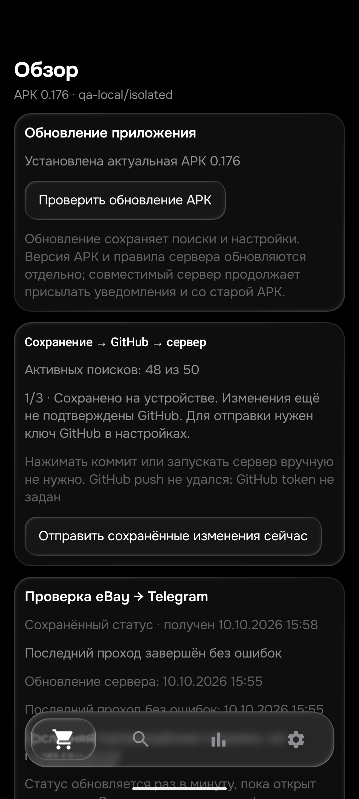

# Этап180 — очередь вариантов и проданные DEX, 26 октября2026

Выпущена **APK0.176/code176/rules1792986775/History53/Room9**, SHA256 `ba34a12616c701ba1c2838a014e80094b6b4ed7528673c99ca1b46e2547224dd`. Обновление установлено с сохранением данных **только на emulator-5580**. [Подписанный выпуск](https://github.com/GitGayHub/e-monitor-android/releases/tag/v0.176) опубликован в прежнем закрытом репозитории; размер, подпись, пакет, версия, hash и авторизованное скачивание проверены. Физический телефон не использовался, окна ПК не активировались. Изменение176 относится к серверной очереди; Kotlin-фильтры остались как в175, APK получила общую версию правил.

## Исправленная потеря полноценной попытки

В реальном завершённом GitHub run40259438606 обнаружен механизм пропуска хвостовых вариантов. Pixel03:02:53.822 начал вариант4/6; после HTML и API вариант5/6 завершился03:03:12.759, а вариант6/6 начался03:03:12.783 при остатке общей20-секундной части около1с. Он возвращал `pass_deferred`, но сохранённый курсор уже переходил дальше. В повторяющемся порядке одни и те же варианты не получали полной попытки. Это подтверждённая ошибка очереди, а не доказательство потери конкретного подходящего объявления.

Теперь только при `pass_deferred` после действительно укороченной HTML-попытки курсор сохраняет этот вариант следующим. Полноценный таймаут и остановка процесса по-прежнему переводят очередь дальше: один заблокированный вариант не должен навсегда остановить остальные. Схема состояния, цены, приоритеты, фильтры и стратегияHTML-first/API-reserve не менялись. Текущий приоритетPixel18 сохранён.

Два новых детерминированных теста воспроизвели пропуск на старом коде:14тестов/2FAIL. После исправления14PASS0,853с. Проверены3варианта и6задач вариант×формат с повторными проходами. Отдельно проверен режимauto с12сHTML внутри20сродительского окна: выдачи12/12/4с и последующие проходы завершают все варианты. Длительности моделировались, реальныхAPI-запросов иTelegram-отправок0. Первый черновой before-прогон дополнительно ломал Windowsasyncio собственным сетевым запретомQA; это исправлено в обёртке, не считается дефектом продукта или чистым воспроизведением. Валидный before сохранён отдельно.

В том же реальномPixel-проходе гипотеза об отсутствии времени наAPI не подтвердилась: резерв вернул6и114кандидатов примерно за0,53/0,79с. Существующее распределение12сHTML+8сAPI сохранено. Ending-sweep иногда добавляет реальныеID в других сохранённых проходах, поэтому целиком не удалён.

## Независимые проданные объявления

В **Android Chrome**, отдельно отWebViewAPK, открыты ещё8уникальныхID прежней soldDEX-выдачи: у6прочитаны полныеown, у1только продуктовый блок, ещё1перенаправлен в каталог. Первые6входов сравниваются по полному прочитанному тексту; седьмой — только по явно обозначенному фрагменту.

|Лот|Ручной вывод|Python/ART176|
|---|---|---|
|[186701249323](https://www.ebay.de/itm/186701249323)|Only replacement feet; photograph shows the mouse for illustration and catalogue aspect misleadingly says Gaming-Maus.|Отказ|
|[128103007306](https://www.ebay.de/itm/128103007306)|Whole working DEX mouse; no defect or standalone part declared.|Подходит по назначению|
|[800415105149](https://www.ebay.de/itm/800415105149)|Whole DEX mouse, customer return technically checked, like new, opened packaging. Current out-of-stock remains a separate live restriction.|Подходит по назначению|
|[267810724913](https://www.ebay.de/itm/267810724913)|Whole working DEX with fitted Obsidian feet; switches and sensor are specifications, not separately sold parts.|Подходит по назначению|
|[407097409757](https://www.ebay.de/itm/407097409757)|Sealed new manufacturer replacement; defect concerns seller's former mouse, not the device offered.|Подходит по назначению|
|[206633697214](https://www.ebay.de/itm/206633697214)|Whole DEX mouse, no defect or standalone part declared in the complete seller paragraph. UK shipment and current unavailable status remain separate restrictions.|Подходит по назначению|
|[389189283637](https://www.ebay.de/itm/389189283637)|Visible own product block offers a technically checked whole DEX return with opened packaging. Bottom merchant template not read; verdict is provisional and restricted to captured excerpt.|Подходит по назначению (только прочитанный фрагмент)|

У186701249323 фотография целой мыши и каталоговыйGaming-Maus не меняют назначения: продаются только ножки. У267810724913 целая мышь с установленнымиObsidianSkates и характеристикамиLIGHTFORCE не становится запчастью. У407097409757 дефект относится к прежней мыши владельца; продаётся новая запечатанная замена. У206633697214 общее полеModelGProXSuperlight не отменяет явныйDEX в заголовке иown. ТекущиеUK/нетвналичии/доставка проверяются отдельно от назначения.

**398224446236** перенаправлен на каталог `/p/2349236787` с другим текущим предложением. Исходное sold-описание не найдено, вердикт исходного лота не подтверждён. Защитные предупреждения не обходились. У389189283637 прочитаны название,MPN910-007358/EAN5099206128088 и условие технически проверенного возврата; нижние спецификации и общий магазинный шаблон не дочитаны. Это не полная приёмкаown.

Всего по прежней выдаче41ID: старые3+8этапа179+7продуктовых примеровэтогоэтапа=**18разобранных примеров:16полныхown и2частичных**. Ещё23ID не приняты, включая1редирект;22ещё не открыты в этой sold-серии. Это не18новых активныхDEX и не18полных новыхописаний. Старые49активных/65парныхown не пересчитаны как новые. Проданные аукционы пока не приняты. Перечёркнутые/показанныеBestOffer цены не называем фактической ценой сделки. В браузере остаётся04179, а09648 как точный адрес доставки ещё не сверён.

## Проверки и сохранение данных

- **602PythonPASS91,397с**; **484JVM/114наборов/0ошибок/0skip**, включая104прежнихown. Обе сборки176успешны45с.3970оригинальных примеров не изменялись.
- ART176: финальные7входовPASS, из них6полных и1фрагмент;25старыхконтролейPASS. Предыдущий5-входовыйPASS не добавляет5новыхлотов. Подготовленные500€/DE/наличие не доказывают правоTelegram-отправки, реальные суммы/рынок ими не подменялись.
- Первый запуск instrumentation176 не присоединился, следующий завершилсяstartupANR. В диагностике медленнаяARTверификация/стартWorkManager подCloudUiRunner; обычныйcoldstart затем успешен за19,177с. После остановкиAndroidChrome для освобождения процессов валидные повторные5и25PASS; финальный7PASS. Не объявляем startupпроизводительность проверенной и не скрываем неудачные старты. Нового Kotlinизменения на этом этапе нет, данные не сбрасывались.
- После финальных7: Room9→9, все50строк и все столбцы поисков/seen/feed/история/баны/ключи сохранены. Изapp_config изменён толькоlogic_version_ts. Старые2QAфайла25контролей точно восстановлены, новыхQAцен0. QA остаётсяqa-local/isolated,notify=false/worker=false/безAPI. НастройкиQA не публиковались. Снимок ниже показывает именно изолированнуюAPK; старый сохранённыйruntime в ней не выдаётся за текущий production.

## Рабочий сервер и задержки

Runtime **2026-10-26T04:10:00+00:00** подтвердил176 и фактически работающие исходники. Fingerprint конфигурации совпал; ревизияf92/50поисков/48активных/лимиты/верхние цены/notify/enabled/приоритеты точно совпали с рабочим манифестом. Mode normal, получатель иPixelpriority18 сохранены. Источники: botmain`a605e11e1d978543127fdd6526bbc4f3355a8663`,botroad`d0384c6fb5ffda8d9d30a2a7f2c299d405e883e7`,Androidroad`4758710dce669325a768f489e819e83509290662`; release-manifestmain`d741be7dcc803c27e837886caafa3f3ec605c61d`. Публикация исходников не затронула config/seen/feed/pending/history.

Состояние **partial**: последний проход04:03:53→04:10:00UTC,14попыток/3полныхуспеха/711кандидатов/17описаний/0подтверждений уведомления.4отдельные проблемы выдачи:Redmagic11Proauc/NubiaZ70aucsite_error,PS5Proaucdetails_unavailable,DEXaucblocked;16записей очереди/деферов могут относиться к тем же поискам. Это не14−3сетевыхошибок и не число потерянных лотов. Rooterror=null.

Последние официальные остатки **1710/5000** (03:57:35UTC) и **2290/5000** (03:50:52UTC), оба ключа безпаузы; reset26октября07:00UTC. Это несинхронные замеры, не мгновенный общий остаток и не процент потерянных объявлений.HTMLостаётся основным/APIрезервом.

Реальный run40259438606:67dispatch,1438,221ссуммарно,медиана20,151снаdispatch. Это обработка, не задержка от публикации. Pixel51,297с:20,757свыдача/10,173сосновныеown/20,367споследующийэтап. Приruntime04:10:00лишь29/48поисков имели попытку за15мин; самаядавняя2736с(45мин36с). Расчётные интервалыPixel38,3мин/iPhone6,6мин — не publication→Telegram. **Общая скорость≤15мин не доказана и не достигнута по покрытию**. Нужна дальнейшая работа с очередью, доступом и повторными ожиданиями без ослабления описаний.

НативныйAyuGram прочитан без активации, но доступныйAXдо0.172 не подтверждает новые0.173–176сообщения/изображения/ссылки. Новых тестовых сообщений не отправляли; последнееbackendподтверждение00:12:04UTC. Естественная доставка и её свежий показ наПК этим этапом не доказаны.

## Открыто

26товаров/104корзины/40–50независимыхownнакаждыйтовар/soldаукционы/09648/≤15мин/свежийTelegramGUI/deletionconsumerиGit НЕзавершены. Дочитать частичные406777772858и389189283637, разобраться с398224446236, затем оставшиеся22неоткрытыхsoldDEX и другие товары. Следующие237126774150,128034587830,189054729807. Не повторять завершённыеguardsвслепую. БраузерChromeнаПК поинвентарю не подключён, нативные окна не открывались; AndroidChromeданные/старые вкладки сохранены,2своихраннихвкладки корректно закрыты. Настоящийreserve128150684813/цена покупки1050≠reserve ещё открыт. Два ключа/Worker сохранены, реальныеdeletionсобытия неACK. Отзывыmojibake162и6,19сохранить.
