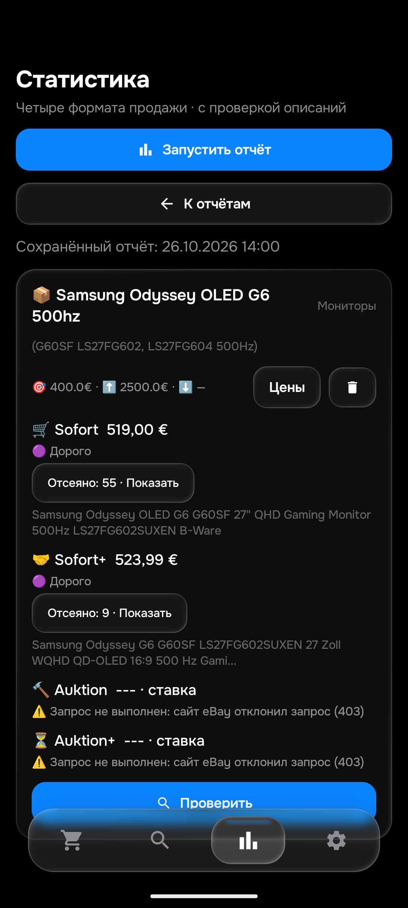

# Этап184 — Samsung OLED500Гц и APK0.178,26октября2026

APK **0.178/code178/rules1793022848/History53/Room9**. SHA256 `0535429db18215adf9e1e4917ab5e540037094b0e20aededf7687374b34caeeb`. [Релиз](https://github.com/GitGayHub/e-monitor-android/releases/tag/v0.178). Обновлена только emulator-5580; физический телефон не использован, окна ПК не активировались. Общая приёмка26товаров/104корзин/40–50полныхownнакаждый/≤15мин **не закончена**.

## Реальный исправленный пропуск

[267437531888](https://www.ebay.de/itm/267437531888) — целый Samsung Odyssey S27FG602SU, собственное описание подтверждает OLED/500Hz. Заголовок использует короткий SKU без начальнойL. Оба фильтра раньше знали только LS27FG602SU и отвергали заголовок до проверки описания. Python и Kotlin теперь признают оба написания. Противоречащие E-модели/IPS/350Hz, другая модель, отдельная подставка, дефект и отсутствие собственного описания остаются отказами. Новых поисковых alias и изменений лимита400€ не делали; History53 и Room9 сохранены.

Реальный старый отказ воспроизведён Python/JVM и на ART0.177; ART0.178 принимает модель на том же входе. Модельный replay использует нейтральные500€/DE/наличие и не доказывает право реального уведомления.

## Независимый настоящий Chrome

Chrome3/профильБейби, без нативной активации. Страна Deutschland и «Versand nach09648» подтверждены. Основной запрос `samsung odyssey oled g6 500hz`:10точных активных карточек до рекомендаций. `G60SF LS27FG602` добавил одинID, всего11активных. `LS27FG604 500Hz`: честный ноль. Три соответствующие страницы аукционов показали0точных результатов; рекомендации ниже не посчитаны. Начальная категория80053, последующие alias интерфейс переводил на все категории — одинаковую категорию на всех страницах не утверждаем.

Полные собственные тексты прочитаны у14разных текущихID:11активных и3из раздела проданных. Это не40–50 и не14новыхглобальныхID:9пересекаются с историческим набором18, а127332124787 раньше читался вне того набора. У227319448387 собственный текст совпадает с326729817624: дваID, но не два независимых правила.

|Лот|Независимый вывод|
|---|---|
|[326729817624](https://www.ebay.de/itm/326729817624)|ЦелыйOLED500Гц; профилактика burn-in не повреждение.|
|[267437531888](https://www.ebay.de/itm/267437531888)|ЦелыйOLED500Гц; Pixelfehlerklasse2 — характеристика, не обнаруженные битые пиксели; исправлен короткийSKU.|
|[307167578900](https://www.ebay.de/itm/307167578900)|519€ с бесплатной доставкой; B-Ware/витринный, описание like-new; собственное описание раскрыто отдельно от отзывов. Коммерческие вкладки оплаты/контактов отдельно не прочитаны.|
|[398162444700](https://www.ebay.de/itm/398162444700)|500+23,99=523,99€; BestOffer; whole500Hz, исправен, без царапин и ошибок пикселей.|
|[307068841472](https://www.ebay.de/itm/307068841472)|ЦелыйOLED500Гц, короткийSKU и полные характеристики.|
|[336635401817](https://www.ebay.de/itm/336635401817)|ЦелыйOLED500Гц; юридический текст об утилизации не дефект.|
|[307052593665](https://www.ebay.de/itm/307052593665)|ЦелыйOLED500Гц; политика старых повреждённых батарей не описание повреждения товара.|
|[206403655849](https://www.ebay.de/itm/206403655849)|ЦелыйOLED500Гц; собственный текст прочитан отдельно.|
|[377167350824](https://www.ebay.de/itm/377167350824)|ЦелыйOLED500Гц, SKU/комплект подтверждены.|
|[206605307527](https://www.ebay.de/itm/206605307527)|ЦелыйOLED500Гц; длинный юридический хвост дочитан, реклама инструментов не смешана с товаром.|
|[227319448387](https://www.ebay.de/itm/227319448387)|807€ с бесплатной доставкой; целыйOLED500Гц, текст совпадает с326729817624.|
|[137245228620](https://www.ebay.de/itm/137245228620)|Проданные, целый500Гц;524,99€ или offer — показанная цена, фактическая принятая offer-цена неизвестна.|
|[127332124787](https://www.ebay.de/itm/127332124787)|Проданные, собственное описание Samsung подтверждает QDOLED500Гц. Галерея23изображений не просмотрена целиком; старые ограничения FAQ/юридических вкладок не сняты автоматически.|
|[407216707533](https://www.ebay.de/itm/407216707533)|Проданный рабочий монитор сOVP, Originalangebot раскрыт;350+10,49€ — отображаемая цена, окончательная offer-цена неизвестна.|

Повтор Python/ART14реальныхown не дал расхождений по модели и назначению. Исторические18Samsung+1неподходящийAsus также совпали, но это19старыхreplay, не новые чтения сайта.

## Свежий эмулятор и цена

Первый скан0.177 завершился60,054с:519/523,99/пусто/пусто. После обновления скан0.178 завершился75,873с:519/523,99/**403/403**. Независимые страницы Chrome вернули нули, но это другой доступ/время: реальные ошибки эмулятора не переименованы в нули, универсальный доступ не доказан. Настоящие покупки и доставка дополнительно воспроизведены Python из Android-данных:519€ и523,99€; обе выше лимита400€, отправка не разрешена.

При сохранении длинного DOM три первоначальных raw-файла оказались усечены инструментом. Их не использовали как полное описание. Повторно сохранён настоящий DOM с сохранением структуры/атрибутов и исключением только script/style/noscript; видимый текст проверен целиком. Это компактный DOM, не rawHTTP. Отдельная ошибка QA сопоставляла название с действием «Beobachtungsliste» и дала10ложных расхождений; исправлена обёртка сопоставления, продукт ради неё не менялся. Все raw/частные данные остаются локально.

## Проверки и сохранность

- Python614PASS,111,085с. Общий новый fixture16контролей ×4формата; только первый заголовок взят из реального наблюдения, остальные — синтетические защиты.
- JVM486тестов/115наборов/0ошибок/0пропусков, старые104own явно включены. Обе Android-сборки PASS57с.
- ART13+1реальныхown,16контролейSKU,25старых и19исторических PASS. У16SKU наART один покупной формат, все4формата проверены JVM/Python. Промежуточные13 и итог14 не суммируются в27.
- Room9→9, все50строк со всеми столбцами и всеseen/feed/цены/баны/хэши/история/зашифрованные ключи сохранены. НовыхQAцен0; старые дваQA-файла восстановлены; изменён толькоlogic_version_ts. Обычная MainActivity открыта после терминальных instrumentation. Локальные qa-local/notifyfalse/workerfalse/безAPI не опубликованы.

## Production и доставка

Runtime **2026-10-26T16:37:41+00:00** подтверждает rules1793022848 и совпадение исходников. `normal`, ревизияf92be8e8-8345-4d11-9078-4bffa9fa17df,50/48, fingerprint/цены/приоритетPixel18/получатель/3ключа сохранены. Публикация исходников не меняла защищённые config/seen/feed/history; естественная работа сервера продолжается.

Снимок16:37:41UTC:48/48попыток≤15мин, самая давняя525с, **10/48полных успехов≤15мин**,41с успехом хотя бы раз с12:02:04UTC. Завершившийся проход40попыток/5полныхуспехов/966кандидатов/23проверенныхописания/0уведомлений. Это не суточный процент пойманных и не доказанный SLA.

Чтение правильного чата AyuGram в фоне подтвердило текст настоящего уведомления0.177: [267818751501](https://www.ebay.de/itm/267818751501),777,77+6,19=783,96€, продавецprobsandre, initial, Telegrammessage120241. Совпадает с серверной подтверждённой лентой, доставка13:12:36UTC. AX сообщает фотографию600×800, но сохранённый нативный снимок показал окно ChatGPT вместо Telegram; он **не является визуальным подтверждением фотографии**. Показ медиа остаётся непроверенным. Новых тестовых сообщений0; доставку0.178 этим старым сообщением не подтверждаем.

Sourcebotmain8b025bbd22da264fbcec878e208880027801870a/cloud71ef849ce6a81ee32925a341c7e30e6050727fc1/Androidcloud62de44555cd75cf63edc34b4de3962f75a1ccd4a; релизныйmanifestmain3eedc507f3f004d38f39033db9dff5251b6f9028. Финальные docs-коммиты и checkpoint проверяются отдельными записями публикации, не подменяют исходныйSHA.

## Дальше

Asus185 уже завершил свежий68,308с скан0.178:34отказа в каждой покупной корзине, обе аукционные пусты без сетевой ошибки. Это «не найдено подходящих», не отсутствие любых ноутбуков. Проверить независимо в Chrome исходные варианты/полныеown/RTX3050/Intel/вариативный лот, затем остальные группы и soldаукционы. Не перезапускать терминальные guards вслепую.

Остаются полный дневной успешный охват, publication→Telegram≤15мин, реальныйfollowup при пустой очереди,40–50ownгде доступны, оставшиеся товары, новыйTGGUIс медиа, deletionconsumer/историческийGit. Реальныеdeletionсобытия неACK/неудалять. Отзывыmojibake162 и6,19€ сохранены. Цель активна.
