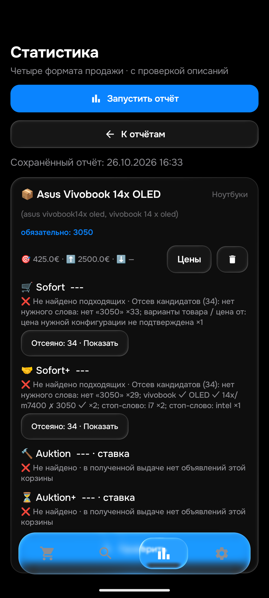

# Этап185 — Asus Vivobook14X OLED,26октября2026

Проверка выполнена на APK0.178/code178/rules1793022848/History53/Room9; нового продуктового изменения на этапе185 нет. Толькоemulator-5580, без физического телефона и активации оконПК. Общая26/104/40–50own/≤15мин приёмка открыта.

## Сохранённые условия и свежий результат

Asus: лимит425€, верхняя граница2500€, обязательно3050, исключеныintel/i5/i7/i9/core i, регион **worldwide**. Первые браузерные проверки выполнялись сDE; после чтения строки настроек сверка расширена доWeltweit. РезультатыDE не названы полной мировой выдачей. Доставка09648 подтверждена на сайте. Все категории — как в URL бота; категорияноутбуки применяется локально.

Скан эмулятора завершился68,308с без ошибки: Sofort34отказа, Sofort+34отказа, Auktion0/Auktion+0. Софорт:33без3050 и1неподтверждённый вариант конфигурации; оффер:29без3050,2не14X/M7400,2i7,1intel. Два набора34 могут пересекаться: это не68уникальныхлотов.

Показанная дата16:33 — GMT эмулятора, не время Берлина. Просмотрен уже сохранённый отчёт, новый запуск ради скрина не делали.

## Независимый настоящий Chrome

Основной запрос сWeltweit показывает367результатов; изучена первая страница, не все367own. ВDE ранее198. Два сохранённых дополнительных написания проверены отдельно. Нормализатор самого бота сводит `asus vivobook14x oled` к основному запросу; `vivobook 14 x oled` остаётся отдельным.

Раздел проданных: основнойworldwide6точных карточек; компактныйalias2; вариантсразделённым14 x —8. Объединение **8уникальныхточныхsoldID**, включая6аксессуаров и2ноутбука, все8own прочитаны. Это не8подходящихноутбуков. Рекомендации «Ergebnisse für weniger Suchbegriffe» и служебная скрытая заглушка123456 исключены; последняя однажды открыта обёрткой, сразу исправлена и не посчитана лотом. Модельный запросM7400/OLED/3050 вDE:0активных/1sold — тот же377126864169. Он не добавлен второй раз.

Два разных нормализованных аукционныхURL самого бота сworldwide/условиями/≤2500 открыты Chrome: оба0точных. Те же страницы сVerkaufteArtikel также0. Это подтверждение текущих страниц, не историческая гарантия отсутствия любых аукционов. Оффер-аукционы — подмножество этих нулей; не заявляем четыре независимых запроса там, где дваURL покрывают их.

##14прочитанных собственных описаний

|Лот|Независимое решение по текущим условиям|
|---|---|
|[377126864169](https://www.ebay.de/itm/377126864169)|Sold14X/M7400Q/OLED/Ryzen9/3050Ti, исправен, ноутбук/блокпитания/USB-C; заменённая батарея не превращена в отдельный аккумулятор. Модель/own проходят;690+10,49€ выше425. Принятая offer-цена неизвестна, завершённый лот не разрешает уведомление.|
|[920030466954](https://www.ebay.de/itm/920030466954)|Own и характеристики подтверждают15,6/M3500QC-D3500QC, не14X;650+7,69€. Правильный отказ.|
|[168812007939](https://www.ebay.de/itm/168812007939)|Целый14X/OLED/3050, ноIntelCorei7-11370H;850+7,69€. Исключён пользовательскимi7.|
|[189047331987](https://www.ebay.de/itm/189047331987)|Исправен сLinux/блоком/OVP/сумкой, ноi7-11370H;750+10,49€. Правильное исключениеi7.|
|[267301388029](https://www.ebay.de/itm/267301388029)|Целый14X/OLED/3050, ноIntelCorei7;1050+7,69€. Правильное исключениеCPU.|
|[297923526267](https://www.ebay.de/itm/297923526267)|Вариативный18X/IPS/Radeon, не14X/OLED/3050. Отказ правильный; подпись неопределённой конфигурации менее точна, чем явная другая модель, это остаётся UI-вопросом. СтарыйID перечитан, не новыйglobalown.|
|[158308836970](https://www.ebay.de/itm/158308836970)|SoldS14X/S5402Z/i7,3050неподтверждена; есть две вмятины крышки/батарея~2ч.399+7,69€ не делает неподходящую модель подходящей. Окончательнаяoffer-цена неизвестна.|
|[940005344253](https://www.ebay.de/itm/940005344253)|Целый15,6/D3500QC/Ryzen5/3050, не14X. УпоминаниеIntelSSD не доказательствоIntelCPU; здесь отказ по модели достаточен.|
|[206622188466](https://www.ebay.de/itm/206622188466)|SoldодинUSB-Cзарядник100W; итальянскоеownпрочитано, не ноутбук.|
|[840012921909](https://www.ebay.de/itm/840012921909)|SoldотдельныйаккумуляторC31N2019, списоксовместимости не продажаM7400.|
|[187799304552](https://www.ebay.de/itm/187799304552)|Soldодинvhbwаккумулятор; юридический текст утилизации отдельно, назначениечасть подтверждено.|
|[286602801562](https://www.ebay.de/itm/286602801562)|Soldадаптер65Wбезсетевогокабеля, не ноутбук.|
|[326018819675](https://www.ebay.de/itm/326018819675)|Soldсумка/чехол, совместимость14–16дюймов, не устройство.|
|[226959550960](https://www.ebay.de/itm/226959550960)|Soldсумка/чехол, не устройство.|

Итого8sold+6active=14ID, не40–50. Коднеизменён: на этих входах **Python14/0расхождений иART17814PASS**. Нейтральные500€/DE/наличие в replay проверяют отбор, не реальную цену/проданность/регион/seen/баны/TG. Реальный liveскан работает с сохранённымworldwide; модельные метаданные не подменяют его.

## Сохранность и ограничения

Room9→9, все50строк/столбцы,app_config,seen/feed,баны,цены/хэши/история и зашифрованные ключи совпадают до/после. НовыхQAцен0, два старыхQA-файла восстановлены, MainActivity открыта после завершенияART. Всеguards185терминальны; вслепую не повторять. Локальныйqa-local/notifyfalse/workerfalse/безAPI не публиковался.

Новых617Python/новойAPK на этапе185 ещё нет: базовая проверка0.178 —614Python/486JVM. Для Asusa дополнительныйofflinePython14/ART14, не новый полный прогон. Полный дневной охват и≤15миннеподтверждены; новый найденный дефект пустого хвоста прохода разбирается отдельно в186. Текущий runtime16:57:06UTC:48попытокза15мин,12полныхуспеховза15мин/41всего. Pixel имеет3358с от последней полностью успешной выдачи; короткая0,043спопытка не доказательство запроса к eBay.

APIжурнал:7717вызововза24ч/419час/117за15мин; линейная оценка11232сут — только короткий темп. Все3ключа без паузы; остатки4999/3840/2690 измерены в разные16:51/16:38/16:44UTC, не одновременный запас. Из этого нельзя вычислить процент пропущенных объявлений или гарантировать отсутствие потерь. Runtimeподтверждает0.178,normal/f92/50/48/Pixel18/цены/получатель сохранены.

RawChrome/AX/SQLiteостаются приватныaudit/2026-10-26/review185. СнимокSamsung0.178 и доказательства релиза/применения — REVIEW_184.md. НовыйTGGUIмедиа, остальные товары/soldаукционы,длительныйуспешныйохват иdeletionconsumer/Git всё ещё открыты. Реальныеdeletionсобытия неACK/неудалять; прежниеотзывыmojibake162/доставка6,19сохранены.
